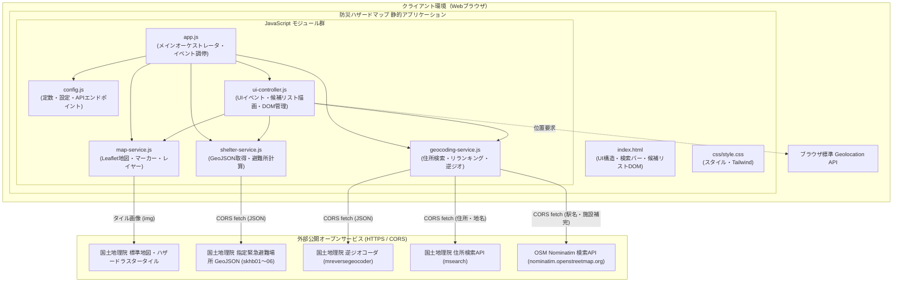
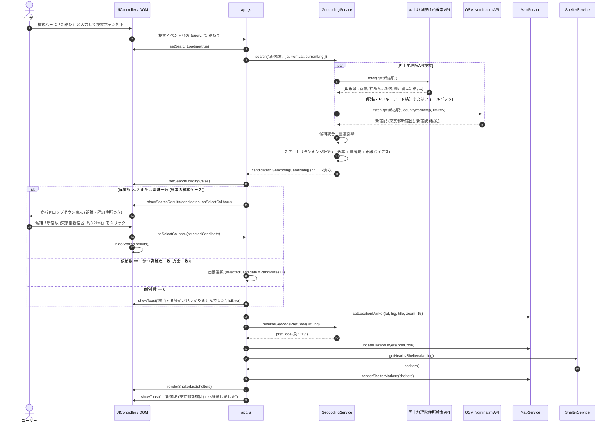

# システムアーキテクチャ設計書: 防災ハザードマップ & 避難場所表示 静的HTMLアプリケーション

本書は、ブラウザ上でスタンドアロンかつ安全に動作する「防災ハザードマップ & 避難場所ナビ 静的HTMLアプリケーション」のシステムアーキテクチャ設計書である。
初版の完全静的化設計に加え、**「検索ボタン押下時に意図しない遠隔地（例: 新宿駅で山形県朝日町新宿）へ誤ジャンプする問題」の抜本的解決**に向けた、ジオコーディング検索精度の向上、スマートリランキング、および候補選択UI/UXの拡張設計を包含する。

---

## 1. 要件定義サマリー

### 1.1 背景と課題
従来のシステムは、国土地理院住所検索API（`msearch.gsi.go.jp`）を採用し、レスポンスの先頭レコード（`data[0]`）を無条件に採用して地図を強制移動させていた。
しかし、国土地理院住所検索APIはクエリとの関連度ソートを行わず、部分一致した地名を全国の地方公共団体コード順（北海道01から順）で返却する仕様であるため、以下の重大な課題が発生していた。
- 「新宿駅」で検索すると、東京都の新宿駅ではなく1件目の「山形県西村山郡朝日町新宿」にジャンプする。
- 「渋谷駅」で福島県猪苗代町、「博多駅」で北海道松前町、「新大阪駅」で千葉県神崎町へジャンプする。
- 「東京タワー」などランドマーク・施設名を入力した場合に住所体系と一致せず誤判定または該当なしとなる。
- UI上に候補一覧（サジェスト／ドロップダウン）が存在せず、複数候補があってもユーザーが選択できない。

本改訂では、サーバーレス・完全静的動作・APIキー不要の制約を厳格に維持しつつ、**スマートリランキング、外部オープンAPIとのハイブリッド連携、および候補一覧選択UI**を導入し、確実で安全な目的地設定を実現する。

### 1.2 機能要件 (Functional Requirements)
- **FR-1: 地図基本表示機能**
  - Leaflet.js を利用したインタラクティブな日本地図の表示。
  - 国土地理院標準地図タイル（`https://cyberjapandata.gsi.go.jp/xyz/std/{z}/{x}/{y}.png`）をベースマップとしてレンダリング。
  - デフォルト表示位置として新大阪駅周辺（緯度: 34.72631588753036, 経度: 135.49736241752382, ズーム: 14）を設定。
- **FR-2: 災害リスクレイヤー重畳機能（国土地理院ハザードマップタイル）**
  - 洪水浸水想定区域（浸水深）レイヤーのON/OFF切り替え表示。
  - 土砂災害警戒区域レイヤーのON/OFF切り替え表示（都道府県別タイル対応）。
  - 津波浸水想定区域レイヤーのON/OFF切り替え表示（都道府県別タイル対応）。
  - 各ハザード情報の凡例（浸水深ランク、土砂警戒区域種別等）のサイドバー表示。
- **FR-3: 現在地取得機能 (Geolocation API)**
  - ブラウザの `navigator.geolocation.getCurrentPosition` による高精度位置情報取得。
  - 初回アクセス時の自動取得判定（取得不可時は初期地点へフォールバック）。
  - ヘッダーの「現在地を取得」ボタンによる随時取得。
  - 取得失敗（拒否、タイムアウト、非対応等）時の適切なトースト通知とフォールバック。
- **FR-4: 周辺指定緊急避難場所の自動取得・計算機能**
  - 中心座標に基づき、Zoom 10 のタイル座標（中心＋周囲8タイルの計9タイル）を算出。
  - 6つの災害種別（洪水: skhb01, 土砂: skhb02, 高潮: skhb03, 地震: skhb04, 津波: skhb05, 火事: skhb06）の国土地理院GeoJSONタイル（計54リクエスト）をクライアントサイドから直接非同期並行取得。
  - 避難所データの重複統合（同一名称・近接座標のレコードをマージし、対応災害種別を結合）。
  - 中心地点からの直線距離（大円距離 / Haversine式）および道なり推定距離（迂回係数 1.25倍）の算出。
  - 徒歩所要時間（分速 80m 基準、切り上げ）の算出。
  - 検索半径 5km 以内の避難所を徒歩所要時間の昇順でソートし、最大50件を抽出。
- **FR-5: 避難所種別（一般 / 福祉・要配慮者優先）の識別・視覚化**
  - プロパティ（`welfare`, `is_welfare`, `remarks`）および施設名称キーワード（「福祉」「介護」「デイサービス」「障がい」等）による福祉避難所の自動判定。
  - 地図上マーカーの色分け（一般: 青色、福祉: 紫色＋二重リング）およびアイコン差別化。
  - サイドバー一覧での視覚的バッジ表示（一般避難場所 / 要介護・要配慮者優先）。
- **FR-6: 詳細ポップアップおよび連携ハイライト**
  - マーカークリック時に、避難所名称、住所、対応災害種別、徒歩所要時間・距離を表示するポップアップを展開。
  - サイドバーの避難所カードクリック時に、該当避難所へ地図をセンタリングし、ポップアップを自動展開。
- **FR-7: 都道府県コードの自動特定（逆ジオコーディング）**
  - 土砂災害および津波レイヤーに必要なJIS都道府県コード（2桁）を、国土地理院逆ジオコーダAPI（`mreversegeocoder`）により座標から自動判定。
  - 判定結果に応じて動的にハザードタイルのURLを再構築。
- **FR-8: 住所・ランドマーク高精度検索および候補選択機能（大幅改訂）**
  - **FR-8.1: ハイブリッド・ジオコーディング検索**:
    - 国土地理院住所検索APIを基本としつつ、駅名（「〜駅」）や主要ランドマークを含むクエリ、または国土地理院APIでの低確度一致時に、OpenStreetMap (OSM) Nominatim API をフォールバック/補完検索として呼び出す。
    - クエリの正規化（全角半角統一、余計な空白トリム、「駅」サフィックス等のハンドリング）。
  - **FR-8.2: スマートリランキングエンジン**:
    - 取得した全候補に対し、「クエリ完全一致度」「地名階層度（政令市・区・都道府県等）」「知名度（importance）」「現在表示中心座標からの近傍距離バイアス」を総合したスコアリングを実行しソート。
  - **FR-8.3: 候補一覧（ドロップダウン/モーダル）提示UI**:
    - 検索ボタン押下時、候補が複数ある場合や曖昧な一致の場合は問答無用でジャンプせず、検索バー直下に「候補一覧ドロップダウン」を展開。
    - 各候補カードに「候補名」「住所・都道府県」「現在地/地図中心からの直線距離（例: 約3.5km、約320km）」を表示し、ユーザーが一目で目的の場所を識別・選択できるようにする。
  - **FR-8.4: 確度別インタラクション制御**:
    - 候補が1件のみかつ高確度（完全一致等）の場合: 即座に該当地点へ移動し、周辺避難所を自動検索。
    - 複数候補または曖昧な場合: 候補リストを表示し、ユーザーがクリックした候補へ移動。
    - 0件の場合: 「該当する場所が見つかりませんでした」の案内と、検索のヒント（市区町村名や都道府県名の付加推奨）を明示。
    - 検索処理中のローディングスピナー表示、ESCキーや外側クリックでの一覧クローズ対応。
- **FR-9: 表示確認用サンプル地点ジャンプ**
  - 「大阪淀川（洪水）」「北海道札幌手稲（土砂）」「広島八木（土砂）」「静岡三保（津波）」へのワンクリック移動および対応レイヤーの自動有効化。
- **FR-10: ユーザーマスター関連の完全削除**
  - バックエンド、スプレッドシート連携、ユーザーバッジコードの非依存を維持。

### 1.3 非機能要件 (Non-Functional Requirements)
- **NFR-1: ポータビリティ・サーバーレス動作**
  - サーバーサイド実行環境（Node.js, Python, GAS等）を一切必要とせず、ブラウザ（Chrome, Edge, Safari, Firefox）のみで100%クライアントサイド完結して動作すること。
- **NFR-2: 外部コスト・キー管理ゼロ**
  - 有料API（Google Maps Geocoding等）や認証キー管理を完全に排除し、利用規約上無料で利用可能なAPIのみで構築すること。
- **NFR-3: 外部API利用規約の厳格遵守（Fair Use Policy）**
  - OSM Nominatim APIの利用ポリシー（最大 1 req/sec、ユーザー明示操作時のみ実行、過度な自動補完リクエストの禁止）を遵守すること。
- **NFR-4: 検索レスポンスと非同期UX**
  - 検索処理中は検索ボタンおよび入力バーにローディングスピナーを表示し、二重送信を防止すること。検索処理完了（候補描画）は通常1.5秒以内に完了すること。
- **NFR-5: レスポンシブUI & アクセシビリティ**
  - デスクトップ環境では検索バー直下のフローティングドロップダウン、モバイル環境では操作しやすい全幅リストまたはモーダルとして自然にレイアウトされること。
  - キーボード操作（Enter, ESC）およびスクリーンリーダーフレンドリーな構造。
- **NFR-6: 保守性と関心の分離**
  - 検索ロジック・リランキングは `GeocodingService`、候補描画・開閉制御は `UIController`、全体のイベント調停は `App` に明確に分離すること。

### 1.4 前提条件と制約事項
- **前提条件**:
  - 国土地理院API（`msearch`, `mreversegeocoder`）および OSM Nominatim API が CORS 許可ヘッダー（`Access-Control-Allow-Origin: *`）を送出していること（実機検証確認済み）。
- **制約事項**:
  - OSM Nominatim APIは1秒間に1回以上の高頻度呼び出しが禁止されているため、キー入力ごとのインクリメンタルサーチ（typeahead）は行わず、ユーザーが「検索ボタン押下」または「Enterキー押下」したタイミングでのみリクエストを実行する。

### 1.5 不明点・ブロッキング事項
- **ブロッキング事項**: なし（全依存APIの通信仕様、CORS適合性、UI要件を検証完了）。

---

## 2. システム境界とコンポーネント構成

### 2.1 システム境界 (System Boundary)
外部システムとの通信はすべてブラウザからの非同期GETリクエスト（CORS対応）で構成される。



### 2.2 各コンポーネントの責務と変更点

| コンポーネント | ファイルパス | 主な責務・今回の改訂内容 |
| :--- | :--- | :--- |
| **HTML View** | `index.html` | 検索入力欄の下部に候補リストドロップダウン用コンテナ（`#search-results-dropdown`）を新設。検索中スピナー、件数ゼロ表示エリアを定義。 |
| **Config & State** | `js/config.js` | Nominatim API エンドポイント、検索リランキング用重み付け係数、候補最大表示件数（デフォルト5件）の設定を追加。 |
| **Geocoding Service** | `js/geocoding-service.js` | 複数候補返却メソッド `search(query, options)` の新設。国土地理院APIとOSM Nominatim APIのハイブリッド取得、正規化、スマートリランキング（マッチ度＋階層度＋現在地距離バイアス）を実装。既存 `geocode()` は最上位候補返却の後方互換メソッドとして維持。 |
| **UI Controller** | `js/ui-controller.js` | 検索候補リスト（ドロップダウン）の描画（`showSearchResults`）、選択イベント連携、非表示制御（`hideSearchResults`）、検索中インジケータ制御（`setSearchLoading`）を追加。 |
| **Application Main** | `js/app.js` | 検索フォーム送信イベントハンドラを改修。高確度単一候補時のダイレクト移動と、複数/曖昧候補時の候補リスト表示・選択コールバック処理の調停ロジックを実装。 |
| **Map Service** | `js/map-service.js` | 変更なし（現在地・中心地点マーカーのプロット、ハザードレイヤー切り替え、避難所描画）。 |
| **Shelter Service** | `js/shelter-service.js` | 変更なし（避難所タイルの並行取得、距離・徒歩時間計算、福祉避難所判定）。 |

### 2.3 外部依存関係一覧

| 依存名称 | URL / エンドポイント | 用途 | 認証 / 制約 |
| :--- | :--- | :--- | :--- |
| **国土地理院 住所検索API** | `https://msearch.gsi.go.jp/address-search/AddressSearch` | 日本国内の住所・大字・小字・公的地名の座標変換 | 無料・キー不要・CORS対応 |
| **国土地理院 逆ジオコーダ** | `https://mreversegeocoder.gsi.go.jp/reverse-geocoder/LonLatToAddress` | 座標からJIS都道府県コード特定 | 無料・キー不要・CORS対応 |
| **OSM Nominatim API** | `https://nominatim.openstreetmap.org/search` | 駅名（新宿駅等）、施設名、商業地、ランドマークの座標補完 | 無料・キー不要・CORS対応（1 req/sec 遵守） |
| **国土地理院 地図・ハザードタイル** | `cyberjapandata.gsi.go.jp`, `disaportaldata.gsi.go.jp` | ベースマップ・浸水・土砂・津波タイル表示 | 無料・キー不要 |
| **国土地理院 避難場所タイル** | `cyberjapandata.gsi.go.jp/xyz/skhb01..06/...` | 指定緊急避難場所 GeoJSON データ取得 | 無料・キー不要・CORS対応 |

---

## 3. データフローとインターフェース

### 3.1 検索・リランキング・候補選択データフロー



### 3.2 ジオコーディング・リランキングアルゴリズムの詳細仕様

各候補 $c$ に対し、総合スコア $S(c)$ を算出して降順ソートする。

$$S(c) = W_{\text{match}} \cdot S_{\text{match}}(c) + W_{\text{hierarchy}} \cdot S_{\text{hierarchy}}(c) + W_{\text{importance}} \cdot S_{\text{importance}}(c) - W_{\text{dist}} \cdot D_{\text{norm}}(c)$$

1. **文字列マッチ度スコア $S_{\text{match}}(c) \in [0, 100]$**:
   - クエリ文字列と候補タイトルの完全一致: $100$
   - クエリから「駅」「タワー」等のサフィックスを除去した基本語が、候補タイトルの構成語（市町村・町名）と完全一致: $80$
   - 前方一致: $60$、部分一致: $40$
   - クエリ内に含まれる都道府県名・市名が候補と合致する場合: $+20$ 加算。
2. **行政階層・主要度スコア $S_{\text{hierarchy}}(c) \in [0, 30]$**:
   - 政令指定都市・東京23区・県庁所在地: $30$
   - 一般市: $20$
   - 町村・大字: $10$
   - 小字・山林部: $0$
3. **外部知名度スコア $S_{\text{importance}}(c) \in [0, 20]$**:
   - OSM Nominatim から返却される `importance`（$0.0 \sim 1.0$）に $20$ を乗算。国土地理院API由来の場合は標準値 $10$。
4. **現在地図中心からの正規化距離ペナルティ $D_{\text{norm}}(c)$**:
   - 現在の地図中心座標（または現在地）と候補座標との大円距離 $D \text{ (km)}$ を算出。
   - $D_{\text{norm}}(c) = \min\left(\frac{D}{1000}, 1.0\right) \times 15$
   - ※距離ペナルティは最大15ポイントにとどめ、遠隔地の明示的検索（例: 大阪にいながら「博多駅」と検索）において、テキストマッチ度が高い候補が近隣の無関係な部分一致地名に負けないよう配慮する。

### 3.3 主要インターフェース定義

#### データ構造仕様 (TypeScript風)

```typescript
/** ジオコーディング候補オブジェクト */
interface GeocodingCandidate {
  id: string;               // 一意な識別子
  title: string;            // 主要名称 (例: "新宿駅", "新宿")
  address: string;          // 完全住所または詳細地名 (例: "東京都新宿区新宿三丁目")
  lat: number;              // 緯度
  lng: number;              // 経度
  prefCode?: string;        // JIS都道府県コード (2桁, 判明している場合)
  source: 'gsi' | 'osm';    // 提供元API (国土地理院 または OpenStreetMap)
  distanceKm?: number;      // 現在地図中心/現在地からの直線距離 (km)
  score: number;            // 算出された総合スコア
  isHighConfidence: boolean;// 高確度フラグ (完全一致かつスコア閾値以上)
}

/** 検索オプション */
interface GeocodingOptions {
  centerLat?: number;       // バイアス計算用中心緯度
  centerLng?: number;       // バイアス計算用中心経度
  maxResults?: number;      // 最大返却件数 (デフォルト 5件)
  enableFallback?: boolean; // OSM Nominatim 補完の有効/無効 (デフォルト true)
}

/** ジオコーディング単一結果 (後方互換用) */
interface GeocodingResult {
  lat: number;
  lng: number;
  title: string;
  prefCode: string;
}
```

#### モジュールインターフェース

```javascript
// js/geocoding-service.js
export class GeocodingService {
  /**
   * クエリ文字列からスコアリング・ソート済みの候補リストを取得する
   * @param {string} query - 検索文字列
   * @param {GeocodingOptions} [options] - 検索オプション
   * @returns {Promise<GeocodingCandidate[]>} ソート済み候補リスト (0件時は空配列)
   */
  static async search(query, options = {}) {}

  /**
   * 後方互換メソッド: 最上位候補1件を返却する
   * @param {string} address - 検索クエリ
   * @returns {Promise<GeocodingResult | null>}
   */
  static async geocode(address) {}

  /**
   * 座標からJIS都道府県コード(2桁)を取得する（逆ジオコーディング）
   * @param {number} lat
   * @param {number} lng
   * @returns {Promise<string>}
   */
  static async reverseGeocodePrefCode(lat, lng) {}
}

// js/ui-controller.js
export class UIController {
  /**
   * 検索バー直下に候補一覧ドロップダウンを表示する
   * @param {GeocodingCandidate[]} candidates - 表示候補一覧
   * @param {(candidate: GeocodingCandidate) => void} onSelect - 選択時コールバック
   */
  static showSearchResults(candidates, onSelect) {}

  /**
   * 候補一覧ドロップダウンを非表示にする
   */
  static hideSearchResults() {}

  /**
   * 検索バーのローディング状態（スピナー表示・ボタン無効化）を切り替える
   * @param {boolean} isLoading
   */
  static setSearchLoading(isLoading) {}
}

// js/app.js
export class App {
  /**
   * 住所・キーワード検索のオーケストレーション
   * @param {string} query
   */
  static async searchAddress(query) {}
}
```

---

## 4. アーキテクチャ上の決定事項 (ADR)

### ADR-01: クライアントサイド完結型 SPA（静的HTML）の採用 (維持)
- **決定**: バックエンドサーバーを排除し、HTML/CSS/Vanilla JavaScriptで完結する静的SPAアーキテクチャを採用する。
- **理由**: サーバー維持費・認証保守をゼロ化し、GitHub Pages等の静的ホスティングで即時運用可能にするため。
- **検討した代替案**: BFFプロキシサーバーの設置。
- **トレードオフ**: クライアント端末の通信量が増加するが、適切な並行制御とキャッシュで十分なパフォーマンスが得られる。
- **結果・影響**: サーバーレスで運用可能。

### ADR-02: 国土地理院公式オープンAPIのプライマリ採用 (維持)
- **決定**: 日本国内の公式住所・境界情報には国土地理院オープンAPIを最優先として採用する。
- **理由**: 公的住所体系への信頼性が高く、商用ライセンス料が不要。
- **検討した代替案**: 有料商用API（Google Maps等）。
- **トレードオフ**: 曖昧検索や施設名検索が単体では弱い。
- **結果・影響**: APIキー漏洩リスクゼロを維持。

### ADR-03: 避難所タイルの並行取得制御とインメモリキャッシュ (維持)
- **決定**: 54タイルのGeoJSON取得に `Promise.allSettled()` による並行非同期処理を導入し、URL単位のインメモリキャッシュを保持する。
- **理由**: 高速な避難所検索とHTTP 404の安全な吸収を両立するため。
- **結果・影響**: 高速で堅牢な避難所検索パイプラインの実現。

### ADR-04: ディレクトリ構成とモジュール分割 (維持)
- **決定**: `index.html`, `css/style.css`, `js/` 配下の単一責任モジュール群（Config, Geocoding, Map, Shelter, UI, App）に分割する。
- **理由**: 凝集度を高め、テスト・検証を容易にするため。
- **結果・影響**: 変更影響範囲の局所化。

### ADR-05 (新規): 国土地理院APIとOSM Nominatim APIのハイブリッド検索およびスマートリランキングの採用
- **決定**: 国土地理院住所検索APIをプライマリとしつつ、駅名（「〜駅」）や施設名を含むクエリ、または国土地理院APIの低スコア時に OpenStreetMap Nominatim API（無料・CORS対応）をフォールバック/補完として呼び出し、統合スマートリランキングを行う。
- **理由**:
  1. 国土地理院APIは地名（小字等）がJISコード順で返るため、「新宿駅」が山形県朝日町新宿になる等の誤判定が構造的に不可避である。
  2. OSM Nominatim は駅名・施設名・商業地名（POI）に極めて強く、「新宿駅」「東京タワー」を高精度にピンポイント特定できる。
  3. 両APIともAPIキー不要・無料でCORS通信が可能であり、静的Webアプリケーションの原則（ADR-01, ADR-02）を一切侵害しない。
  4. 取得した複数レコードを「文字列一致度」「階層度」「現在地からの距離」で再計算・ソートすることで、常に最も関連性の高い候補を上位に提示できる。
- **検討した代替案**:
  - 代替案A: 国土地理院APIのみを使い、クライアントサイドのリランキングのみで解決する。
    → 「新宿駅」「東京タワー」などの駅・施設そのものの座標データが国土地理院APIに含まれていない場合、地名「新宿」「東京」への強引な近似となり、根本的な駅前特定ができない。
  - 代替案B: Google Places API 等の商用APIを導入する。
    → APIキーが必要となり、フロントエンドへの露出リスクおよび月額従量課金が発生するため却下。
- **トレードオフ**:
  - OSM Nominatim は 1秒あたり1リクエスト（1 req/sec）の利用ポリシーがある。
  - 対策: 入力ごとのリアルタイムインクリメンタルサジェストは行わず、ユーザーが「検索ボタン押下」または「Enter押下」したタイミングでのみリクエストを発行することで、利用ポリシーを完全に遵守する。
- **結果・影響**:
  - 駅名・施設名・住所表記揺れに対する検索精度が劇的に向上し、「全然違うところにジャンプする」問題が根本解消される。

### ADR-06 (新規): 誤ジャンプ防止のための候補一覧UI（ドロップダウン）と確度別インタラクションの採用
- **決定**: 検索ボタン押下時に無条件で地図を移動させる仕様を廃止し、原則として検索候補リスト（ドロップダウン）を提示してユーザーに選択させる。例外として「候補が1件かつ完全一致」の高確度時のみダイレクト移動を許可する。
- **理由**:
  1. 日本全国には同名の地名（例: 「府中」「小柳」「新宿」「富士見」など）が無数に存在し、いかなる高度なアルゴリズムであっても、ユーザーの意図（東京の新宿か、山形の実家の新宿か）を100%自動断定することは不可能である。
  2. 候補リストに「詳細住所」および「現在地/地図中心からの直線距離（例: 約3.5km / 約320km）」を表示することで、ユーザーが誤った候補を直感的に回避できる。
  3. 万が一第一候補が意図と異なっていても、一覧から即座に正しい候補を選択できる。
- **検討した代替案**:
  - 代替案A: 常に最もスコアの高い1件目に自動ジャンプし、画面隅に「違う場所ですか？」リンクを出す。
    → 不要な地図移動・避難所54タイルのfetchが発生し、ユーザー体験が著しく損なわれるため却下。
- **トレードオフ**:
  - 複数候補がある場合、ユーザーに1クリック（候補選択）の操作が追加される。
  - しかし、「全く無関係な遠隔地に飛ばされてパニックになる」最悪のUXに比べ、確実性と安心感が圧倒的に向上する。
- **結果・影響**:
  - 誤ジャンプの完全防止と直感的な操作感の確立。

---

## 5. 品質特性に関する考慮事項

### 5.1 ユーザビリティと操作性 (Usability)
- **距離情報の視覚提示**:
  - 候補一覧の各行に「現在地（または地図中心）からの距離」を明記する。これにより、東京にいながら北海道や東北の同名地名を選んでしまう人為的ミスを視覚的に防ぐ。
- **明確なフィードバック**:
  - 検索中: 検索ボタン内に小さなスピナーアイコンを表示し、多重クリックを防止。
  - 0件時: 「見つかりませんでした」のメッセージとともに、「市区町村名を追加して検索してみてください（例: 東京都 新宿）」という具体的な入力改善サジェスチョンを提示。
- **快適な操作性**:
  - 検索窓の外側をクリック、またはESCキー押下で候補リストが速やかに閉じる。

### 5.2 信頼性と耐障害性 (Reliability & Fault Tolerance)
- **APIフォールバックの多重化**:
  - 国土地理院APIが一時的にエラーやタイムアウトとなった場合でも、OSM Nominatim APIからの結果のみで候補リストを生成して処理を継続する。
  - 逆にOSM Nominatim APIが接続不可またはレート制限に達した場合は、国土地理院APIの結果をリランキングして提示する。
  - どちらのAPIも不達となった場合は、通信エラーをトースト通知し、現在の地図位置を維持して安全に停止する。
- **XSS（クロスサイトスクリプティング）の完全防止**:
  - 外部APIから取得した地名・住所文字列（`title`, `address` 等）をDOMに描画する際は、必ず `textContent` を使用し、悪意あるHTMLタグやスクリプトの混入を根本的に防ぐ。

### 5.3 パフォーマンス (Performance)
- **不要なリクエストの抑制**:
  - インクリメンタルサーチ（文字入力のたびのAPI呼び出し）は行わず、ユーザー明示の検索実行時のみ通信を行う。
- **レンダリング軽量性**:
  - ドロップダウンの表示件数は最大5件（設定可能）に制限し、DOMの生成・破棄コストを最小化する。

### 5.4 保守性 (Maintainability)
- **設定値の外部化**:
  - Nominatim エンドポイント、検索重み付け係数、最大表示件数はすべて `js/config.js` に集約し、後からのチューニングを容易にする。
- **後方互換性の担保**:
  - `GeocodingService.geocode(address)` メソッドのシグネチャと戻り値構造を維持し、既存のテストコードや他モジュールを破壊しない。

---

## 6. 受け入れ基準 (Acceptance Criteria)

- [ ] **AC-1: サーバー非依存の完全静的動作 (維持)**
  - バックエンドサーバーなしで、静的HTMLおよび関連JS/CSSファイルをブラウザで読み込むだけで全機能が動作すること。
- [ ] **AC-2: ユーザーマスター関連の完全削除 (維持)**
  - ユーザー情報コードやGAS依存が一切存在しないこと。
- [ ] **AC-3: 国土地理院地図およびハザードレイヤーの重畳表示 (維持)**
  - 洪水・土砂・津波レイヤーが正常に切り替え表示できること。
- [ ] **AC-4: 都道府県コードの自動判別とレイヤー反映 (維持)**
  - 移動先の都道府県コードに応じて土砂・津波レイヤーのURLが自動更新されること。
- [ ] **AC-5: 現在地取得機能 (維持)**
  - Geolocation APIによる現在地取得および初期位置フォールバックが機能すること。
- [ ] **AC-6: 避難所データの取得・距離計算・一覧表示 (維持)**
  - 5km圏内の避難所が徒歩時間順に最大50件一覧表示されること。
- [ ] **AC-7: 福祉避難所・一般避難所の視覚的分離 (維持)**
  - アイコンと色で明確に福祉避難所が識別できること。
- [ ] **AC-8: インタラクティブ連携 (維持)**
  - 地図ピンとサイドバーカードのクリック連動が動作すること。
- [ ] **AC-9: 住所・施設名検索と候補選択UI (大幅改訂・検証基準)**
  - [ ] **AC-9.1: 駅名・ランドマークの正確な特定**
    - 「新宿駅」で検索した際、山形県朝日町ではなく「東京都新宿区の新宿駅」が候補の最上位に表示されること。
    - 「渋谷駅」「博多駅」「新大阪駅」「東京タワー」で検索した際、全国の意図しない小字ではなく、目的地の正しい座標・住所が提示されること。
  - [ ] **AC-9.2: 候補一覧ドロップダウンの提示と選択ジャンプ**
    - 複数候補が存在する場合、検索バー直下に候補一覧（名称、詳細住所、現在地/地図中心からの距離）が展開されること。
    - ユーザーが候補をクリックすると、該当座標へ地図がパンし、避難所データが正しく再計算・表示されること。
  - [ ] **AC-9.3: 高確度完全一致時のスマート動作**
    - 候補が1件かつ完全一致の高確度判定の場合、ダイレクトに移動し完了トーストが表示されること。
  - [ ] **AC-9.4: ヒット件数ゼロ時の案内表示**
    - 存在しない文字列（例: 「zzxyy9999」）で検索した場合、誤ジャンプせず「該当する場所が見つかりませんでした」と入力改善ヒントが表示されること。
  - [ ] **AC-9.5: UI操作性とクローズ挙動**
    - 検索実行中にインジケータ（スピナー）が表示されること。
    - 候補リストの外側をクリック、またはESCキー押下で候補リストが安全に非表示となること。
- [ ] **AC-10: サンプル地点ジャンプ機能 (維持)**
  - サンプルボタン操作で各検証地点へ即座に移動できること。
