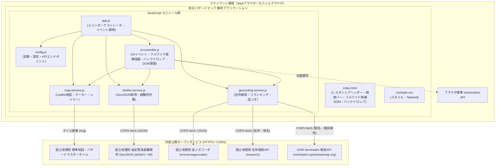
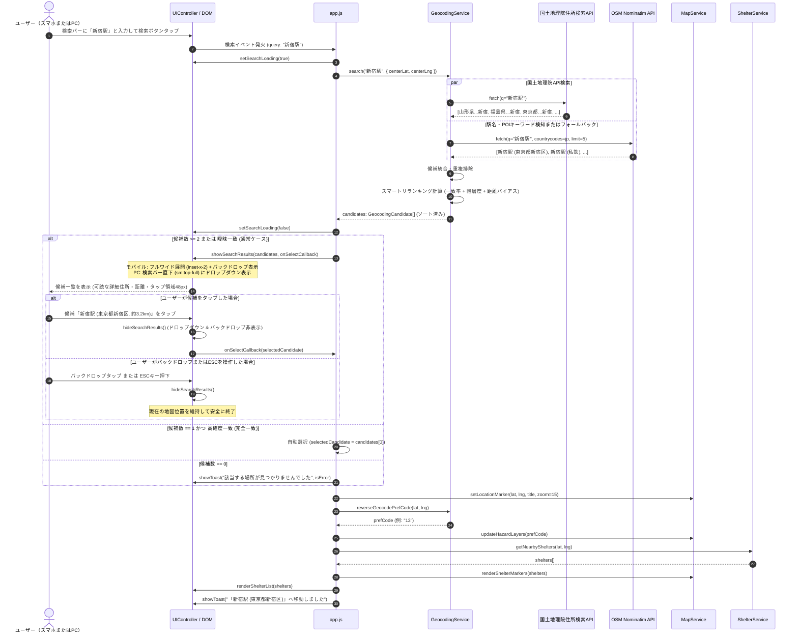

# システムアーキテクチャ設計書: 防災ハザードマップ & 避難場所表示 静的HTMLアプリケーション

本書は、ブラウザ上でスタンドアロンかつ安全に動作する「防災ハザードマップ & 避難場所ナビ 静的HTMLアプリケーション」のシステムアーキテクチャ設計書（第3版）である。
初版の完全静的化設計、第2版のハイブリッド・ジオコーディング検索および候補選択機能の設計に加え、**「スマートフォン（モバイル）環境におけるヘッダー狭小化および検索結果ドロップダウン不可読問題」の抜本的解決**に向けた、モバイル優先レスポンシブ・情報設計、ビューポート基準フルワイド候補パネル、およびタッチ最適化UXの拡張設計を包含する。

---

## 1. 要件定義サマリー

### 1.1 背景と課題

#### 1.1.1 検索精度と候補選択に関する課題（第2版にて解決）
従来のシステムは、国土地理院住所検索API（`msearch.gsi.go.jp`）を採用し、レスポンスの先頭レコード（`data[0]`）を無条件に採用して地図を強制移動させていた。
しかし、国土地理院住所検索APIはクエリとの関連度ソートを行わず、部分一致した地名を全国の地方公共団体コード順（北海道01から順）で返却する仕様であるため、「新宿駅」で山形県朝日町新宿へ飛ぶなどの重大な誤判定が発生していた。
第2版において、国土地理院APIとOpenStreetMap (OSM) Nominatim APIのハイブリッド連携、スマートリランキング、および候補ドロップダウンUIを導入し、この誤ジャンプ問題を解決した。

#### 1.1.2 モバイル環境における操作性・可読性の重大課題（第3版での解決対象）
第2版のリリース後、スマートフォン（モバイル幅 360px〜400px）の実機環境において以下の極めて深刻なユーザビリティ障害が発生していることがユーザーより報告された。
1. **ヘッダーレイアウトの狭小化と検索バーの圧迫（「検索バーが見えない」問題）**:
   - ヘッダーは 1 行固定（高さ 64px）で構成され、左側に「サイドバートグルボタン＋アプリアイコン＋『防災ハザードマップ』テキスト」、右側に「現在地ボタン」が配置されている。
   - 画面幅 360px〜400px のスマートフォンでは、左右の要素が画面幅の過半を占有するため、中央の `#search-container` に割り当てられる幅がわずか 60px〜90px 程度に押し潰される。
   - その結果、検索バー内のプレースホルダー「住所・駅名・施設名を入力して検索...」や入力文字が完全に見えなくなり、ユーザーが「検索バーが見えない」と感じる。
2. **検索結果ドロップダウンの極小化と不可読化（「プルダウンが一切読めない」問題）**:
   - `#search-results-dropdown` は親要素 `#search-container` に対し `absolute left-0 right-0 top-full` で配置されている。
   - 親要素の幅が 60px〜90px しかないため、ドロップダウンの幅も 60px〜90px に強制的に制限される。
   - その極小幅の中に「[OSM] 新宿駅」「東京都新宿区新宿三丁目...」「約3.2km」を詰め込んでいるため、文字が `truncate` で極限まで削られ（「[OS... 新...」）、あるいは縦に激しく重なって「一切読めない」状態となっている。
   - タッチデバイス向けの快適なタップターゲット（44px以上）や指先での操作性、地図の視覚ノイズとの分離（背景オーバーレイ）が考慮されていない。

本改訂（第3版）では、サーバーレス・完全静的動作・APIキー不要の制約を厳格に維持しつつ、**モバイル優先ヘッダー情報設計（ロゴテキストのレスポンシブ最適化）、ビューポート基準フルワイド候補パネル、および半透明バックドロップオーバーレイ**を導入し、スマートフォンおよびPC双方で直感的に検索・選択できる高品質なUI/UXアーキテクチャを確立する。

---

### 1.2 機能要件 (Functional Requirements)

- **FR-1: 地図基本表示機能 (維持)**
  - Leaflet.js を利用したインタラクティブな日本地図の表示。
  - 国土地理院標準地図タイル（`https://cyberjapandata.gsi.go.jp/xyz/std/{z}/{x}/{y}.png`）をベースマップとしてレンダリング。
  - デフォルト表示位置として新大阪駅周辺（緯度: 34.72631588753036, 経度: 135.49736241752382, ズーム: 14）を設定。
- **FR-2: 災害リスクレイヤー重畳機能（国土地理院ハザードマップタイル） (維持)**
  - 洪水浸水想定区域（浸水深）レイヤーのON/OFF切り替え表示。
  - 土砂災害警戒区域レイヤーのON/OFF切り替え表示（都道府県別タイル対応）。
  - 津波浸水想定区域レイヤーのON/OFF切り替え表示（都道府県別タイル対応）。
  - 各ハザード情報の凡例（浸水深ランク、土砂警戒区域種別等）のサイドバー表示。
- **FR-3: 現在地取得機能 (Geolocation API) (維持)**
  - ブラウザの `navigator.geolocation.getCurrentPosition` による高精度位置情報取得。
  - 初回アクセス時の自動取得判定（取得不可時は初期地点へフォールバック）。
  - ヘッダーの「現在地を取得」ボタンによる随時取得。
  - 取得失敗（拒否、タイムアウト、非対応等）時の適切なトースト通知とフォールバック。
- **FR-4: 周辺指定緊急避難場所の自動取得・計算機能 (維持)**
  - 中心座標に基づき、Zoom 10 のタイル座標（中心＋周囲8タイルの計9タイル）を算出。
  - 6つの災害種別（洪水: skhb01, 土砂: skhb02, 高潮: skhb03, 地震: skhb04, 津波: skhb05, 火事: skhb06）の国土地理院GeoJSONタイル（計54リクエスト）をクライアントサイドから直接非同期並行取得。
  - 避難所データの重複統合（同一名称・近接座標のレコードをマージし、対応災害種別を結合）。
  - 中心地点からの直線距離（大円距離 / Haversine式）および道なり推定距離（迂回係数 1.25倍）の算出。
  - 徒歩所要時間（分速 80m 基準、切り上げ）の算出。
  - 検索半径 5km 以内の避難所を徒歩所要時間の昇順でソートし、最大50件を抽出。
- **FR-5: 避難所種別（一般 / 福祉・要配慮者優先）の識別・視覚化 (維持)**
  - プロパティ（`welfare`, `is_welfare`, `remarks`）および施設名称キーワード（「福祉」「介護」「デイサービス」「障がい」等）による福祉避難所の自動判定。
  - 地図上マーカーの色分け（一般: 青色、福祉: 紫色＋二重リング）およびアイコン差別化。
  - サイドバー一覧での視覚的バッジ表示（一般避難場所 / 要介護・要配慮者優先）。
- **FR-6: 詳細ポップアップおよび連携ハイライト (維持)**
  - マーカークリック時に、避難所名称、住所、対応災害種別、徒歩所要時間・距離を表示するポップアップを展開。
  - サイドバーの避難所カードクリック時に、該当避難所へ地図をセンタリングし、ポップアップを自動展開。
- **FR-7: 都道府県コードの自動特定（逆ジオコーディング） (維持)**
  - 土砂災害および津波レイヤーに必要なJIS都道府県コード（2桁）を、国土地理院逆ジオコーダAPI（`mreversegeocoder`）により座標から自動判定。
  - 判定結果に応じて動的にハザードタイルのURLを再構築。
- **FR-8: 住所・ランドマーク高精度検索および候補選択機能 (改訂・レスポンシブ拡張)**
  - **FR-8.1: ハイブリッド・ジオコーディング検索**:
    - 国土地理院住所検索APIを基本としつつ、駅名（「〜駅」）や主要ランドマークを含むクエリ、または国土地理院APIでの低確度一致時に、OpenStreetMap (OSM) Nominatim API をフォールバック/補完検索として呼び出す。
    - クエリの正規化（全角半角統一、余計な空白トリム、「駅」サフィックス等のハンドリング）。
  - **FR-8.2: スマートリランキングエンジン**:
    - 取得した全候補に対し、「クエリ完全一致度」「地名階層度（政令市・区・都道府県等）」「知名度（importance）」「現在表示中心座標からの近傍距離バイアス」を総合したスコアリングを実行しソート。
  - **FR-8.3: モバイル最適化・候補一覧（フルワイドドロップダウン）提示UI (第3版新規)**:
    - 検索ボタン押下時、候補が複数ある場合や曖昧な一致の場合は問答無用でジャンプせず、候補一覧を展開する。
    - **モバイル画面（`sm` 未満）**: 親要素の幅制約を解除し、画面幅全体を活用したビューポート固定配置（左右マージン約8〜12px、最大幅は画面幅に追従）として展開。同時に背後に半透明オーバーレイ（backdrop）を展開し、地図の背景ノイズを遮断。
    - **デスクトップ画面（`sm` 以上）**: 検索バー直下の整然としたフローティングドロップダウン（親要素基準、幅約 400px）として展開。
    - 各候補カードに「候補名」「住所・都道府県」「現在地/地図中心からの直線距離（例: 約3.5km、約320km）」を表示し、モバイル画面でも文字が極端に省略されることなく一目で識別・選択可能とする。
  - **FR-8.4: 確度別インタラクション制御**:
    - 候補が1件のみかつ高確度（完全一致等）の場合: 即座に該当地点へ移動し、周辺避難所を自動検索。
    - 複数候補または曖昧な場合: 候補リストを表示し、ユーザーがクリック/タップした候補へ移動。
    - 0件の場合: 「該当する場所が見つかりませんでした」の案内と、検索のヒント（市区町村名や都道府県名の付加推奨）を明示。
    - 検索処理中のローディングスピナー表示、ESCキー、外側クリック、またはバックドロップタップでの一覧クローズ対応。
- **FR-9: 表示確認用サンプル地点ジャンプ (維持)**
  - 「大阪淀川（洪水）」「北海道札幌手稲（土砂）」「広島八木（土砂）」「静岡三保（津波）」へのワンクリック移動および対応レイヤーの自動有効化。
- **FR-10: ユーザーマスター関連の完全削除 (維持)**
  - バックエンド、スプレッドシート連携、ユーザーバッジコードの非依存を維持。

---

### 1.3 非機能要件 (Non-Functional Requirements)

- **NFR-1: ポータビリティ・サーバーレス動作 (維持)**
  - サーバーサイド実行環境（Node.js, Python, GAS等）を一切必要とせず、ブラウザ（Chrome, Edge, Safari, Firefox、モバイルブラウザ含む）のみで100%クライアントサイド完結して動作すること。
- **NFR-2: 外部コスト・キー管理ゼロ (維持)**
  - 有料API（Google Maps Geocoding等）や認証キー管理を完全に排除し、利用規約上無料で利用可能なAPIのみで構築すること。
- **NFR-3: 外部API利用規約の厳格遵守（Fair Use Policy） (維持)**
  - OSM Nominatim APIの利用ポリシー（最大 1 req/sec、ユーザー明示操作時のみ実行、過度な自動補完リクエストの禁止）を遵守すること。
- **NFR-4: 検索レスポンスと非同期UX (維持)**
  - 検索処理中は検索ボタンおよび入力バーにローディングスピナーを表示し、二重送信を防止すること。検索処理完了（候補描画）は通常1.5秒以内に完了すること。
- **NFR-5: モバイルレスポンシブUI & タッチアクセシビリティ (大幅拡張)**
  - 画面幅 360px（iPhone SE等）からデスクトップ大画面まで、全ブレークポイントで要素の押し潰れや文字の不可読が発生しないこと。
  - モバイル環境（`sm` 未満）において、検索コンテナに最低 200px 以上の有効幅を確保すること。
  - モバイルにおける各候補アイテムのタッチターゲット高さは 44px（推奨 48px）以上を確保し、タップ時の視覚的フィードバック（アクティブ背景色等）を提供すること。
  - キーボード操作（Enter, ESC）、外側クリック、およびバックドロップタップでの安全なクローズ制御。
- **NFR-6: 保守性と関心の分離 (維持)**
  - 検索ロジック・リランキングは `GeocodingService`、候補描画・開閉・レスポンシブ制御は `UIController`、全体のイベント調停は `App` に明確に分離すること。
- **NFR-7: レンダリングパフォーマンスとDOM最小化 (第3版新規)**
  - デスクトップとモバイルで重複したHTML構造（二重DOM）を構築せず、CSS（Tailwindレスポンシブクラス）および単一の候補コンテナを活用して高速にレンダリングすること。

---

### 1.4 前提条件と制約事項

- **前提条件**:
  - 国土地理院API（`msearch`, `mreversegeocoder`）および OSM Nominatim API が CORS 許可ヘッダー（`Access-Control-Allow-Origin: *`）を送出していること（実機検証確認済み）。
  - ブラウザが CSS Flexbox, Grid, `position: fixed`, および Tailwind CSS レスポンシブプレフィックス（`sm:` 等）を正常に解釈できること。
- **制約事項**:
  - OSM Nominatim APIは1秒間に1回以上の高頻度呼び出しが禁止されているため、キー入力ごとのインクリメンタルサーチ（typeahead）は行わず、ユーザーが「検索ボタン押下」または「Enterキー押下」したタイミングでのみリクエストを実行する。
  - モバイル表示時にヘッダーを2段化して地図の表示高さを削ることは避け、1行ヘッダーのままコンテンツ優先度制御で十分な検索幅を確保する。

---

### 1.5 不明点・ブロッキング事項

- **ブロッキング事項**: なし（全依存APIの通信仕様、CORS適合性、Tailwindレスポンシブクラス、DOM配置仕様を検証完了）。

---

## 2. システム境界とコンポーネント構成

### 2.1 システム境界 (System Boundary)



---

### 2.2 各コンポーネントの責務と変更点

| コンポーネント | ファイルパス | 主な責務・第3版における改訂内容 |
| :--- | :--- | :--- |
| **HTML View** | `index.html` | 1. **ヘッダーレスポンシブ最適化**: モバイル時にロゴタイトル「防災ハザードマップ」を非表示（`hidden sm:block`）にし、検索コンテナ（`#search-container`）の有効幅（200px以上）を確保。<br>2. **フルワイド候補コンテナの再定義**: `#search-results-dropdown` にモバイル固定配置（`fixed inset-x-2 sm:inset-x-auto sm:left-0 sm:right-0 top-[60px] sm:top-full`）を適用。<br>3. **バックドロップ新設**: モバイル候補表示用の半透明背景オーバーレイ（`#search-backdrop`）を定義。 |
| **UI Controller** | `js/ui-controller.js` | 1. `showSearchResults`: モバイル全幅を活用した候補カード描画（タイトル＋距離を1行目、詳細住所を2行目に配置、タップ領域 48px 以上、バックドロップ表示）。<br>2. `hideSearchResults`: ドロップダウンと同時にバックドロップを非表示化。<br>3. 外側クリック・バックドロップタップ・ESCキーによる一括クローズ調停の強化。 |
| **Config & State** | `js/config.js` | 変更なし（Nominatim エンドポイント、検索リランキング重み付け、最大候補表示件数等を維持）。 |
| **Geocoding Service** | `js/geocoding-service.js` | 変更なし（ハイブリッド検索、スマートリランキングアルゴリズム、後方互換性メソッド `geocode()` を完全に維持）。 |
| **Application Main** | `js/app.js` | 候補選択コールバックおよびバックドロップ連携のイベントバインドを確認・強化。 |
| **Map Service** | `js/map-service.js` | 変更なし（Leaflet地図操作・ハザードレイヤー管理を維持）。 |
| **Shelter Service** | `js/shelter-service.js` | 変更なし（避難所54タイルの並行取得・計算ロジックを維持）。 |

---

### 2.3 外部依存関係一覧 (維持)

| 依存名称 | URL / エンドポイント | 用途 | 認証 / 制約 |
| :--- | :--- | :--- | :--- |
| **国土地理院 住所検索API** | `https://msearch.gsi.go.jp/address-search/AddressSearch` | 日本国内の住所・大字・小字・公的地名の座標変換 | 無料・キー不要・CORS対応 |
| **国土地理院 逆ジオコーダ** | `https://mreversegeocoder.gsi.go.jp/reverse-geocoder/LonLatToAddress` | 座標からJIS都道府県コード特定 | 無料・キー不要・CORS対応 |
| **OSM Nominatim API** | `https://nominatim.openstreetmap.org/search` | 駅名（新宿駅等）、施設名、商業地、ランドマークの座標補完 | 無料・キー不要・CORS対応（1 req/sec 遵守） |
| **国土地理院 地図・ハザードタイル** | `cyberjapandata.gsi.go.jp`, `disaportaldata.gsi.go.jp` | ベースマップ・浸水・土砂・津波タイル表示 | 無料・キー不要 |
| **国土地理院 避難場所タイル** | `cyberjapandata.gsi.go.jp/xyz/skhb01..06/...` | 指定緊急避難場所 GeoJSON データ取得 | 無料・キー不要・CORS対応 |

---

## 3. データフローとインターフェース

### 3.1 検索・リランキング・候補選択およびレスポンシブ表示データフロー



---

### 3.2 ジオコーディング・リランキングアルゴリズムの詳細仕様 (維持)

各候補 $c$ に対し、総合スコア $S(c)$ を算出して降順ソートする。

$$S(c) = W_{\text{match}} \cdot S_{\text{match}}(c) + W_{\text{hierarchy}} \cdot S_{\text{hierarchy}}(c) + W_{\text{importance}} \cdot S_{\text{importance}}(c) - W_{\text{dist}} \cdot D_{\text{norm}}(c)$$

1. **文字列マッチ度スコア $S_{\text{match}}(c) \in [0, 100]$**:
   - クエリ文字列と候補タイトルの完全一致: $100$
   - クエリから「駅」「タワー」等のサフィックスを除去した基本語が、候補タイトルの構成語（市町村・町名）と完全一致: $80$
   - 前方一致: $60$、部分一致: $40$
   - クエリ内に含まれる都道府県名・市名が候補と合致する場合: $+20$ 加算。
2. **行政階層・主要度スコア $S_{\text{hierarchy}}(c) \in [0, 30]$**:
   - 政令指定都市・東京23区・県庁所在地: $30$
   - 一般市: $20$
   - 町村・大字: $10$
   - 小字・山林部: $0$
3. **外部知名度スコア $S_{\text{importance}}(c) \in [0, 20]$**:
   - OSM Nominatim から返却される `importance`（$0.0 \sim 1.0$）に $20$ を乗算。国土地理院API由来の場合は標準値 $10$。
4. **現在地図中心からの正規化距離ペナルティ $D_{\text{norm}}(c)$**:
   - 現在の地図中心座標（または現在地）と候補座標との大円距離 $D \text{ (km)}$ を算出。
   - $D_{\text{norm}}(c) = \min\left(\frac{D}{1000}, 1.0\right) \times 15$
   - （遠隔地の明示的検索でテキスト一致度が高い候補が近隣の無関係な部分一致に負けないよう上限15に抑制）

---

### 3.3 モバイルレスポンシブUIレイアウト仕様 (第3版新規)

#### 3.3.1 ブレークポイント設計と要素別表示マトリクス

| ブレークポイント | 画面幅 | ロゴタイトル (`#header-logo h1`) | サブタイトル (`#header-logo p`) | 検索バー (`#search-container`) | 現在地ボタン (`#btn-current-location`) | 候補リスト (`#search-results-dropdown`) |
| :--- | :--- | :--- | :--- | :--- | :--- | :--- |
| **Mobile (`< sm`)** | `< 640px` (360〜400px) | **非表示 (`hidden`)**<br>※ロゴアイコンのみ表示 | **非表示 (`hidden`)** | **全幅伸長 (`flex-1 mx-1.5`)**<br>有効幅: 約 210px〜250px | アイコンのみ表示<br>(テキスト `hidden`) | **固定フルワイド (`fixed inset-x-2 top-[60px]`)**<br>+ バックドロップ表示 |
| **Tablet / Desktop (`>= sm`)** | `>= 640px` | **表示 (`sm:block`)** | **表示 (`sm:block`)** | **中央固定幅 (`sm:max-w-md sm:mx-3`)** | アイコン＋「現在地を取得」テキスト表示 | **直下ドロップダウン (`sm:absolute sm:top-full`)**<br>バックドロップ不要 |

#### 3.3.2 候補カードの行レイアウト・タイポグラフィ設計
モバイル全幅（幅約 340px〜380px）およびデスクトップ幅（約 400px）において、情報の優先度に応じた2行構造を採用する。

```
┌────────────────────────────────────────────────────────┐
│ [OSM] 新宿駅                            約3.2km (距離) │  ← 1行目: 名称(太字・視認性最優先) + 距離
│ 📍 東京都新宿区新宿三丁目38-1                          │  ← 2行目: 詳細住所(アイコン付き・灰色・可読)
└────────────────────────────────────────────────────────┘
```
- **タッチターゲット要件**: 各アイテムの上下パディングを `p-3.5`（または `min-h-[48px]`）とし、指先で容易にタップ可能とする。
- **アクティブフィードバック**: `active:bg-blue-100 hover:bg-blue-50 transition` によりタップの実感を担保。
- **文字省略ルール**:
  - タイトル: `truncate` を適用するが、横幅が十分なため主要名称（例: 「新宿駅」「東京タワー」）は欠落せず完全表示される。
  - 住所: `line-clamp-2` または余裕ある幅での `truncate`。文字サイズ `text-xs` で約25〜35文字まで欠落なく読める。

---

### 3.4 主要インターフェース定義

#### データ構造仕様 (TypeScript風)

```typescript
/** ジオコーディング候補オブジェクト (維持) */
interface GeocodingCandidate {
  id: string;               // 一意な識別子
  title: string;            // 主要名称 (例: "新宿駅", "新宿")
  address: string;          // 完全住所または詳細地名 (例: "東京都新宿区新宿三丁目")
  lat: number;              // 緯度
  lng: number;              // 経度
  prefCode?: string;        // JIS都道府県コード (2桁, 判明している場合)
  source: 'gsi' | 'osm';    // 提供元API (国土地理院 または OpenStreetMap)
  distanceKm?: number;      // 現在地図中心/現在地からの直線距離 (km)
  score: number;            // 算出された総合スコア
  isHighConfidence: boolean;// 高確度フラグ (完全一致かつスコア閾値以上)
}

/** 検索オプション (維持) */
interface GeocodingOptions {
  centerLat?: number;       // バイアス計算用中心緯度
  centerLng?: number;       // バイアス計算用中心経度
  maxResults?: number;      // 最大返却件数 (デフォルト 5件)
  enableFallback?: boolean; // OSM Nominatim 補完の有効/無効 (デフォルト true)
}

/** ジオコーディング単一結果 (後方互換用・維持) */
interface GeocodingResult {
  lat: number;
  lng: number;
  title: string;
  prefCode: string;
}
```

#### モジュールインターフェース

```javascript
// js/ui-controller.js
export class UIController {
  /**
   * 検索候補一覧を表示する（モバイル時はフルワイド＆バックドロップ表示、PC時は直下ドロップダウン）
   * @param {GeocodingCandidate[]} candidates - 表示候補一覧
   * @param {(candidate: GeocodingCandidate) => void} onSelect - 選択時コールバック
   */
  static showSearchResults(candidates, onSelect) {}

  /**
   * 検索候補一覧および検索バックドロップを非表示にする
   */
  static hideSearchResults() {}

  /**
   * 検索バーのローディング状態（スピナー表示・ボタン無効化）を切り替える
   * @param {boolean} isLoading
   */
  static setSearchLoading(isLoading) {}
}

// js/geocoding-service.js (維持)
export class GeocodingService {
  /**
   * クエリ文字列からスコアリング・ソート済みの候補リストを取得する
   * @param {string} query
   * @param {GeocodingOptions} [options]
   * @returns {Promise<GeocodingCandidate[]>}
   */
  static async search(query, options = {}) {}

  /**
   * 後方互換メソッド: 最上位候補1件を返却する
   * @param {string} address
   * @returns {Promise<GeocodingResult | null>}
   */
  static async geocode(address) {}

  /**
   * 座標からJIS都道府県コード(2桁)を取得する
   * @param {number} lat
   * @param {number} lng
   * @returns {Promise<string>}
   */
  static async reverseGeocodePrefCode(lat, lng) {}
}
```

---

## 4. アーキテクチャ上の決定事項 (ADR)

### ADR-01: クライアントサイド完結型 SPA（静的HTML）の採用 (維持)
- **決定**: バックエンドサーバーを排除し、HTML/CSS/Vanilla JavaScriptで完結する静的SPAアーキテクチャを採用する。
- **理由**: サーバー維持費・認証保守をゼロ化し、GitHub Pages等の静的ホスティングで即時運用可能にするため。
- **検討した代替案**: BFFプロキシサーバーの設置。
- **トレードオフ**: クライアント端末の通信量が増加するが、適切な並行制御とキャッシュで十分なパフォーマンスが得られる。
- **結果・影響**: サーバーレスで運用可能。

### ADR-02: 国土地理院公式オープンAPIのプライマリ採用 (維持)
- **決定**: 日本国内の公式住所・境界情報には国土地理院オープンAPIを最優先として採用する。
- **理由**: 公的住所体系への信頼性が高く、商用ライセンス料が不要。
- **検討した代替案**: 有料商用API（Google Maps等）。
- **トレードオフ**: 曖昧検索や施設名検索が単体では弱い。
- **結果・影響**: APIキー漏洩リスクゼロを維持。

### ADR-03: 避難所タイルの並行取得制御とインメモリキャッシュ (維持)
- **決定**: 54タイルのGeoJSON取得に `Promise.allSettled()` による並行非同期処理を導入し、URL単位のインメモリキャッシュを保持する。
- **理由**: 高速な避難所検索とHTTP 404の安全な吸収を両立するため。
- **結果・影響**: 高速で堅牢な避難所検索パイプラインの実現。

### ADR-04: ディレクトリ構成とモジュール分割 (維持)
- **決定**: `index.html`, `css/style.css`, `js/` 配下の単一責任モジュール群（Config, Geocoding, Map, Shelter, UI, App）に分割する。
- **理由**: 凝集度を高め、テスト・検証を容易にするため。
- **結果・影響**: 変更影響範囲の局所化。

### ADR-05: 国土地理院APIとOSM Nominatim APIのハイブリッド検索およびスマートリランキングの採用 (維持)
- **決定**: 国土地理院住所検索APIをプライマリとしつつ、駅名（「〜駅」）や施設名を含むクエリ、または国土地理院APIの低スコア時に OpenStreetMap Nominatim API（無料・CORS対応）をフォールバック/補完として呼び出し、統合スマートリランキングを行う。
- **理由**:
  1. 国土地理院APIは地名がJISコード順で返るため、「新宿駅」が山形県朝日町新宿になる等の誤判定が構造的に不可避である。
  2. OSM Nominatim は駅名・施設名・商業地名（POI）に極めて強く、「新宿駅」「東京タワー」を高精度にピンポイント特定できる。
  3. 両APIともAPIキー不要・無料でCORS通信が可能であり、静的Webアプリケーションの原則（ADR-01, ADR-02）を一切侵害しない。
- **トレードオフ**:
  - OSM Nominatim は 1秒あたり1リクエストの利用ポリシーがあるため、インクリメンタルサジェストは行わず、明示的検索実行時のみ通信を行う。
- **結果・影響**: 駅名・施設名に対する誤ジャンプ問題が根本解消。

### ADR-06: 誤ジャンプ防止のための候補一覧UIと確度別インタラクションの採用 (維持)
- **決定**: 検索ボタン押下時に無条件で地図を移動させる仕様を廃止し、原則として検索候補リストを提示してユーザーに選択させる。例外として「候補が1件かつ完全一致」の高確度時のみダイレクト移動を許可する。
- **理由**: 同名地名（府中、新宿等）におけるユーザーの意図を100%自動断定することは不可能なため、詳細住所と距離を提示して誤操作を防ぐ。
- **結果・影響**: 誤ジャンプの完全防止と安心感の確立。

### ADR-07 (第3版新規): モバイル優先ヘッダー情報設計（ロゴタイトルのレスポンシブ省略と検索幅の死守）
- **決定**:
  モバイル画面（`sm` 未満、幅 < 640px）では、ヘッダー左側のタイトルテキスト「防災ハザードマップ」を非表示（`hidden sm:block`）にし、ブランドロゴアイコン（`w-9 h-9`）のみを表示する。
  さらにヘッダー左右パディングを `px-2 sm:px-4`、検索コンテナのマージンを `mx-1.5 sm:mx-3` に最適化し、検索入力コンテナに最低 200px 以上の有効幅を確保する。
- **理由**:
  1. スマートフォン実機において、ヘッダーの横幅（360px〜400px）に対し、ロゴタイトル（約125px）＋トグルボタン＋現在地ボタンが過半を占有し、中央の検索バーが 60px〜90px に押し潰されて「検索バーが見えない」という致命的障害が発生していた。
  2. ユーザーが現場（モバイル）で最も必要とする主機能は「場所の検索」と「現在地取得」であり、静的なアプリ名テキストは優先度が低い。
  3. ロゴアイコン（シールドアイコン）によりアプリケーションの視覚的ブランド認知は十分に維持でき、アプリ名はサイドバー最上部やウェルカムモーダルでも確認できる。
  4. ヘッダーを2段化することなく1行（高さ 64px）のコンパクトさを維持できるため、地図表示領域（ファーストビュー）を一切犠牲にしない。
- **検討した代替案**:
  - 代替案A: 検索バーをヘッダー下部に別行として配置する2段ヘッダー構成。
    → 地図表示エリアが縦方向に圧迫され、高さ計算（`calc(100vh - 4rem)`）の改修や画面スクロールの複雑化を招くため却下。
  - 代替案B: ヘッダーに虫眼鏡アイコンのみを置き、タップで全画面検索入力モードへ遷移させる。
    → 常時入力可能なデスクトップ版とUXの一貫性が失われ、検索開始に1タップ余計な手数がかかるため却下。
- **トレードオフ**:
  モバイル時にヘッダーからアプリ名テキストが消えるが、検索バーの視認性・入力性（200px〜250px確保）が劇的に改善され、実用性が圧倒的に向上する。
- **結果・影響**:
  「検索バーが見えない」問題が完全に解消され、プレースホルダーや入力中の文字がはっきりと視認・編集可能となる。

### ADR-08 (第3版新規): ビューポート基準フルワイド展開ドロップダウンおよび半透明バックドロップの採用
- **決定**:
  候補一覧コンテナ（`#search-results-dropdown`）を、モバイル画面（`sm` 未満）では親要素の幅から独立したビューポート固定配置（`fixed inset-x-2 sm:inset-x-auto sm:left-0 sm:right-0 top-[60px] sm:top-full z-50`）として展開し、画面幅全体（左右マージン各8px）を活用する。
  同時に、候補一覧の背後に半透明の背景オーバーレイ（`#search-backdrop`、`fixed inset-0 bg-black/40 z-40`）を表示し、地図の背景ノイズを遮断する。
- **理由**:
  1. 親要素 `#search-container` の幅が 200px〜240px に広がったとしても、候補カードに含まれる「提供元バッジ」「施設名」「詳細住所」「現在地からの距離」を快適に表示するには依然として窮屈である。
  2. モバイル全幅（約 340px〜380px）を活用することで、タイトルと距離を1行目に左右配置し、詳細住所を2行目にゆったりと配置できる。これにより文字の極端な省略（`truncate`）を防ぎ、「一覧が一切読めない」問題を根本的に解決できる。
  3. 地図上には道路・等高線・ハザード着色・ピンなどの多色・高密度なビジュアルが存在するため、ドロップダウンの背景が透けたり隙間があると視覚的なノイズが干渉して文字が読みにくくなる。半透明バックドロップにより候補リストを鮮明に浮き上がらせることができる。
  4. タッチデバイスでは画面外タップによるキャンセルが自然なメンタルモデルであるため、バックドロップをタップすることで即座に候補リストをクローズできる直感的な操作感を実現する。
  5. 単一のDOM要素に対し Tailwind CSS のレスポンシブクラスを割り当てるだけで実現できるため、PC表示（親幅基準の整然としたドロップダウン）とモバイル表示をコードの重複なくシームレスに両立できる。
- **検討した代替案**:
  - 代替案A: ドロップダウンを親幅（約220px）のままにし、文字サイズを極小化（10px）する。
    → 老眼や屋外の日光下で極めて読みにくく、タッチターゲットも小さくなり誤タップが頻発するため却下。
  - 代替案B: 全画面モーダルを完全に別HTML/JSで作成する。
    → PCとモバイルで二重のメンテナンスが発生し、保守性を損なうため却下。
- **トレードオフ**:
  モバイル時に候補一覧表示中は背後の地図操作が一時的にブロックされるが、候補選択またはバックドロップタップで瞬時に解除されるため、ユーザー体験上むしろ誤操作を防ぐ安全な動作となる。
- **結果・影響**:
  「検索結果の一覧をプルダウンで出してくれてるけどそれも一切読めない」問題が抜本的に解消され、駅名・施設名・詳細住所・距離が極めて明瞭に読めるようになる。

---

## 5. 品質特性に関する考慮事項

### 5.1 ユーザビリティとモバイルアクセシビリティ (Usability & Accessibility)
- **十分なタッチターゲットの確保 (WCAG / Apple HIG 準拠)**:
  - モバイル時の各候補アイテムの高さを最低 48px 以上とし、指先での押し間違い（ファットフィンガー問題）を防止する。
  - ヘッダーのハンバーガーボタン、現在地ボタンもパディングとタッチ領域を最適化。
- **明確な視覚的フィードバック**:
  - モバイル候補カードタップ時に `active:bg-blue-100` による即時フィードバックを提供。
  - 検索中インジケータ（スピナー）の明確な表示と、二重送信の抑止。
- **直感的なクローズ動作**:
  - ドロップダウン外部タップ、バックドロップタップ、ESCキー押下のいずれでも確実に候補一覧が閉じる堅牢なイベント調停。

### 5.2 信頼性と耐障害性 (Reliability & Fault Tolerance)
- **API多重フォールバックの維持**:
  - 国土地理院APIおよびOSM Nominatim APIのいずれかがダウン・制限に達した場合でも、他方のデータを用いて候補一覧を正常生成する。
- **XSS（クロスサイトスクリプティング）の完全防止**:
  - 外部APIから返却される地名・住所文字列（`candidate.title`, `candidate.address` 等）は、DOM挿入前に必ず `UIController.escapeHtml()` を経由するか `textContent` を使用し、悪意あるスクリプト注入を100%遮断する。

### 5.3 パフォーマンスとDOM最小化 (Performance)
- **単一DOMアーキテクチャ**:
  - モバイル専用の別DOMツリーを複製せず、同一の `#search-results-dropdown` 要素を CSS レスポンシブクラス（`fixed sm:absolute inset-x-2 sm:inset-x-0`）で切り替えるため、メモリ消費およびDOM構築コストを最小化。
- **検索候補数の上限制御**:
  - 表示候補数は最大5件（`MAX_SEARCH_RESULTS`）に制限し、モバイル画面での過剰なスクロールや描画負荷を抑制。

### 5.4 保守性と関心の分離 (Maintainability)
- **スタイルの集約と関心の分離**:
  - レイアウト・レスポンシブ表現は HTML / Tailwind CSS クラスおよび `css/style.css` に集約。
  - ロジック（検索、リランキング、距離計算）は `GeocodingService`、DOM状態制御は `UIController` に純粋に分離。
- **後方互換性の厳格維持**:
  - 既存の `GeocodingService.geocode()` や `UIController.showSearchResults()` のメソッドシグネチャを維持し、既存テストや他モジュールへの副作用をゼロにする。

---

## 6. 受け入れ基準 (Acceptance Criteria)

- [ ] **AC-1: サーバー非依存の完全静的動作 (維持)**
  - バックエンドサーバーなしで、静的HTMLおよび関連JS/CSSファイルをブラウザで読み込むだけで全機能が動作すること。
- [ ] **AC-2: ユーザーマスター関連の完全削除 (維持)**
  - ユーザー情報コードやGAS依存が一切存在しないこと。
- [ ] **AC-3: 国土地理院地図およびハザードレイヤーの重畳表示 (維持)**
  - 洪水・土砂・津波レイヤーが正常に切り替え表示できること。
- [ ] **AC-4: 都道府県コードの自動判別とレイヤー反映 (維持)**
  - 移動先の都道府県コードに応じて土砂・津波レイヤーのURLが自動更新されること。
- [ ] **AC-5: 現在地取得機能 (維持)**
  - Geolocation APIによる現在地取得および初期位置フォールバックが機能すること。
- [ ] **AC-6: 避難所データの取得・距離計算・一覧表示 (維持)**
  - 5km圏内の避難所が徒歩時間順に最大50件一覧表示されること。
- [ ] **AC-7: 福祉避難所・一般避難所の視覚的分離 (維持)**
  - アイコンと色で明確に福祉避難所が識別できること。
- [ ] **AC-8: インタラクティブ連携 (維持)**
  - 地図ピンとサイドバーカードのクリック連動が動作すること。
- [ ] **AC-9: 住所・施設名検索と候補選択UI (大幅改訂・検証基準)**
  - [ ] **AC-9.1: 駅名・ランドマークの正確な特定 (維持)**
    - 「新宿駅」で検索した際、山形県朝日町ではなく「東京都新宿区の新宿駅」が候補の最上位に表示されること。
    - 「渋谷駅」「博多駅」「新大阪駅」「東京タワー」で検索した際、全国の意図しない小字ではなく、目的地の正しい座標・住所が提示されること。
  - [ ] **AC-9.2: 候補一覧の提示と選択ジャンプ (維持)**
    - 複数候補が存在する場合、候補一覧（名称、詳細住所、現在地/地図中心からの距離）が展開されること。
    - ユーザーが候補をクリック/タップすると、該当座標へ地図がパンし、避難所データが正しく再計算・表示されること。
  - [ ] **AC-9.3: 高確度完全一致時のスマート動作 (維持)**
    - 候補が1件かつ完全一致の高確度判定の場合、ダイレクトに移動し完了トーストが表示されること。
  - [ ] **AC-9.4: ヒット件数ゼロ時の案内表示 (維持)**
    - 存在しない文字列（例: 「zzxyy9999」）で検索した場合、誤ジャンプせず「該当する場所が見つかりませんでした」と入力改善ヒントが表示されること。
  - [ ] **AC-9.5: UI操作性とクローズ挙動 (維持・拡張)**
    - 検索実行中にインジケータ（スピナー）が表示されること。
    - 候補リストの外側をクリック、バックドロップをタップ、またはESCキー押下で候補リストおよびバックドロップが安全に非表示となること。
  - [ ] **AC-9.6 (第3版新規): モバイル画面（幅360px〜400px）における検索バーの十分な横幅確保**
    - 画面幅 360px〜400px において、ロゴタイトル「防災ハザードマップ」が非表示となり、検索バーコンテナ（`#search-container`）に最低 200px 以上の有効幅が確保されること。
    - 検索入力欄内のプレースホルダー「住所・駅名・施設名を入力して検索...」および入力テキストが押し潰されることなく、明瞭に視認・入力できること。
  - [ ] **AC-9.7 (第3版新規): モバイル画面における候補一覧のフルワイド展開と高い可読性**
    - 画面幅 360px〜400px において、候補一覧ドロップダウンが検索バーの狭小幅に拘束されず、画面幅全体を活用したビューポート固定配置（左右マージン約8px）で展開されること。
    - 候補アイテム内に「提供元バッジ」「候補名称」「詳細住所」「直線距離」が途切れることなく（あるいは十分な文字数をもって）明瞭に可読できること。
    - 各候補アイテムのタッチターゲット高さが 44px（推奨 48px）以上確保され、タップしやすいパディングが設定されていること。
    - 候補一覧表示時に半透明バックドロップが表示され、背後の地図ノイズが低減されること。
  - [ ] **AC-9.8 (第3版新規): デスクトップ表示（幅640px以上）との一貫性保持**
    - デスクトップ画面（`sm` 以上）では、ヘッダーにロゴタイトルおよびサブタイトルが通常通り表示されること。
    - デスクトップ画面では、候補一覧が検索バー直下の幅約400pxのフローティングドロップダウンとして整然と表示され、バックドロップは表示されないこと。
- [ ] **AC-10: サンプル地点ジャンプ機能 (維持)**
  - サンプルボタン操作で各検証地点へ即座に移動できること。
