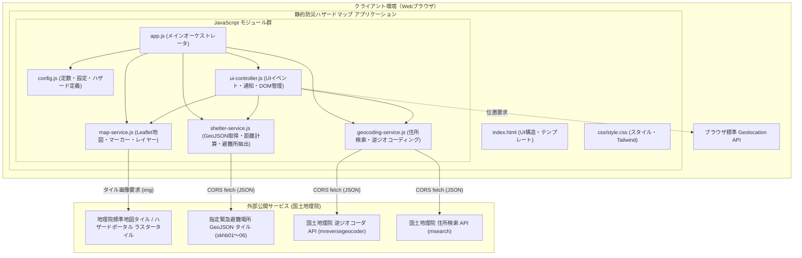
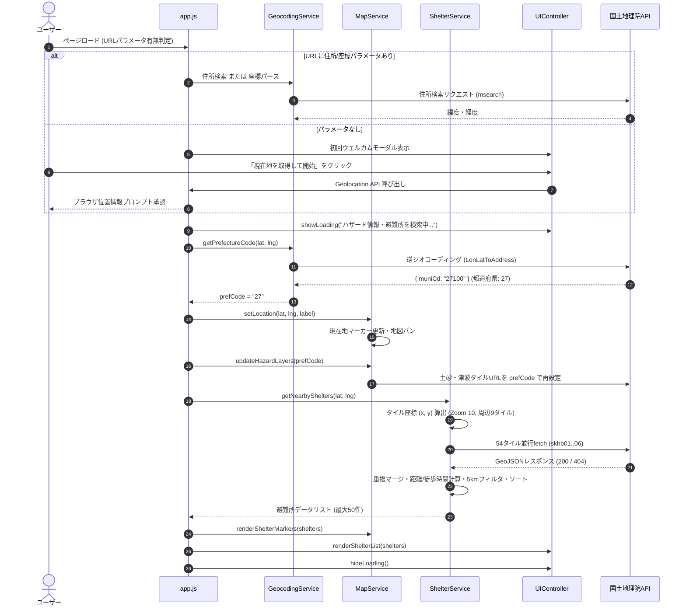

# システムアーキテクチャ設計書: 防災ハザードマップ & 避難場所表示 静的HTMLアプリケーション

本書は、従来の Google Apps Script (GAS) ベースのハザードマップWebアプリケーションから、バックエンド依存を完全に排除し、ブラウザ上でスタンドアロンかつ安全に動作する「静的HTMLアプリケーション」へと移行するためのシステムアーキテクチャ設計書である。

---

## 1. 要件定義サマリー

### 1.1 背景と移行の目的
従来のシステムは、Google Apps Script (GAS) 上で動作し、スプレッドシート（ユーザーマスタ）との連携やサーバー側ジオコーディング（Google Maps Geocoder）、スクリプトプロパティへの依存を前提としていた。
今回の移行では、**ユーザーマスター連携およびGASバックエンドコードを完全に撤廃**し、GitHub Pages、AWS S3、Cloudflare Pagesなどの静的ホスティング環境、あるいはローカルブラウザ環境（HTTPサーバー/ローカル環境）で単独動作する軽量かつ高可用なWebアプリケーションとして再構築する。

### 1.2 機能要件 (Functional Requirements)
- **FR-1: 地図基本表示機能**
  - Leaflet.js を利用したインタラクティブな日本地図の表示。
  - 国土地理院標準地図タイル（`https://cyberjapandata.gsi.go.jp/xyz/std/{z}/{x}/{y}.png`）をベースマップとしてレンダリング。
  - デフォルト表示位置として新大阪駅周辺（緯度: 34.72631588753036, 経度: 135.49736241752382, ズーム: 14）を設定。
- **FR-2: 災害リスクレイヤー重畳機能（国土地理院ハザードマップタイル）**
  - 洪水浸水想定区域（浸水深）レイヤーのON/OFF切り替え表示。
  - 土砂災害警戒区域レイヤーのON/OFF切り替え表示（都道府県別タイル対応）。
  - 津波浸水想定区域レイヤーのON/OFF切り替え表示（都道府県別タイル対応）。
  - 各ハザード情報の凡例（浸水深ランク、土砂警戒区域種別等）のサイドバー表示。
- **FR-3: 現在地取得機能 (Geolocation API)**
  - ブラウザの `navigator.geolocation.getCurrentPosition` による高精度位置情報取得。
  - 初回アクセス時のウェルカムモーダルによる位置情報取得の選択（取得して開始 / スキップして初期位置で開始）。
  - ヘッダーの「現在地を取得」ボタンによる随時取得。
  - 取得失敗（拒否、タイムアウト、非対応等）時の適切なトースト通知とフォールバック。
- **FR-4: 周辺指定緊急避難場所の自動取得・計算機能**
  - 中心座標に基づき、Zoom 10 のタイル座標（中心＋周囲8タイルの計9タイル）を算出。
  - 6つの災害種別（洪水: skhb01, 土砂: skhb02, 高潮: skhb03, 地震: skhb04, 津波: skhb05, 火事: skhb06）の国土地理院GeoJSONタイル（計54リクエスト）をクライアントサイドから直接非同期並行取得。
  - 避難所データの重複統合（同一名称・近接座標のレコードをマージし、対応災害種別を結合）。
  - 中心地点からの直線距離（大円距離 / Haversine式）および道なり推定距離（迂回係数 1.25倍）の算出。
  - 徒歩所要時間（分速 80m 基準、切り上げ）の算出。
  - 検索半径 5km 以内の避難所を徒歩所要時間の昇順でソートし、最大50件を抽出。
- **FR-5: 避難所種別（一般 / 福祉・要配慮者優先）の識別・視覚化**
  - プロパティ（`welfare`, `is_welfare`, `remarks`）および施設名称キーワード（「福祉」「介護」「デイサービス」「障がい」等）による福祉避難所の自動判定。
  - 地図上マーカーの色分け（一般: 青色、福祉: 紫色＋二重リング）およびアイコン差別化。
  - サイドバー一覧での視覚的バッジ表示（一般避難場所 / 要介護・要配慮者優先）。
- **FR-6: 詳細ポップアップおよび連携ハイライト**
  - マーカークリック時に、避難所名称、住所、対応災害種別、徒歩所要時間・距離を表示するポップアップを展開。
  - サイドバーの避難所カードクリック時に、該当避難所へ地図をセンタリングし、ポップアップを自動展開。
- **FR-7: 都道府県コードの自動特定（逆ジオコーディング）**
  - 土砂災害および津波レイヤーに必要なJIS都道府県コード（2桁）を、国土地理院逆ジオコーダAPI（`mreversegeocoder`）により座標から自動判定。
  - 判定結果に応じて動的にハザードタイルのURLを再構築。
- **FR-8: 住所・キーワード検索機能（新規クライアントサイド機能）**
  - 国土地理院 住所検索API（`msearch`）を利用し、ヘッダーの検索入力から任意の住所・ランドマークへのジャンプを実現。
  - URLクエリパラメータ解析による初期位置指定（`?address=...` または `?lat=...&lng=...&zoom=...`）のサポート。
- **FR-9: 表示確認用サンプル地点ジャンプ**
  - 「大阪淀川（洪水）」「北海道札幌手稲（土砂）」「広島八木（土砂）」「静岡三保（津波）」へのワンクリック移動および対応レイヤーの自動有効化。
- **FR-10: ユーザーマスター関連の完全削除（削除要件）**
  - `UserService.gs`、`AdminService.gs`、スプレッドシート接続処理の完全撤廃。
  - ヘッダーのユーザー情報バッジ（`#user-badge`）の削除。
  - GAS特有のテンプレートタグ（`<?= ... ?>` 等）および `google.script.run` 呼び出しの完全排除。

### 1.3 非機能要件 (Non-Functional Requirements)
- **NFR-1: ポータビリティ・サーバーレス動作**
  - サーバーサイド実行環境を一切必要とせず、最新のモダンブラウザ（Chrome, Edge, Safari, Firefox）で100%クライアントサイド完結して動作すること。
- **NFR-2: 外部コスト・キー管理ゼロ**
  - 有料API（Google Maps Platform等）や認証キーが不要であり、国土地理院が提供する公式オープンデータおよびAPI（CORS対応）のみで完結すること。
- **NFR-3: 描画パフォーマンスとネットワーク効率**
  - 54タイルのGeoJSON取得において、ブラウザの同時接続制限（同一オリジン最大6多重）を考慮した並行制御およびインメモリキャッシュを導入し、避難所計算を原則2〜3秒以内に完了させること。
  - 避難所データがないタイルの 404 Not Found を正常系（該当なし）として適切にハンドリングし、コンソールエラーや処理停止を防ぐこと。
- **NFR-4: 耐障害性とフォールバック**
  - オフライン時、位置情報取得拒否時、外部APIエラー時でも地図操作がブロックされず、Sharedライブラリ思想に準拠した非同期トーストやエラーメッセージでユーザーに状態を通知すること。
- **NFR-5: レスポンシブUI & アクセシビリティ**
  - Tailwind CSSを活用し、デスクトップ（サイドバー常時表示・スプリットビュー）およびスマートフォン（ドロワー開閉式）の双方で最適に閲覧・操作できること。
- **NFR-6: 保守性と関心の分離**
  - スパゲッティコード化を防ぐため、設定（Config）、地図描画（MapService）、データ取得・計算（ShelterService）、ジオコーディング（GeocodingService）、UI制御（UIController）のモジュール分離設計を徹底すること。

### 1.4 前提条件と制約事項
- **前提条件**:
  - 国土地理院のタイル配信サーバーおよび検索APIがCORS（`Access-Control-Allow-Origin: *`）を継続して許可していること（事前検証によりヘッダー送出を確認済み）。
- **制約事項**:
  - ブラウザのセキュリティ仕様により、`navigator.geolocation` は安全なコンテキスト（`https://` または `http://localhost`）でのみ動作する。ローカルの `file://` プロトコル等で開いた場合は位置情報取得が拒否されるため、フォールバック（デフォルト位置表示および住所検索）が正しく機能する必要がある。

### 1.5 不明点・ブロッキング事項
- **ブロッキング事項**: なし（全依存APIのCORS適合性、データ形式、アルゴリズム互換性を検証完了）。

---

## 2. システム境界とコンポーネント構成

### 2.1 システム境界 (System Boundary)
本システムは、ブラウザ内のシングルページアプリケーション（SPA）として動作し、外部システムとの通信は国土地理院の公開HTTP/HTTPSエンドポイントに対するGETリクエストのみで構成される。



### 2.2 各コンポーネントの責務

| コンポーネント | ファイルパス | 主な責務 |
| :--- | :--- | :--- |
| **HTML View** | `index.html` | アプリケーションの骨格構造。ヘッダー（検索バー・現在地ボタン）、サイドバー（レイヤー切替・凡例・サンプル移動・避難所リスト）、地図コンテナ、モーダル、トースト、ローディングオーバーレイのDOM要素を定義。 |
| **Stylesheet** | `css/style.css` | カスタムスクロールバー、Leaflet地図コンテナの全画面調整、アニメーションパルスピン、福祉避難所マーカー等のカスタムスタイル定義。 |
| **Config & State** | `js/config.js` | アプリケーション全体の定数（歩行速度、迂回係数、検索半径、初期座標、タイルURLテンプレート、都道府県コードマッピング、災害種別コード、福祉キーワード等）の一元管理。 |
| **UI Controller** | `js/ui-controller.js` | DOM操作、サイドバーの開閉、全画面ローディング表示/非表示（Sharedライブラリ思想）、トースト通知制御、避難所カードリストの描画、初期モーダルの制御。 |
| **Map Service** | `js/map-service.js` | Leaflet `L.map` インスタンスの生成・管理、ベースタイルおよびハザードレイヤーの生成・重畳・破棄、現在地マーカーおよび避難所マーカー群（一般/福祉アイコン）のプロット、ポップアップ連携。 |
| **Shelter Service** | `js/shelter-service.js` | 緯度経度からZoom 10タイル座標の計算、周辺9タイル×6種別（計54リクエスト）の非同期バッチ取得、タイルのインメモリキャッシュ、重複避難所マージ、大円距離・道なり距離・徒歩時間計算、福祉避難所判定、5km圏内ソート・上位50件抽出。 |
| **Geocoding Service**| `js/geocoding-service.js`| 国土地理院住所検索APIを用いた住所から緯度経度への変換、および国土地理院逆ジオコーダAPI（`LonLatToAddress`）を用いた自治体コード（muniCd）からのJIS都道府県コード（2桁）特定。 |
| **Application Main** | `js/app.js` | エントリポイント。URLパラメータの解析、初期化フローの調停、ユーザー操作（検索、現在地取得、サンプル地点移動）のイベントハンドラ連携とライフサイクル管理。 |

### 2.3 外部依存関係一覧

| 依存名称 | バージョン / URL | 用途 | 導入形態 |
| :--- | :--- | :--- | :--- |
| **Leaflet.js** | v1.9.4 | 地図レンダリング・タイル重畳・マーカー操作 | CDN (`unpkg.com`) |
| **Tailwind CSS** | v3.x | UIスタイリング（ユーティリティファースト） | CDN (`cdn.tailwindcss.com`) |
| **FontAwesome** | v6.4.0 | UIアイコン（シールド、車椅子、波、山等） | CDN (`cdnjs.cloudflare.com`) |
| **国土地理院 標準タイル** | `cyberjapandata.gsi.go.jp/xyz/std/{z}/{x}/{y}.png` | ベースマップ表示 | HTTP(S) レスポンス |
| **国土地理院 ハザードタイル** | `disaportaldata.gsi.go.jp/raster/...` | 洪水・土砂・津波レイヤー | HTTP(S) レスポンス |
| **国土地理院 GeoJSONタイル** | `cyberjapandata.gsi.go.jp/xyz/skhb01..06/...` | 指定緊急避難場所データ | CORS fetch |
| **国土地理院 逆ジオコーダ** | `mreversegeocoder.gsi.go.jp/reverse-geocoder/...` | 座標→都道府県コード特定 | CORS fetch |
| **国土地理院 住所検索API** | `msearch.gsi.go.jp/address-search/AddressSearch` | 住所・施設名→座標変換 | CORS fetch |

---

## 3. データフローとインターフェース

### 3.1 主要データフロー

#### (1) 初期化・現在地特定データフロー


### 3.2 避難所データパイプラインの詳細仕様
1. **タイル座標変換**:
   $$n = 2^{10} = 1024$$
   $$x = \lfloor \frac{\text{lng} + 180}{360} \times n \rfloor$$
   $$y = \lfloor \frac{1 - \ln(\tan(\text{latRad}) + \frac{1}{\cos(\text{latRad})}) / \pi}{2} \times n \rfloor$$
2. **タイル範囲**:
   中心タイル $(x, y)$ に対し、$\Delta x \in \{-1, 0, 1\}, \Delta y \in \{-1, 0, 1\}$ の9タイル。
3. **カテゴリ展開**:
   各タイルに対して 6 種別（`skhb01`〜`skhb06`）の計 54 URL を構築。
4. **取得と耐障害性**:
   - `fetch()` を `Promise.allSettled()` で並行実行。
   - HTTP 404 は「当該タイルに対象避難所が存在しない」正常状態として空配列として処理。
   - ネットワーク一時エラー時はコンソール警告にとどめ、取得できたタイルのみで処理を継続。
5. **重複判定キー**:
   `key = ${name}_${lat.toFixed(5)}_${lng.toFixed(5)}`
   同一キーが存在する場合、対応カテゴリ（例: `['洪水', '地震']`）をマージ。
6. **距離・時間計算**:
   - 直線距離 $D_{\text{direct}}$: Haversine 式（地球半径 $R = 6371 \text{ km}$）。
   - 徒歩推定距離 $D_{\text{walk}} = D_{\text{direct}} \times 1.25$（迂回係数）。
   - 徒歩所要時間 $T_{\text{walk}} = \lceil \frac{D_{\text{walk}} \times 1000}{80} \rceil$（分速80m、分単位切り上げ）。
   - フィルタリング: $D_{\text{direct}} \le 5.0 \text{ km}$。
   - ソート: $D_{\text{walk}}$ 昇順、上位50件。

### 3.3 主要インターフェース定義

#### データ型定義 (TypeScript 風定義)
```typescript
/** 避難所データ構造 */
interface ShelterData {
  name: string;             // 施設・避難所名称
  address: string;          // 所在地住所
  lat: number;              // 緯度
  lng: number;              // 経度
  directDistance: number;   // 直線距離 (km, 小数第2位)
  walkingDistance: number;  // 推定徒歩距離 (km, 小数第2位)
  walkingMinutes: number;   // 推定徒歩所要時間 (分)
  category: string;         // 対応災害種別表示文字列 (例: "洪水・土砂・津波 対応")
  categories: string[];     // 対応災害種別配列
  isWelfare: boolean;       // 福祉避難所フラグ
  targetNote: string;       // 対象者補足 (一般避難者対象 / 要介護者・要配慮者優先)
}

/** ジオコーディング結果 */
interface GeocodingResult {
  lat: number;              // 緯度
  lng: number;              // 経度
  title: string;            // 検索該当住所・地名
  prefCode: string;         // JIS都道府県コード (2桁, 例: "27")
}

/** アプリケーション設定オブジェクト */
interface AppConfig {
  WALKING_SPEED_MPM: number;        // 徒歩分速 (80 m/分)
  CIRCUITY_FACTOR: number;          // 迂回係数 (1.25)
  DEFAULT_LAT: number;              // デフォルト緯度 (34.726315...)
  DEFAULT_LNG: number;              // デフォルト経度 (135.497362...)
  DEFAULT_ZOOM: number;             // デフォルトズーム (14)
  DEFAULT_PREF_CODE: string;        // デフォルト都道府県コード ('27')
  MAX_SEARCH_RADIUS_KM: number;     // 最大検索半径 (5 km)
  MAX_SHELTER_DISPLAY_COUNT: number;// 最大表示件数 (50 件)
  TILE_URLS: {
    std: string;
    flood: string;
    sediment: string;
    tsunami: string;
    shelterGeoJson: string;
  };
  HAZARD_CATEGORIES: Array<{ type: string; code: string }>;
  WELFARE_KEYWORDS: string[];
}
```

#### モジュールインターフェース
```javascript
// js/geocoding-service.js
export class GeocodingService {
  /** 住所文字列から座標および都道府県コードを取得 */
  static async geocode(address: string): Promise<GeocodingResult | null>;
  /** 緯度経度からJIS都道府県コード(2桁)を取得 */
  static async reverseGeocodePrefCode(lat: number, lng: number): Promise<string>;
}

// js/shelter-service.js
export class ShelterService {
  /** 中心座標から周辺避難所データを取得・計算して返却 */
  static async getNearbyShelters(lat: number, lng: number, maxRadiusKm?: number): Promise<ShelterData[]>;
}

// js/map-service.js
export class MapService {
  /** 地図初期化 */
  static initMap(containerId: string, initialCoords: [number, number], initialZoom: number): void;
  /** ハザードレイヤーの都道府県コード再構築 */
  static updateHazardLayers(prefCode: string): void;
  /** ハザードレイヤーの表示切り替え */
  static toggleHazardLayer(type: 'flood' | 'sediment' | 'tsunami', visible: boolean): void;
  /** 中心地点マーカー配置と地図移動 */
  static setLocationMarker(lat: number, lng: number, label: string, zoom?: number): void;
  /** 避難所マーカー群の再描画 */
  static renderShelterMarkers(shelters: ShelterData[], onMarkerClick?: (shelter: ShelterData) => void): void;
  /** 特定避難所のフォーカスとポップアップ展開 */
  static focusShelter(shelter: ShelterData): void;
}

// js/ui-controller.js
export class UIController {
  /** ローディング表示 (Sharedライブラリ思想) */
  static showLoading(message?: string): void;
  /** ローディング非表示 */
  static hideLoading(): void;
  /** トースト通知表示 (メッセージ, エラー判定, 自動非表示ms) */
  static showToast(message: string, isError?: boolean, autoHideMs?: number): void;
  /** 避難所リストカード描画 */
  static renderShelterList(shelters: ShelterData[], onCardClick: (shelter: ShelterData) => void): void;
  /** サイドバー開閉 */
  static toggleSidebar(): void;
}
```

---

## 4. アーキテクチャ上の決定事項 (ADR)

### ADR-01: クライアントサイド完結型 SPA（静的HTML）の採用
- **決定**: GAS（Google Apps Script）やNode.jsなどのサーバーサイド実行系を全廃し、HTML/CSS/Vanilla JavaScriptで完結する静的SPAアーキテクチャを採用する。
- **理由**:
  1. ユーザー要望「ハザードマップを静的HTMLのアプリに変更」「ユーザーマスターは完全に削除」に直結する。
  2. サーバーサイドの維持コスト・認証管理が不要となり、GitHub PagesやローカルWebサーバーで即座にホスト可能。
  3. 国土地理院が提供する地図・ハザードタイルおよびAPIが全てCORS（`Access-Control-Allow-Origin: *`）に対応しているため、サーバー中継プロキシを設ける技術的必然性がない。
- **検討した代替案**:
  - 代替案A: ExpressやFastAPIなどの軽量BFF（Backend for Frontend）を構築し、避難所データ取得をサーバー側で集約する。
  - 代替案B: AWS Lambda等のサーバーレス関数でプロキシする。
- **トレードオフ**:
  - クライアント端末から54リクエストのGeoJSON fetchが実行されるため端末通信量が増加するが、GeoJSONタイルは1ファイル数KB〜数十KB程度であり、ブラウザによる並行取得で十分高速（実測1〜2秒以内）に処理可能。
- **結果・影響**:
  - `UserService.gs`, `AdminService.gs`, `Main.gs`, `user-badge` などのバックエンド依存コードを100%削除。
  - セキュリティリスク（APIキー漏洩やスプレッドシートへのアクセス権限管理）が完全に解消。

### ADR-02: 国土地理院公式オープンAPIによる無料・キーレスジオコーディング
- **決定**: Google Geocoding API等の外部商用サービスを使用せず、国土地理院が提供する公式オープンAPI（住所検索: `msearch.gsi.go.jp`, 逆ジオコーダ: `mreversegeocoder.gsi.go.jp`）を採用する。
- **理由**:
  1. APIキーの管理およびクライアントサイドへの露出リスクがゼロになる。
  2. 利用料金が発生せず、永続的に無料・無登録で運用可能。
  3. 日本国内の公的住所体系に完全に特化しており、高い精度でJIS都道府県コードおよび座標を取得可能。
  4. 事前検証により、ブラウザからのCORSアクセスが完全に許可されていることを確認済み。
- **検討した代替案**:
  - 代替案A: OpenStreetMap Nominatim（無料だが利用規約で毎秒1リクエスト制限があり、商用・多頻度利用にリスク）。
  - 代替案B: Google Maps Geocoding API（APIキー露出、月額課金枠の超過リスク）。
- **トレードオフ**:
  - 住所表記揺れに対する曖昧検索能力は商用Google Mapsに比べて限定される場合があるが、一般的な市町村名・町名・主要ランドマークは十分にヒットする。
- **結果・影響**:
  - 外部サービスとの契約や設定が不要となり、完全なスタンドアロン動作が保証される。

### ADR-03: 避難所タイルの並行取得制御とインメモリキャッシュ
- **決定**: 周辺9タイル×6種別（計54URL）のGeoJSON取得に `Promise.allSettled()` による並行非同期処理を導入し、さらにURL単位のインメモリキャッシュ（`Map<string, GeoJSON>`）を保持する。
- **理由**:
  1. シーケンシャル（順次）取得では数秒〜十数秒要するが、ブラウザのHTTP/2多重化・並行接続により1〜2秒以内で完了可能。
  2. 国土地理院タイルは避難所が存在しない地域において HTTP 404 を返却する仕様であるため、`allSettled` で正常ステータス以外を安全にスキップする耐障害性が必要。
  3. 同一地点での再計算や近接地点への移動時にキャッシュを活用し、無駄な外部トラフィックを抑制する。
- **検討した代替案**:
  - 代替案A: 単一の大きな避難所マスターGeoJSON（全国版）をアプリ起動時に一括ダウンロードする。
    → 全国データは数十MB以上あり、初期ロード時間とメモリを著しく圧迫するため不適。
- **トレードオフ**:
  - 初回検索時に短時間のネットワークバーストが発生するが、ユーザーには「避難所データを計算中...」のスピナーを明示することでUXを担保。
- **結果・影響**:
  - 高速な避難所検索と安定したエラー処理の両立。

### ADR-04: ディレクトリ構成とモジュール分割
- **決定**: 1つの巨大な `index.html` にインライン記述するのではなく、関心の分離に基づき以下のファイル構造に分割する。
  ```text
  HazardMap-app/
  ├── index.html              # UI構造・DOM
  ├── css/
  │   └── style.css           # カスタムCSS
  ├── js/
  │   ├── config.js           # 定数・設定・URL
  │   ├── geocoding-service.js # 住所検索・逆ジオコーダ
  │   ├── map-service.js      # Leaflet地図操作
  │   ├── shelter-service.js  # 避難所GeoJSON取得・計算
  │   ├── ui-controller.js    # DOM・トースト・ローディング制御
  │   └── app.js              # メイン調停ロジック
  └── docs/
      └── architecture.md     # 本設計書
  ```
- **理由**:
  1. シニアコーダー、QAエンジニア、コードレビュアーが各責務ごとに独立して検証・テスト可能。
  2. 将来的な機能追加（例: 印刷機能、別レイヤー追加）における保守性を最大化。
- **検討した代替案**:
  - 代替案A: Vite/Webpack等のビルドツールを導入しTypeScript + バンドル構成にする。
    → 本要件は「静的HTMLアプリ」であり、ビルド不要で直接ブラウザで動かせる簡便さを重視するため、標準ES Modules（またはグローバル名前空間連携）を採用。
- **トレードオフ**:
  - 複数ファイル構成となるが、静的Webサーバー環境で自然に読み込める標準的なWeb標準に準拠。
- **結果・影響**:
  - 高凝集・低結合で透明性の高いコードベースの実現。

---

## 5. 品質特性に関する考慮事項

### 5.1 セキュリティ (Security)
- **APIキー漏洩リスクの完全排除**:
  - 外部の商用APIキーを一切保持・使用しないため、クライアントサイドでの秘密情報漏洩リスクが根本的に存在しない。
- **XSS（クロスサイトスクリプティング）対策**:
  - 避難所名称、住所、URLパラメータからの入力値などをDOMに描画する際は、必ず `textContent` または適切なHTMLエスケープ関数を介して挿入し、悪意あるスクリプト注入を防止する。
- **セキュア通信**:
  - 国土地理院を含むすべての外部エンドポイントへの通信は HTTPS を強制する。

### 5.2 スケーラビリティ (Scalability)
- **サーバー負荷ゼロ**:
  - 自前サーバーが存在しないため、アクセス集中によるサーバースケールアウトの課題やダウンタイムが存在しない。
- **クライアント計算量の最適化**:
  - 避難所の検索範囲を5km圏内に絞り込み、画面描画対象を上位50件に制限することで、モバイル端末のDOMツリー肥大化および描画カクつき（ジャンク）を防止する。

### 5.3 信頼性と耐障害性 (Reliability & Fault Tolerance)
- **国土地理院 404 ハンドリング**:
  - 存在しないGeoJSONタイルの404応答を正常系（データなし）として吸収し、UIエラーを発生させない。
- **位置情報フォールバック**:
  - Geolocation APIが拒否された場合、エラーをトースト通知し、即座にデフォルト座標（新大阪駅）で地図を描画する。
- **逆ジオコーダ障害時のフォールバック**:
  - `mreversegeocoder` APIが不達またはエラーとなった場合は、デフォルト都道府県コード（`27`: 大阪府）または直前の都道府県コードを維持し、地図表示自体を止めない。

### 5.4 保守性 (Maintainability)
- **定数・URLの一元管理**:
  - タイルURLテンプレート、徒歩計算パラメータ（80m/分、迂回係数1.25）、ハザード種別一覧はすべて `js/config.js` に集約し、仕様変更時に1箇所のみの修正で対応可能とする。
- **JSDocコメントの整備**:
  - 各関数・クラス・パラメータにJSDocコメントを付与し、引数の型と責務を明文化する。

---

## 6. 受け入れ基準 (Acceptance Criteria)

- [ ] **AC-1: サーバー非依存の完全静的動作**
  - Webサーバーバックエンド（GAS、Node.js等）を起動することなく、静的HTMLおよび関連JS/CSSファイルをブラウザで読み込むだけで正常に動作すること。
- [ ] **AC-2: ユーザーマスター関連の完全削除**
  - 画面上にユーザー名バッジ（`#user-badge`）や部署名等のユーザー情報が表示されないこと。
  - ソースコード内に `UserService.gs`, `AdminService.gs`, `google.script.run`, スプレッドシート連携コードが一切残存していないこと。
- [ ] **AC-3: 国土地理院地図およびハザードレイヤーの重畳表示**
  - 初期表示で国土地理院標準地図が表示されること。
  - 「洪水」「土砂」「津波」のチェックボックス操作により、対応するハザードタイルが正しく地図上に重畳・非表示されること。
- [ ] **AC-4: 都道府県コードの自動判別とレイヤー反映**
  - 異なる都道府県（例: 北海道、広島、静岡）に移動した際、逆ジオコーディングにより都道府県コードが正しく取得され、土砂災害・津波レイヤーが該当都道府県のタイルに切り替わること。
- [ ] **AC-5: 現在地取得と初期モーダル**
  - 初回アクセス時に位置情報確認モーダルが表示され、「現在地を取得して開始」で現在地周辺へジャンプすること。
  - 「現在地を取得せずに開始」でデフォルト位置（新大阪駅周辺）が表示されること。
  - ヘッダーの「現在地を取得」ボタンで随時現在地を再取得できること。
- [ ] **AC-6: 避難所データの取得・距離計算・一覧表示**
  - 指定地点周辺の避難所GeoJSONタイルがCORSエラーなく取得できること。
  - 徒歩距離（直線×1.25）および徒歩所要時間（分速80m）が正しく計算され、徒歩所要時間順にソートされた避難所一覧がサイドバーに表示されること（最大50件）。
- [ ] **AC-7: 福祉避難所・一般避難所の視覚的分離**
  - 福祉避難所と一般避難所がピンアイコンおよび色（紫/青）で明確に区別されて地図上に表示されること。
  - サイドバー一覧でも「要介護・要配慮者優先」バッジが表示されること。
- [ ] **AC-8: インタラクティブ連携**
  - 地図上の避難所マーカーをクリックすると詳細情報ポップアップが表示されること。
  - サイドバーの避難所カードをクリックすると、地図が該当避難所にパンしポップアップが開くこと。
- [ ] **AC-9: 住所検索機能**
  - ヘッダーの検索バーに住所や地名を入力して検索した際、国土地理院住所検索APIを通じて該当地点へスムーズに移動し、周辺避難所が再計算されること。
- [ ] **AC-10: サンプル地点ジャンプ機能**
  - 「大阪淀川」「北海道札幌」「広島八木」「静岡三保」の各テストボタンをクリックすると、該当地点に移動し、適切なハザードレイヤーが自動有効化されること。
