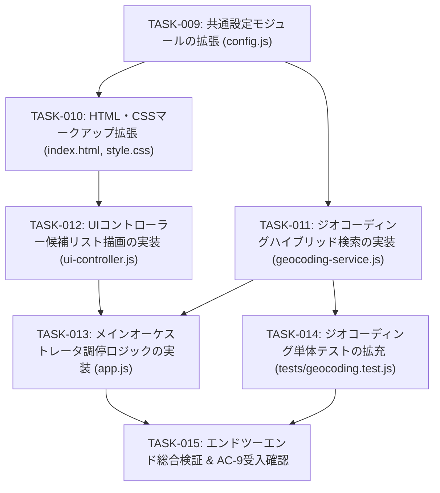

# 実装計画・タスク仕様書: 防災ハザードマップ & 避難場所表示 静的HTMLアプリケーション
## （第2版: ジオコーディング高精度化 & 候補選択UI拡張）

本書は、システムアーキテクチャ設計書（`docs/architecture.md`）の改訂内容（ADR-05, ADR-06, 受け入れ基準 AC-9）に基づき、シニアコーダーが迷わず実装に着手できるよう、技術的レビュー所見、詳細インターフェース仕様、テスト戦略、および段階的な実装タスク仕様を定義した技術計画書である。

初版（TASK-001〜TASK-008）にて稼働中の完全静的SPA基盤を維持・保護しつつ、「検索ボタン押下時に意図しない遠隔地（例: 新宿駅で山形県朝日町新宿）へ誤ジャンプする問題」を抜本解決するための具体的な実装タスク（TASK-009〜TASK-015）を定義する。

---

## 1. アーキテクチャレビュー所見

### 1.1 実現可能性評価 (Feasibility Assessment)
- **総合判定**: **【極めて高い（Go）】**
- **理由**:
  1. **外部APIのCORS適合性とキーフリー運用**:
     - 国土地理院住所検索API（`msearch.gsi.go.jp`）に加え、補完採用する OpenStreetMap (OSM) Nominatim API（`https://nominatim.openstreetmap.org/search`）もブラウザからの直接 CORS GET リクエスト（`Access-Control-Allow-Origin: *`）を公式に許可している。
     - 有料APIや個人APIキーを一切必要とせず、完全静的・クライアント完結の基本原則（ADR-01, ADR-02, NFR-1, NFR-2）を完全に遵守可能である。
  2. **スマートリランキングの計算量**:
     - 検索候補数は国土地理院API（最大10件）とOSM Nominatim API（最大5件）を合わせて最大15件程度である。
     - 文字列一致度、階層スコア、距離ペナルティのスコア算出・ソート処理は $O(N \log N)$（$N \le 15$）であり、クライアントサイドのJavaScript実行環境において数ミリ秒未満で即時完了する。
  3. **UI/UXコンポーネントの軽量性**:
     - 検索バー直下に展開する候補リストドロップダウンは、既存の Tailwind CSS と Vanilla DOM API のみで完全に制御可能であり、外部UIライブラリの追加なしで高い応答性を実現できる。

### 1.2 留意事項・技術リスク (Technical Risks & Mitigations)
1. **OSM Nominatim API 利用規約（Fair Use Policy）の厳格遵守**:
   - **リスク**: Nominatim API には「最大 1 リクエスト/秒（1 req/sec）」という厳格な利用規約がある。リアルタイムなインクリメンタルサジェスト（キー入力ごとの通信）を行うと、IP一時遮断（HTTP 429 / 403）を招くリスクがある。
   - **対策**: インクリメンタルサジェストは一切導入せず、ユーザーが明示的に「検索ボタンを押下」または「Enterキーを押下」したタイミングでのみリクエストを発行する。また、連続連打を防止するため、検索実行中は検索ボタンを即時 `disabled` 化しスピナーを表示する。
2. **座標・プロパティ構造の差異（GSI vs OSM）の吸収**:
   - **リスク**: 国土地理院APIは GeoJSON 形式で `coordinates: [経度, 緯度]`（数値配列）だが、OSM Nominatim API は JSON 形式で `lat`, `lon` が文字列（`"lat": "35.690921"`, `"lon": "139.700258"`）で返却される。
   - **対策**: 各APIアダプタでレスポンスを共通インターフェース `GeocodingCandidate` に正規化・変換する際、`parseFloat()` による確実な数値化と NaN ガードを実施し、緯度・経度の逆転バグを防止する。
3. **API部分障害時の耐障害性（片肺運転の保証）**:
   - **リスク**: ネットワーク不安定や外部サーバー障害により、国土地理院またはOSMのどちらか一方がタイムアウト・500エラーになる可能性がある。
   - **対策**: `Promise.allSettled()` による並行非同期取得を採用し、一方のAPIが失敗しても他方の取得結果のみで候補リストを生成して処理を継続する。両方とも失敗した場合のみ通信エラーの案内を表示し、地図の現在位置を維持する。
4. **XSS（クロスサイトスクリプティング）の完全防止**:
   - **リスク**: 外部APIから取得した地名や詳細住所文字列に悪意あるHTMLタグやスクリプトが混入している場合、DOM描画時にXSS脆弱性となる恐れがある。
   - **対策**: ドロップダウンへの候補テキスト挿入時は、`UIController.escapeHtml()` を適用するか、DOM要素の `textContent` プロパティを使用してレンダリングし、HTMLインジェクションを根本遮断する。

### 1.3 アーキテクトへのエスカレーション有無
- **エスカレーション**: **【なし（仕様合意済み）】**
  - システムアーキテクチャ設計書の改訂方針（ADR-05, ADR-06, 受け入れ基準 AC-9）に矛盾や未定義事項はなく、本計画書にて具体的なタスクとインターフェース仕様を確定することで、シニアコーダーが安全かつ確実に実装可能である。

---

## 2. 影響範囲・変更対象ファイル一覧

### 2.1 変更対象ファイル一覧

```text
HazardMap-app/
├── js/
│   ├── config.js               # [変更] OSMエンドポイント、検索リランキング係数、候補件数定数の追加
│   ├── geocoding-service.js    # [変更] search()新設、ハイブリッド取得、リランキング、geocode()互換維持
│   ├── ui-controller.js        # [変更] 候補ドロップダウン描画、開閉制御、検索スピナー制御の追加
│   └── app.js                  # [変更] 検索イベント調停、確度別分岐、ドロップダウン連携、ESC/外側クリック制御
├── index.html                  # [変更] 検索バー直下への候補ドロップダウンコンテナ、スピナーDOMの配置
├── css/style.css               # [変更] 検索候補ドロップダウンのフローティング・スクロール・ホバースタイル追加
└── tests/
    └── geocoding.test.js       # [変更] search()単体テスト、スマートリランキング、高確度判定、互換性テスト追加
```

### 2.2 依存関係・後方互換性への考慮事項
- **`GeocodingService.geocode(address)` の後方互換性の維持**:
  - 既存のテストコード（`tests/geocoding.test.js`）や他モジュールからの呼び出しを壊さないため、`geocode(address)` メソッドのシグネチャおよび戻り値型（`Promise<{ lat, lng, title, prefCode } | null>`）を完全に維持する。
  - 内部実装としては、新設する `search(address)` を呼び出し、スコア最上位の候補1件を既存形式に適合させて返却するラッパーとして機能させる。
- **他サービスモジュールへの影響の局所化**:
  - `MapService`（地図・レイヤー・ピン描画）および `ShelterService`（GeoJSONタイル取得・避難所計算）のインターフェース変更は一切行わない。
  - 検索結果が単一自動選択された場合も、ユーザーがドロップダウンから選択した場合も、最終的には既存の `App.updateLocation(lat, lng, label, zoom, prefCode)` に座標を引き渡すため、避難所計算やハザードレイヤーの連動ロジックに影響を与えない。

---

## 3. インターフェース・データ構造仕様

### 3.1 データ構造仕様

#### (1) ジオコーディング候補オブジェクト (`GeocodingCandidate`)
```typescript
interface GeocodingCandidate {
  id: string;               // 一意な識別子 (例: "gsi_0", "osm_node_123456")
  title: string;            // 主要名称 (例: "新宿駅", "東京都新宿区")
  address: string;          // 詳細住所または構成地名 (例: "東京都新宿区新宿三丁目", "山形県西村山郡朝日町新宿")
  lat: number;              // 緯度 (数値)
  lng: number;              // 経度 (数値)
  prefCode: string;         // JIS都道府県コード2桁 (例: "13")
  source: 'gsi' | 'osm';    // 提供元API ('gsi': 国土地理院, 'osm': OpenStreetMap)
  distanceKm: number | null;// 現在地図中心からの直線距離 (km, 小数第1位)。中心未指定時は null
  score: number;            // 総合スコアリング値
  isHighConfidence: boolean;// 高確度フラグ (完全一致かつスコア閾値以上)
}
```

#### (2) ジオコーディング検索オプション (`GeocodingOptions`)
```typescript
interface GeocodingOptions {
  centerLat?: number;       // 距離バイアス計算用中心緯度 (現在の地図中心または現在地)
  centerLng?: number;       // 距離バイアス計算用中心経度
  maxResults?: number;      // 最大返却件数 (デフォルト: APP_CONFIG.MAX_SEARCH_CANDIDATES = 5)
  enableFallback?: boolean; // OSM Nominatim 補完の有効/無効 (デフォルト: true)
}
```

#### (3) アプリケーション設定への追加項目 (`APP_CONFIG` 拡張)
```javascript
// js/config.js の APP_CONFIG に以下を追加
API_ENDPOINTS: Object.freeze({
  reverseGeocode: 'https://mreversegeocoder.gsi.go.jp/reverse-geocoder/LonLatToAddress',
  addressSearch: 'https://msearch.gsi.go.jp/address-search/AddressSearch',
  osmSearch: 'https://nominatim.openstreetmap.org/search' // [新規追加]
}),

/** 検索・リランキング関連設定 */
SEARCH_CONFIG: Object.freeze({
  MAX_CANDIDATES: 5,               // ドロップダウン最大表示候補数
  HIGH_CONFIDENCE_THRESHOLD: 85,   // 単一候補時に自動ジャンプを許可する最低スコア
  WEIGHTS: Object.freeze({
    MATCH: 1.0,                    // 文字列マッチ度重み
    HIERARCHY: 1.0,                // 行政階層・主要度重み
    IMPORTANCE: 1.0,               // 知名度重み
    DISTANCE_PENALTY_MAX: 15       // 距離ペナルティ最大減点幅
  })
}),
```

---

### 3.2 モジュール別クラス・関数シグネチャ仕様

#### (1) `js/geocoding-service.js`
```javascript
export class GeocodingService {
  /**
   * クエリ文字列からスコアリング・ソート済みの候補リストを取得する (新規メソッド)
   * @param {string} query - 検索文字列
   * @param {GeocodingOptions} [options={}] - 検索オプション
   * @returns {Promise<GeocodingCandidate[]>} ソート済み候補リスト (0件時は空配列)
   */
  static async search(query, options = {}) {}

  /**
   * 後方互換メソッド: 最上位候補1件を返却する
   * @param {string} address - 検索クエリ
   * @returns {Promise<{ lat: number, lng: number, title: string, prefCode: string } | null>}
   */
  static async geocode(address) {}

  /**
   * 候補単体の総合スコアを算出する
   * @param {Object} rawCandidate - 正規化前候補情報
   * @param {string} normalizedQuery - 正規化済み検索クエリ
   * @param {number|null} centerLat - 中心緯度
   * @param {number|null} centerLng - 中心経度
   * @returns {{ score: number, distanceKm: number|null, isHighConfidence: boolean }}
   */
  static calculateCandidateScore(rawCandidate, normalizedQuery, centerLat, centerLng) {}

  /**
   * クエリ文字列の正規化（全角英数・記号の半角化、余分な空白のトリム）
   * @param {string} text
   * @returns {string}
   */
  static normalizeQuery(text) {}

  /**
   * 既存メソッド: 緯度経度からJIS都道府県コード(2桁)を取得する
   * @param {number} lat
   * @param {number} lng
   * @returns {Promise<string>}
   */
  static async reverseGeocodePrefCode(lat, lng) {}

  /**
   * 既存メソッド: 自治体コードから都道府県コード(2桁)を抽出する
   * @param {string|number} muniCd
   * @returns {string}
   */
  static extractPrefCodeFromMuniCd(muniCd) {}

  /**
   * 既存メソッド: テキスト内から都道府県名を検出する
   * @param {string} text
   * @returns {string | null}
   */
  static findPrefCodeFromText(text) {}
}
```

#### (2) `js/ui-controller.js`
```javascript
export class UIController {
  /**
   * 検索バー直下に候補一覧ドロップダウンを表示する (新規メソッド)
   * @param {GeocodingCandidate[]} candidates - 表示候補一覧
   * @param {(candidate: GeocodingCandidate) => void} onSelect - 選択時コールバック
   */
  static showSearchResults(candidates, onSelect) {}

  /**
   * 候補一覧ドロップダウンを非表示にし、DOMをクリアする (新規メソッド)
   */
  static hideSearchResults() {}

  /**
   * 検索ボタン・入力欄のローディング状態（スピナー表示・ボタン無効化）を切り替える (新規メソッド)
   * @param {boolean} isLoading
   */
  static setSearchLoading(isLoading) {}

  // ※ 既存の showLoading, hideLoading, showToast, renderShelterList, escapeHtml 等はすべて維持
}
```

#### (3) `js/app.js`
```javascript
export class App {
  /**
   * 住所・キーワード検索のオーケストレーション（改修）
   * 1. UIController.setSearchLoading(true)
   * 2. GeocodingService.search(query, { centerLat, centerLng })
   * 3. 確度判定:
   *    - candidates.length === 1 かつ isHighConfidence: 自動移動
   *    - candidates.length >= 1: UIController.showSearchResults(candidates, callback)
   *    - candidates.length === 0: トーストで0件案内と入力ヒント提示
   * 4. UIController.setSearchLoading(false)
   * @param {string} query
   */
  static async searchAddress(query) {}
}
```

---

### 3.3 DOM・HTML構造仕様 (`index.html`)

検索フォームコンテナ（`#search-form` の親ラッパー）内に、以下の構造を配置する。

```html
<!-- 住所・施設名 検索バー & 候補ドロップダウンコンテナ -->
<div class="flex-1 max-w-md mx-3 relative" id="search-container">
  <form id="search-form" class="relative flex items-center">
    <input
      type="text"
      id="search-input"
      placeholder="住所・駅名・施設名を入力して検索..."
      class="w-full pl-9 pr-10 py-1.5 text-xs sm:text-sm bg-gray-50 border border-gray-300 rounded-lg focus:outline-none focus:ring-2 focus:ring-blue-500 focus:bg-white transition"
      autocomplete="off"
      aria-autocomplete="list"
      aria-controls="search-results-dropdown"
      aria-expanded="false"
    />
    <i class="fa-solid fa-magnifying-glass absolute left-3 text-gray-400 text-xs" id="search-glass-icon"></i>
    <button
      type="submit"
      id="search-btn"
      class="absolute right-1.5 p-1 px-2.5 text-xs bg-blue-600 hover:bg-blue-700 text-white rounded font-medium transition shadow-sm flex items-center gap-1.5 disabled:opacity-60 disabled:cursor-not-allowed"
      title="検索実行"
    >
      <i class="fa-solid fa-spinner fa-spin hidden" id="search-spinner"></i>
      <span id="search-btn-text">検索</span>
    </button>
  </form>

  <!-- 候補一覧ドロップダウン (初期状態: hidden) -->
  <div
    id="search-results-dropdown"
    class="absolute left-0 right-0 top-full mt-1.5 bg-white border border-gray-200 rounded-xl shadow-2xl z-50 overflow-hidden hidden max-h-80 overflow-y-auto divide-y divide-gray-100"
    role="listbox"
    aria-label="検索候補一覧"
  >
    <!-- JSから動的に候補行 (<div role="option" class="search-result-item ...">) が生成される -->
  </div>
</div>
```

---

## 4. テスト戦略 (Test Strategy)

### 4.1 単体テスト方針 (Unit Testing)
- **テストランナー**: Node.js 18+ 組み込みテストランナー（`node --test`）。
- **対象ファイル**: `tests/geocoding.test.js`（既存テスト35件の保護と、新規テストの追加）。
- **主要検証項目**:
  1. **クエリ正規化**:
     - 全角英数・記号（「新宿　駅」→「新宿 駅」）の半角・スペース統一。
  2. **スマートリランキング計算ロジック**:
     - 完全一致（タイトルがクエリと同一）が最高スコア（100点ベース）を獲得すること。
     - 行政階層スコア（東京都・新宿区が町村より加点されること）。
     - 距離ペナルティ（同一タイトルまたは近似スコア時、現在中心座標に近い候補が上位になること）。
  3. **GSI / OSM ハイブリッド取得と統合**:
     - 「新宿駅」検索のモック時、GSIが山形県朝日町新宿を返し、OSMが東京都新宿区の新宿駅を返した場合に、統合リランキングによって「東京都新宿区の新宿駅」が配列のインデックス0（最上位）になること。
     - 重複候補（近接座標かつ類似名称）が適切にマージまたはスコアリングされること。
  4. **耐障害性（片肺運転）**:
     - OSM Nominatim API が 500 またはネットワークエラーで拒否された場合、GSIの結果のみで候補が返却されること。
     - GSI API が失敗した場合、OSM Nominatim の結果のみで候補が返却されること。
  5. **高確度判定 (`isHighConfidence`)**:
     - クエリとタイトルが完全一致し、スコアが閾値（85以上）を満たす場合のみ `true` になること。
     - 曖昧な部分一致のみの場合は `false` となること。
  6. **後方互換性 (`geocode`)**:
     - `GeocodingService.geocode(query)` が既存どおり `{ lat, lng, title, prefCode }` を返し、最上位候補の情報と一致すること。

### 4.2 結合テスト方針 (Integration Testing)
ローカルWebサーバー環境にて、ブラウザ操作により受け入れ基準 AC-9 を網羅検証する。

| シナリオID | テスト手順 | 期待される結果 |
| :--- | :--- | :--- |
| **IT-01: 新宿駅検索** | 検索窓に「新宿駅」と入力して検索ボタン押下 | ドロップダウン最上位に「新宿駅（東京都新宿区）」が表示され、山形県朝日町への誤ジャンプが発生しないこと。候補クリックで新宿駅周辺へ移動し避難所がロードされること。 |
| **IT-02: ランドマーク検索** | 「東京タワー」「博多駅」「渋谷駅」「新大阪駅」で検索 | 該当する正確な施設・駅名候補が上位に提示されること。 |
| **IT-03: 候補ドロップダウン表示** | 曖昧な地名（「富士見」「本町」など）で検索 | 複数候補が住所・距離付きで一覧表示され、ユーザーが任意の地点を選択できること。 |
| **IT-04: ドロップダウン開閉操作** | 候補表示中に検索窓外をクリック、またはESCキー押下 | ドロップダウンが安全に閉じ、地図操作に復帰できること。 |
| **IT-05: 該当なし検索** | 「zzxyy9999」等の実在しない地名で検索 | 誤ジャンプせず、スピナーが停止し、「該当する場所が見つかりませんでした」の案内と検索ヒント（市区町村名付加）がトースト表示されること。 |
| **IT-06: 連打防止・スピナー** | 検索ボタン押下中 | 検索ボタンが disable 化され、スピナーアイコンが表示されて二重リクエストが防止されること。 |

### 4.3 回帰テスト観点
- 既存の全単体テスト（35件）が `node --test tests/*.test.js` で引き続きオールグリーン（PASS）であること。
- サンプル地点ジャンプ（大阪淀川、札幌手稲、広島八木、静岡三保）が正常に動作し、ハザードレイヤーの切り替えが機能すること。
- 現在地取得（Geolocation API）および初期位置（新大阪駅周辺）フォールバックが正常に動作すること。
- ユーザーマスター関連コード（`#user-badge` 等）が混入していないこと。

---

## 5. 実装タスク一覧 (順序定義)



---

### タスク [TASK-009]: 共通設定モジュールの拡張 (`js/config.js`)
- **ID**: `TASK-009`
- **目的**: OSM Nominatim API エンドポイント、検索リランキング重み付け係数、候補最大表示件数、確度判定閾値の設定を `APP_CONFIG` に追加する。
- **入力**:
  - `docs/architecture.md` セクション 2.2, 3.2
  - 本書 セクション 3.1 (3)
- **期待される結果**:
  - `js/config.js` の `APP_CONFIG` に `API_ENDPOINTS.osmSearch` および `SEARCH_CONFIG`（`MAX_CANDIDATES`, `HIGH_CONFIDENCE_THRESHOLD`, `WEIGHTS`）が定義され、`Object.freeze` で保護される。
- **対象ファイル**:
  - `js/config.js`
- **依存関係**: なし（既存 TASK-001 の拡張）
- **受け入れ基準**:
  - `APP_CONFIG.API_ENDPOINTS.osmSearch` が `'https://nominatim.openstreetmap.org/search'` として定義されていること。
  - `APP_CONFIG.SEARCH_CONFIG.MAX_CANDIDATES` が 5 として定義されていること。
  - `APP_CONFIG.SEARCH_CONFIG.HIGH_CONFIDENCE_THRESHOLD` が 85 として定義されていること。
  - 既存の定数（タイルURL、災害種別、都道府県コードマップ、サンプル地点）が一切破壊されていないこと。
- **検証方法**:
  - `node -e "import('./js/config.js').then(m => console.log(m.APP_CONFIG.SEARCH_CONFIG))"` を実行し、追加された設定が正常に出力されることを確認。
  - `node --test tests/config.test.js` が PASS すること。

---

### タスク [TASK-010]: HTML・CSSマークアップ拡張 (`index.html`, `css/style.css`)
- **ID**: `TASK-010`
- **目的**: 検索入力欄の下部に候補一覧ドロップダウン用コンテナ（`#search-results-dropdown`）を新設し、検索ボタン内にスピナーアイコンを配置。必要なフローティング・ホバースタイルを追加する。
- **入力**:
  - 本書 セクション 3.3
  - 既存 `index.html`, `css/style.css`
- **期待される結果**:
  - `index.html` にドロップダウンコンテナおよびスピナーが配置され、アクセシビリティ属性（`role="listbox"`, `aria-autocomplete` 等）が付与される。
  - `css/style.css` に候補リスト用のスタイル（最大高さ、スクロール、アクティブ状態、バッジ）が追加される。
- **対象ファイル**:
  - `index.html`
  - `css/style.css`
- **依存関係**: `TASK-009`
- **受け入れ基準**:
  - `#search-results-dropdown` が `#search-input` の直下に配置され、初期状態で `hidden` クラスが付与されていること。
  - `#search-spinner` が検索ボタン内に配置され、初期状態で `hidden` であること。
  - ドロップダウンがデスクトップ・モバイル双方で検索バーの幅いっぱいに自然に広がり、z-index 競合で Leaflet 地図に隠れないこと（`z-50` 以上）。
  - 各候補行のホバー効果（背景色変化、カーソルポインター）が設定されていること。
- **検証方法**:
  - ブラウザで `index.html` を開き、要素検証で `#search-results-dropdown` および `#search-spinner` の構造とCSSプロパティを確認。

---

### タスク [TASK-011]: ジオコーディングハイブリッド検索の実装 (`js/geocoding-service.js`)
- **ID**: `TASK-011`
- **目的**: 国土地理院住所検索APIとOSM Nominatim APIのハイブリッド並行取得、クエリ正規化、重複排除、スマートリランキング（マッチ度＋階層度＋知名度−距離ペナルティ）、および後方互換メソッド `geocode()` の改修を行う。
- **入力**:
  - `docs/architecture.md` セクション 3.1, 3.2, 3.3, ADR-05
  - 本書 セクション 3.1 (1)(2), 3.2 (1)
  - `js/config.js`
- **期待される結果**:
  - `GeocodingService.search(query, options)` が実装され、ソート済みの `GeocodingCandidate[]` が返却される。
  - 既存の `GeocodingService.geocode(address)` が最上位候補を返す後方互換メソッドとして正常に動作する。
- **対象ファイル**:
  - `js/geocoding-service.js`
- **依存関係**: `TASK-009`
- **受け入れ基準**:
  - **クエリ正規化**:
    - 全角英数・スペースを半角化し、トリムすること。
  - **ハイブリッド通信**:
    - GSI住所検索APIを呼び出し、GeoJSONから候補を抽出すること。
    - 駅名サフィックス（「駅」）や施設名を含む場合、または全般検索時に OSM Nominatim API（`countrycodes=jp`, `limit=5`, `format=json`）を呼び出し、両者を統合すること。
    - どちらか一方のAPIが失敗しても、成功したAPIの結果のみで候補を返却すること（片肺運転の保証）。
  - **スマートリランキング**:
    - クエリ完全一致候補に高得点（100点基準）を付与すること。
    - 政令指定都市・区・県庁所在地に行政階層スコア（最大30点）を加算すること。
    - 現在地図中心（`centerLat`, `centerLng`）が渡された場合、直線距離に応じた正規化ペナルティ（最大15点減点）を適用すること。
    - 総合スコア降順にソートし、最大 `MAX_CANDIDATES` 件を返却すること。
  - **高確度フラグ判定**:
    - クエリ完全一致かつスコアが `HIGH_CONFIDENCE_THRESHOLD` 以上の場合は `isHighConfidence = true`、それ以外は `false` とすること。
  - **後方互換性**:
    - `geocode(address)` は `search(address)` の最上位結果から `{ lat, lng, title, prefCode }` を返却し、未検出時は `null` を返却すること。
- **検証方法**:
  - 単体テスト（`tests/geocoding.test.js`）を実行し、「新宿駅」で東京都新宿区の候補が最上位になること、各スコアリング式が正しく評価されることを確認。

---

### タスク [TASK-012]: UIコントローラー候補リスト描画の実装 (`js/ui-controller.js`)
- **ID**: `TASK-012`
- **目的**: 検索候補一覧ドロップダウンのDOM生成・描画、距離表示、選択イベントの発火、非表示制御、および検索中スピナー/ボタン無効化制御を実装する。
- **入力**:
  - 本書 セクション 3.2 (2), 3.3
  - `js/ui-controller.js`
- **期待される結果**:
  - `UIController.showSearchResults(candidates, onSelect)`, `UIController.hideSearchResults()`, `UIController.setSearchLoading(isLoading)` が実装される。
- **対象ファイル**:
  - `js/ui-controller.js`
- **依存関係**: `TASK-010`, `TASK-011`
- **受け入れ基準**:
  - `showSearchResults(candidates, onSelect)`:
    - `#search-results-dropdown` の `hidden` を解除して展開すること。
    - 各候補カードに「名称（title）」「詳細住所（address）」「提供元バッジ（国土地理院 / OSM）」「直線距離（例: 約3.2km）」を綺麗にレンダリングすること。
    - **XSS対策**: テキスト挿入時は必ず `escapeHtml` または `textContent` を使用し、安全にレンダリングすること。
    - 各候補カードのクリック時に、`hideSearchResults()` を実行した上で `onSelect(candidate)` コールバックを呼び出すこと。
  - `hideSearchResults()`:
    - `#search-results-dropdown` に `hidden` を付与し、内部HTMLをクリアすること。
  - `setSearchLoading(isLoading)`:
    - `isLoading = true` のとき、検索ボタン内のスピナー（`#search-spinner`）を表示し、検索テキストを非表示または調整し、ボタン（`#search-btn`）を `disabled` にすること。
    - `isLoading = false` のとき、元の状態に復帰させること。
- **検証方法**:
  - ブラウザコンソールからの直接関数呼び出し検証、およびUI手動操作確認。

---

### タスク [TASK-013]: メインオーケストレータ調停ロジックの実装 (`js/app.js`)
- **ID**: `TASK-013`
- **目的**: 住所検索フォーム送信時の確度別フロー（高確度単一ならダイレクト移動、複数/曖昧ならドロップダウン提示、0件なら案内トースト）、およびドロップダウン外クリック・ESCキーによるクローズ調停を実装する。
- **入力**:
  - `docs/architecture.md` セクション 3.1, ADR-06, AC-9
  - 本書 セクション 3.2 (3)
  - `js/app.js`
- **期待される結果**:
  - `App.searchAddress(query)` が改修され、高精度検索・候補選択UIの統合ライフサイクルが完成する。
  - ドロップダウン外クリックおよびESCキーのイベントリスナーが登録される。
- **対象ファイル**:
  - `js/app.js`
- **依存関係**: `TASK-011`, `TASK-012`
- **受け入れ基準**:
  - 検索実行時、現在の地図中心座標（`MapService.getMapInstance()?.getCenter()` 等）を取得し、`GeocodingService.search(query, { centerLat, centerLng })` に渡すこと。
  - 検索開始時に `UIController.setSearchLoading(true)` を呼び出し、完了時に確実に `UIController.setSearchLoading(false)` を呼び出すこと（finallyブロック等）。
  - **確度別分岐**:
    - `candidates.length === 1 && candidates[0].isHighConfidence`: ドロップダウンを出さず、即座に該当地点へ移動（`updateLocation`）し完了トーストを表示すること。
    - `candidates.length >= 1`（上記以外）: `UIController.showSearchResults(candidates, (c) => this.updateLocation(c.lat, c.lng, c.title, 15, c.prefCode))` を呼び出すこと。
    - `candidates.length === 0`: 誤ジャンプせず、`UIController.showToast('該当する場所が見つかりませんでした。市区町村名を追加して検索してみてください', true)` を表示すること。
  - **クローズ制御**:
    - `document` に対するクリックイベントで、クリック先が `#search-container` 外である場合に `UIController.hideSearchResults()` を呼び出すこと。
    - `keydown` イベントで、`e.key === 'Escape'` の場合に `UIController.hideSearchResults()` を呼び出すこと。
- **検証方法**:
  - ブラウザでの各検索クエリ入力テスト、ドロップダウン選択テスト、ESC/外側クリックテスト。

---

### タスク [TASK-014]: ジオコーディング単体テストの拡充 (`tests/geocoding.test.js`)
- **ID**: `TASK-014`
- **目的**: 新設された `GeocodingService.search()` のクエリ正規化、スマートリランキング、距離バイアス、高確度判定、エラーフォールバック、および後方互換性 `geocode()` を網羅するテストケースを追加する。
- **入力**:
  - `js/geocoding-service.js`
  - 既存 `tests/geocoding.test.js`
- **期待される結果**:
  - `tests/geocoding.test.js` に `search` 関連の網羅的なテストケースが追加され、`node --test tests/*.test.js` で全テストが PASS すること。
- **対象ファイル**:
  - `tests/geocoding.test.js`
- **依存関係**: `TASK-011`
- **受け入れ基準**:
  - モック通信を用いた以下のテストケースを含むこと:
    1. 「新宿駅」検索モック: GSIが山形県朝日町新宿を返し、OSMが東京都新宿区新宿駅を返した場合、ソート後の第1候補が東京都新宿区の新宿駅となること。
    2. 距離バイアス検証: 同一名称の複数候補に対し、中心座標に近い候補が高いスコアを得ること。
    3. 片肺運転検証: OSMまたはGSIのいずれかが500エラーを返しても、生存側の結果で候補リストが生成されること。
    4. 該当なし検証: 両APIが空配列を返した場合、空配列 `[]` が返却されること。
    5. 後方互換性検証: `geocode(query)` が第1候補を `{ lat, lng, title, prefCode }` 形式で正しく返却すること。
  - 既存の35件のテストを一切破壊せず、全テストがグリーンであること。
- **検証方法**:
  - `node --test tests/*.test.js` を実行し、全件パスを確認。

---

### タスク [TASK-015]: エンドツーエンド総合検証 & AC-9受入確認
- **ID**: `TASK-015`
- **目的**: ブラウザ実環境（ローカルWebサーバー起動）において、受け入れ基準 AC-9（駅名・施設名特定、候補ドロップダウン、高確度ダイレクト移動、0件案内、操作性）の全項目を手動・結合検証する。
- **入力**:
  - `TASK-009` 〜 `TASK-014` の全成果物
  - `docs/architecture.md` AC-9
- **期待される結果**:
  - 全ての受け入れ基準が完全に満たされ、コンソールエラーゼロで滑らかに動作することが確認される。
- **対象ファイル**:
  - 全対象ファイル（動作確認のみ）
- **依存関係**: `TASK-009` 〜 `TASK-014`
- **受け入れ基準**:
  - **AC-9.1**: 「新宿駅」「渋谷駅」「博多駅」「新大阪駅」「東京タワー」で検索した際、意図しない遠隔地小字ではなく目的地の正しい候補が提示されること。
  - **AC-9.2**: 複数候補時、候補ドロップダウン（名称、詳細住所、距離）が展開され、クリックで該当地点へパン＆避難所がロードされること。
  - **AC-9.3**: 高確度完全一致時、ダイレクト移動とトースト通知が行われること。
  - **AC-9.4**: 存在しない文字列（例: 「zzxyy9999」）で検索時、誤ジャンプせず適切なエラーヒントが表示されること。
  - **AC-9.5**: 検索中スピナー表示、多重送信抑止、外側クリック/ESCキーでのクローズが完全に機能すること。
  - 開発者ツールのコンソールに予期せぬエラーや未処理の例外が出力されないこと。
- **検証方法**:
  - ローカルWebサーバーを起動し、ブラウザで各種クエリ操作を実施して動作を検証。

---

## 6. シニアコーダーへの申し送り事項・実装上の注意点

1. **完全実装の徹底（コード省略の禁止）**:
   - `// TODO: 実装する` や `// 省略...` などの不完全なコードは記述せず、本番稼働可能な完全なコードを作成してください。
2. **外部API利用規約の厳格遵守**:
   - OSM Nominatim API へのリクエストに `countrycodes=jp` を付加し、日本国外の無関係な検索を抑止してください。
   - インクリメンタルサーチ（`input` イベントごとのAPI呼び出し）は絶対に導入せず、フォーム送信（`submit`）時のみ通信を行ってください。
3. **安全なDOM生成とXSS対策**:
   - 外部APIから取得した文字列（`title`, `address` 等）をドロップダウンに描画する際は、必ず `UIController.escapeHtml()` または DOM 要素の `textContent` を使用してください。`innerHTML` に未エスケープの文字列を直接結合することは厳禁です。
4. **型変換と座標順序の確認**:
   - GSI住所検索APIは GeoJSON 配列 `[経度, 緯度]` です。
   - OSM Nominatim API はオブジェクト属性 `lat`（緯度文字列）, `lon`（経度文字列）です。
   - `parseFloat()` による数値変換と、緯度・経度の取り違えがないか厳重に確認してください。
5. **既存資産の保護**:
   - 既存のテストスイート（`tests/*.test.js`）が全て PASS することを実装の前後で必ず検証してください。
