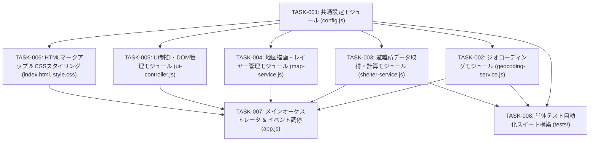

# 実装計画・タスク仕様書: 防災ハザードマップ & 避難場所表示 静的HTMLアプリケーション

本書は、システムアーキテクチャ設計書（`docs/architecture.md`）に基づき、シニアコーダーが迷わず実装に着手できるように、技術的レビュー、詳細インターフェース仕様、テスト戦略、および段階的な実装タスク仕様を定義した技術計画書である。

---

## 1. アーキテクチャレビュー所見

### 1.1 実現可能性評価 (Feasibility Assessment)
- **総合判定**: **【極めて高い（Go）】**
- **理由**:
  1. 国土地理院のタイル配信サーバー（標準地図・ハザードラスター・避難所GeoJSON）およびAPI（`msearch`, `mreversegeocoder`）は、ブラウザからのCORS（`Access-Control-Allow-Origin: *`）アクセスを公式に許可している。
  2. Google Apps Script（GAS）サーバーに依存していた処理（ユーザーマスタ検索、サーバー側ジオコーディング）をクライアント完結型に移行する設計に無理がなく、セキュリティリスク（APIキー露出、スプレッドシート権限漏洩）が完全に解消される。
  3. 避難所データの取得・距離計算・ソート・UIレンダリングのパイプラインはクライアント側の計算資源で十分高速（実測数百ミリ秒〜1秒程度）に動作可能。

### 1.2 留意事項・技術リスク (Technical Risks & Mitigations)
1. **ES Modules とローカルファイル実行 (`file://` 制約)**:
   - **リスク**: ES Modules（`<script type="module">`）は、ブラウザセキュリティにより `file://` プロトコル（直接ダブルクリック）で読み込むと CORS エラーで停止する。
   - **対策**: ローカル検証環境では Node.js の軽量HTTPサーバー（`npx serve` や `http-server`）または Python（`python -m http.server 8000`）を利用することを標準運用とする。また、ブラウザの Geolocation API 自体も `https://` または `http://localhost` のセキュアコンテキストでのみ動作するため、ローカルWebサーバー起動を必須要件として位置付ける。
2. **54タイル非同期並行フェッチとネットワーク耐障害性**:
   - **リスク**: 周辺9タイル×6種別（計54URL）への一斉fetchにより、一部タイルのタイムアウトや国土地理院サーバーの404応答（データ未配備）が発生する。
   - **対策**: `Promise.allSettled()` による並行処理を採用し、HTTP 404 は「該当なし」の正常系として空配列を返却する。ネットワーク切断やリクエスト失敗時も例外をスローせず警告ログにとどめ、取得できたデータのみで避難所計算を継続する。また、同一タイルの重複リクエストを防止するインメモリキャッシュ（`Map<string, Feature[]>`）を実装する。
3. **都道府県コードの動的更新とタイルの整合性**:
   - **リスク**: 日本海沿岸や県境付近において、逆ジオコーダの判定が遅延または取得失敗した場合、土砂・津波レイヤーが不正な都道府県コードを参照してタイル読み込みエラーになる可能性がある。
   - **対策**: 逆ジオコーダ取得失敗時はデフォルトコード（`27`: 大阪府）または直前の都道府県コードに安全にフォールバックし、地図全体の表示が停止しないように設計する。

### 1.3 アーキテクトへのエスカレーション有無
- **エスカレーション**: **【なし（仕様合意済み）】**
  - システムアーキテクチャ設計書に重大な欠陥や不整合はなく、本計画書にてインターフェースおよびデータ構造の粒度を補完することで、完全な実装への移行が可能である。

---

## 2. 影響範囲・変更対象ファイル一覧

### 2.1 変更・新規作成ファイル/モジュール一覧

```text
HazardMap-app/
├── index.html                  # [新規作成] アプリケーション骨格DOM・UI
├── css/
│   └── style.css               # [新規作成] カスタムレイアウト・ピンアニメーション
├── js/
│   ├── config.js               # [新規作成] システム定数・URL・ハザード定義
│   ├── geocoding-service.js    # [新規作成] 住所検索・逆ジオコーダ連携
│   ├── map-service.js          # [新規作成] Leaflet地図・レイヤー・ピン操作
│   ├── shelter-service.js      # [新規作成] タイル計算・GeoJSON取得・距離計算
│   ├── ui-controller.js        # [新規作成] DOM更新・トースト・ローディング制御
│   └── app.js                  # [新規作成] エントリポイント・イベント調停
├── tests/
│   ├── config.test.js          # [新規作成] 設定・定数の健全性テスト
│   ├── geocoding.test.js       # [新規作成] ジオコーディング単体テスト
│   └── shelter.test.js         # [新規作成] タイル計算・距離/徒歩時間計算テスト
└── docs/
    ├── architecture.md         # [既存・参照] システムアーキテクチャ設計書
    └── implementation-plan.md  # [新規作成・本書] 実装計画・タスク仕様書
```

### 2.2 依存関係・後方互換性への考慮事項
- **外部ライブラリ依存**:
  - Leaflet.js v1.9.4（CDN経由）
  - Tailwind CSS v3.x（CDN経由）
  - FontAwesome v6.4.0（CDN経由）
- **削除対象コード（後方互換性の排除）**:
  - 旧GASコード（`UserService.gs`, `AdminService.gs`, `Main.gs`, `GeoService.gs`）およびスプレッドシート接続処理、スクリプトプロパティへの依存を完全撤廃。
  - ヘッダーのユーザー情報バッジ（`#user-badge`）を削除。

---

## 3. インターフェース・データ構造仕様

### 3.1 共通データ構造 (Data Structures)

#### (1) 避難所データモデル (`ShelterData`)
```typescript
interface ShelterData {
  name: string;             // 避難所・施設名称 (例: "新大阪小学校")
  address: string;          // 所在地住所 (例: "大阪府大阪市淀川区...")
  lat: number;              // 緯度 (10進数)
  lng: number;              // 経度 (10進数)
  directDistance: number;   // 直線距離 (km, 小数第2位)
  walkingDistance: number;  // 推定徒歩距離 (km, 小数第2位: 直線×1.25)
  walkingMinutes: number;   // 推定徒歩所要時間 (分: 80m/分、切り上げ)
  category: string;         // 表示用対応災害文字列 (例: "洪水・地震 対応")
  categories: string[];     // 対応災害種別配列 (例: ["洪水", "地震"])
  isWelfare: boolean;       // 福祉避難所フラグ
  targetNote: string;       // 対象者補足 ("要介護者・要配慮者優先（福祉避難所等）" | "一般避難者対象")
}
```

#### (2) ジオコーディング結果モデル (`GeocodingResult`)
```typescript
interface GeocodingResult {
  lat: number;              // 緯度
  lng: number;              // 経度
  title: string;            // 検索ヒット地名・住所
  prefCode: string;         // JIS都道府県コード2桁 (例: "27")
}
```

#### (3) アプリケーション設定モデル (`AppConfig`)
```typescript
interface AppConfig {
  WALKING_SPEED_MPM: number;        // 徒歩分速 (80)
  CIRCUITY_FACTOR: number;          // 迂回係数 (1.25)
  DEFAULT_LAT: number;              // 初期緯度 (34.72631588753036)
  DEFAULT_LNG: number;              // 初期経度 (135.49736241752382)
  DEFAULT_ZOOM: number;             // 初期ズーム (14)
  DEFAULT_PREF_CODE: string;        // 初期都道府県コード ("27")
  MAX_SEARCH_RADIUS_KM: number;     // 検索半径上限 (5)
  MAX_SHELTER_DISPLAY_COUNT: number;// 最大表示件数 (50)
  TILE_URLS: {
    std: string;
    flood: string;
    sediment: string;
    tsunami: string;
    shelterGeoJson: string;
  };
  API_ENDPOINTS: {
    reverseGeocode: string;
    addressSearch: string;
  };
  HAZARD_CATEGORIES: Array<{ type: string; code: string }>;
  PREFECTURE_CODE_MAP: Record<string, string>;
  WELFARE_KEYWORDS: string[];
  SAMPLE_LOCATIONS: Array<{
    name: string;
    lat: number;
    lng: number;
    activeHazard: 'flood' | 'sediment' | 'tsunami';
    prefCode: string;
    icon: string;
    bgClass: string;
    borderClass: string;
    textClass: string;
  }>;
}
```

---

### 3.2 モジュール別クラス・関数シグネチャ仕様

#### (1) `js/config.js`
```javascript
export const APP_CONFIG = Object.freeze({
  WALKING_SPEED_MPM: 80,
  CIRCUITY_FACTOR: 1.25,
  DEFAULT_LAT: 34.72631588753036,
  DEFAULT_LNG: 135.49736241752382,
  DEFAULT_ZOOM: 14,
  DEFAULT_PREF_CODE: '27',
  MAX_SEARCH_RADIUS_KM: 5,
  MAX_SHELTER_DISPLAY_COUNT: 50,
  TILE_URLS: {
    std: 'https://cyberjapandata.gsi.go.jp/xyz/std/{z}/{x}/{y}.png',
    flood: 'https://disaportaldata.gsi.go.jp/raster/01_flood_l2_shinsuishin_data/{z}/{x}/{y}.png',
    sediment: 'https://disaportaldata.gsi.go.jp/raster/05_dosekiryukeikaikuiki_data/{pref}/{z}/{x}/{y}.png',
    tsunami: 'https://disaportaldata.gsi.go.jp/raster/04_tsunami_newlegend_pref_data/{pref}/{z}/{x}/{y}.png',
    shelterGeoJson: 'https://cyberjapandata.gsi.go.jp/xyz/{code}/10/{x}/{y}.geojson'
  },
  API_ENDPOINTS: {
    reverseGeocode: 'https://mreversegeocoder.gsi.go.jp/reverse-geocoder/LonLatToAddress',
    addressSearch: 'https://msearch.gsi.go.jp/address-search/AddressSearch'
  },
  HAZARD_CATEGORIES: [
    { type: '洪水', code: 'skhb01' },
    { type: '土砂', code: 'skhb02' },
    { type: '高潮', code: 'skhb03' },
    { type: '地震', code: 'skhb04' },
    { type: '津波', code: 'skhb05' },
    { type: '火事', code: 'skhb06' }
  ],
  PREFECTURE_CODE_MAP: {
    '北海道': '01', '青森県': '02', '岩手県': '03', '宮城県': '04', '秋田県': '05',
    '山形県': '06', '福島県': '07', '茨城県': '08', '栃木県': '09', '群馬県': '10',
    '埼玉県': '11', '千葉県': '12', '東京都': '13', '神奈川県': '14', '新潟県': '15',
    '富山県': '16', '石川県': '17', '福井県': '18', '山梨県': '19', '長野県': '20',
    '岐阜県': '21', '静岡県': '22', '愛知県': '23', '三重県': '24', '滋賀県': '25',
    '京都府': '26', '大阪府': '27', '兵庫県': '28', '奈良県': '29', '和歌山県': '30',
    '鳥取県': '31', '島根県': '32', '岡山県': '33', '広島県': '34', '山口県': '35',
    '徳島県': '36', '香川県': '37', '愛媛県': '38', '高知県': '39', '福岡県': '40',
    '佐賀県': '41', '長崎県': '42', '熊本県': '43', '大分県': '44', '宮崎県': '45',
    '鹿児島県': '46', '沖縄県': '47'
  },
  WELFARE_KEYWORDS: [
    '福祉', '介護', '特別養護', '養護', 'デイサービス', 'ケアセンター',
    '障害', '障がい', '老健', 'グループホーム', '養護老人ホーム', '支援学校'
  ],
  SAMPLE_LOCATIONS: [
    {
      name: '大阪淀川 (洪水)',
      lat: 34.7130,
      lng: 135.4880,
      activeHazard: 'flood',
      prefCode: '27',
      icon: 'fa-water',
      bgClass: 'bg-blue-50 hover:bg-blue-100',
      borderClass: 'border-blue-300',
      textClass: 'text-blue-800'
    },
    {
      name: '北海道札幌 (土砂)',
      lat: 43.1180,
      lng: 141.2250,
      activeHazard: 'sediment',
      prefCode: '01',
      icon: 'fa-mountain',
      bgClass: 'bg-amber-50 hover:bg-amber-100',
      borderClass: 'border-amber-300',
      textClass: 'text-amber-800'
    },
    {
      name: '広島八木 (土砂)',
      lat: 34.4600,
      lng: 132.4830,
      activeHazard: 'sediment',
      prefCode: '34',
      icon: 'fa-mountain',
      bgClass: 'bg-amber-50 hover:bg-amber-100',
      borderClass: 'border-amber-300',
      textClass: 'text-amber-800'
    },
    {
      name: '静岡三保 (津波)',
      lat: 34.9960,
      lng: 138.5220,
      activeHazard: 'tsunami',
      prefCode: '22',
      icon: 'fa-house-tsunami',
      bgClass: 'bg-purple-50 hover:bg-purple-100',
      borderClass: 'border-purple-300',
      textClass: 'text-purple-800'
    }
  ]
});
```

#### (2) `js/geocoding-service.js`
```javascript
export class GeocodingService {
  /**
   * 住所・ランドマーク名から座標および都道府県コードを取得する
   * @param {string} address - 検索クエリ文字列
   * @returns {Promise<GeocodingResult | null>} 検索結果オブジェクト、未検出時は null
   */
  static async geocode(address);

  /**
   * 緯度経度からJIS都道府県コード(2桁)を取得する（逆ジオコーディング）
   * @param {number} lat - 緯度
   * @param {number} lng - 経度
   * @returns {Promise<string>} JIS都道府県コード（例: "27"）。取得失敗時は DEFAULT_PREF_CODE
   */
  static async reverseGeocodePrefCode(lat, lng);

  /**
   * 全国地方公共団体コード(muniCd)からJIS都道府県コード(2桁)を抽出する
   * @param {string|number} muniCd - 5桁の市区町村コード (例: "27100")
   * @returns {string} 2桁コード (例: "27")
   */
  static extractPrefCodeFromMuniCd(muniCd);
}
```

#### (3) `js/shelter-service.js`
```javascript
export class ShelterService {
  /**
   * 指定座標の周辺指定緊急避難場所を取得・計算・ソートして返却する
   * @param {number} userLat - 中心緯度
   * @param {number} userLng - 中心経度
   * @param {number} [maxRadiusKm=5] - 検索半径上限(km)
   * @returns {Promise<ShelterData[]>} 徒歩所要時間昇順の避難所データリスト (最大50件)
   */
  static async getNearbyShelters(userLat, userLng, maxRadiusKm = APP_CONFIG.MAX_SEARCH_RADIUS_KM);

  /**
   * 緯度経度とズームレベルから国土地理院タイル座標 (X, Y) を算出する
   * @param {number} lat - 緯度
   * @param {number} lng - 経度
   * @param {number} zoom - ズームレベル (避難所タイルは固定で 10)
   * @returns {{ x: number, y: number, z: number }}
   */
  static getTileCoordinate(lat, lng, zoom);

  /**
   * 2地点間の大円距離 (Haversine式) を計算する
   * @param {number} lat1 - 地点1緯度
   * @param {number} lon1 - 地点1経度
   * @param {number} lat2 - 地点2緯度
   * @param {number} lon2 - 地点2経度
   * @returns {number} 直線距離 (km)
   */
  static calculateDistanceKm(lat1, lon1, lat2, lon2);

  /**
   * GeoJSON Featureのgeometryから緯度・経度を安全にパースする
   * @param {Object} geometry - GeoJSON geometry オブジェクト
   * @returns {{ lat: number, lng: number } | null}
   */
  static parseFeatureCoordinates(geometry);

  /**
   * 避難所フィーチャが福祉避難所・要配慮者向けであるかを判定する
   * @param {Object} props - Feature properties
   * @param {string} name - 避難所名称
   * @returns {boolean} 福祉避難所の場合 true
   */
  static checkIsWelfare(props, name);

  /**
   * 単一のタイルGeoJSONを非同期取得する（キャッシュ対応・404許容）
   * @param {string} url - タイルURL
   * @returns {Promise<Array<Object>>} フィーチャ配列（存在しない場合は空配列）
   */
  static async fetchTileFeatures(url);

  /**
   * インメモリキャッシュを全クリアする
   */
  static clearCache();
}
```

#### (4) `js/map-service.js`
```javascript
export class MapService {
  /**
   * Leaflet地図インスタンスを初期化する
   * @param {string} containerId - 地図表示要素のDOM ID ('map')
   * @param {[number, number]} initialCoords - 初期表示座標 [緯度, 経度]
   * @param {number} initialZoom - 初期ズームレベル (14)
   */
  static initMap(containerId, initialCoords, initialZoom);

  /**
   * 都道府県コードに応じてハザードレイヤー（土砂・津波）を再構築する
   * @param {string} prefCode - JIS都道府県コード2桁
   */
  static updateHazardLayers(prefCode);

  /**
   * ハザードレイヤーの表示/非表示を切り替える
   * @param {'flood' | 'sediment' | 'tsunami'} type - レイヤー種別
   * @param {boolean} visible - 表示フラグ
   */
  static toggleHazardLayer(type, visible);

  /**
   * 中心地点マーカー（赤色パルスピン）を配置・移動し、地図をパンする
   * @param {number} lat - 緯度
   * @param {number} lng - 経度
   * @param {string} popupText - ポップアップテキスト
   * @param {number} [zoom=14] - ズームレベル
   */
  static setLocationMarker(lat, lng, popupText, zoom = 14);

  /**
   * 避難所マーカー群を描画する
   * @param {ShelterData[]} shelters - 避難所データリスト
   * @param {(shelter: ShelterData) => void} [onMarkerClick] - マーカークリック時コールバック
   */
  static renderShelterMarkers(shelters, onMarkerClick);

  /**
   * 特定の避難所に地図をフォーカスし、ポップアップを展開する
   * @param {ShelterData} shelter - フォーカス対象避難所
   * @param {number} [zoom=16] - ズームレベル
   */
  static focusShelter(shelter, zoom = 16);

  /**
   * 福祉避難所 / 一般避難所用のカスタム DivIcon を生成する
   * @param {boolean} isWelfare - 福祉避難所フラグ
   * @returns {L.DivIcon}
   */
  static createShelterMarkerIcon(isWelfare);

  /**
   * レンダリング済みのLeafletマップインスタンスを取得する
   * @returns {L.Map | null}
   */
  static getMapInstance();
}
```

#### (5) `js/ui-controller.js`
```javascript
export class UIController {
  /**
   * 全画面ローディングオーバーレイを表示する (Sharedライブラリ思想)
   * @param {string} [message='処理中...'] - 表示メッセージ
   */
  static showLoading(message = '処理中...');

  /**
   * 全画面ローディングオーバーレイを非表示にする
   */
  static hideLoading();

  /**
   * トースト通知を表示する (Sharedライブラリ思想)
   * @param {string} message - 通知メッセージ
   * @param {boolean} [isError=false] - エラー表示フラグ
   * @param {number} [autoHideMs=5000] - 自動非表示ミリ秒 (0で非自動非表示)
   */
  static showToast(message, isError = false, autoHideMs = 5000);

  /**
   * トースト通知を即時閉じる
   */
  static dismissToast();

  /**
   * 初回ウェルカムモーダルを表示する
   */
  static showWelcomeModal();

  /**
   * 初回ウェルカムモーダルを非表示にする
   */
  static hideWelcomeModal();

  /**
   * サイドバーを開閉トグルする（モバイル用）
   */
  static toggleSidebar();

  /**
   * サイドバーを強制的に閉じる（モバイル用）
   */
  static closeSidebar();

  /**
   * 周辺避難所リストカード群を描画する
   * @param {ShelterData[]} shelters - 避難所データリスト
   * @param {(shelter: ShelterData) => void} onCardClick - カードクリック時コールバック
   */
  static renderShelterList(shelters, onCardClick);

  /**
   * ハザードチェックボックスのON/OFF状態をUIに反映する
   * @param {'flood' | 'sediment' | 'tsunami'} type - レイヤー種別
   * @param {boolean} checked - チェック状態
   */
  static setHazardCheckbox(type, checked);
}
```

#### (6) `js/app.js`
```javascript
export class App {
  /**
   * アプリケーション初期化エントリポイント
   */
  static async init();

  /**
   * イベントリスナーの登録（検索、現在地、レイヤー、サンプル地点、モーダル）
   */
  static setupEventListeners();

  /**
   * URLパラメータ（?address=... または ?lat=...&lng=...）の解析と初期位置決定
   */
  static async handleInitialLocation();

  /**
   * 住所検索の実行フロー
   * @param {string} query - 住所または施設名
   */
  static async searchAddress(query);

  /**
   * 現在地取得の実行フロー
   * @param {boolean} isUserInitiated - ユーザーの明示的操作かどうか
   */
  static async getCurrentLocation(isUserInitiated = true);

  /**
   * サンプル地点へのジャンプ実行フロー
   * @param {number} index - SAMPLE_LOCATIONS のインデックス
   */
  static async moveToSample(index);

  /**
   * 座標の決定に伴う総合更新フロー（逆ジオコーダ -> ハザードレイヤー -> 避難所計算 -> マーカー・リスト描画）
   * @param {number} lat - 緯度
   * @param {number} lng - 経度
   * @param {string} label - 表示ラベル
   * @param {number} [zoom=14] - ズームレベル
   */
  static async updateLocation(lat, lng, label, zoom = 14);
}
```

---

## 4. テスト戦略 (Test Strategy)

### 4.1 単体テスト方針 (Unit Testing)
- **テスト実行環境**:
  - Node.js 18+ の組み込みテストランナー（`node --test`）を使用する。
  - 追加の外部テストフレームワーク（npmパッケージインストール）を不要とし、軽量・高速に実行できる構成とする。
- **対象モジュールとテスト項目**:
  1. `tests/config.test.js`:
     - `APP_CONFIG` オブジェクトが `Object.freeze` で凍結されていること。
     - タイルURLテンプレートに必要なプレースホルダー（`{z}`, `{x}`, `{y}`, `{pref}`）が存在すること。
     - 47都道府県の都道府県コードが正しく定義されていること。
     - サンプル地点リストが4件以上定義され、必要なプロパティを持っていること。
  2. `tests/geocoding.test.js`:
     - `extractPrefCodeFromMuniCd`: "27100" -> "27", "01100" -> "01" の正常抽出、null/短文字列時のフォールバック。
     - `reverseGeocodePrefCode`: モックAPIレスポンスから都道府県コードを正確に取得できること。
     - `geocode`: モックAPIレスポンスから座標 `[lat, lng]`（反転順序）を正確にパースできること。
  3. `tests/shelter.test.js`:
     - `getTileCoordinate`: 新大阪駅座標（lat: 34.7263, lng: 135.4973, zoom: 10）における (x, y) が正しいタイル番号になること。
     - `calculateDistanceKm`: 新大阪駅〜大阪駅間の距離が正しく約 2.8km 前後として計算されること（Haversine式の精度）。
     - 徒歩所要時間計算: 迂回係数 1.25、分速 80m、分単位切り上げの整合性。
     - `checkIsWelfare`: `welfare='1'`, `is_welfare='1'`, `remarks` 含有、施設名キーワード（福祉、デイサービス等）によるフラグ判定の網羅性。
     - 重複マージ: 同一名称・同一座標のフィーチャが正しく1レコードに統合され、対応カテゴリが結合されること。

### 4.2 結合テスト方針 (Integration Testing)
- **テスト実行環境**:
  - ローカルWebサーバー（例: `npx serve .` または `python -m http.server 8000`）を起動し、ブラウザ（Chrome / Edge / Firefox）上で手動およびシナリオ検証を実施。
- **検証シナリオ**:
  - **シナリオ 1: 初回起動とモーダル動作**
    - ページアクセス時にウェルカムモーダルが表示される。
    - 「現在地を取得せずに開始」をクリックすると、新大阪駅周辺が表示され、周辺避難所リスト（最大50件）がレンダリングされる。
  - **シナリオ 2: 住所検索機能**
    - ヘッダー検索入力に「東京都千代田区」と入力しEnterまたは検索ボタンを押下。
    - 地図が千代田区（皇居・東京駅周辺）に移動し、ピンが立つ。
    - 都道府県コードが "13" に自動更新され、津波・土砂レイヤーのURLが更新される。
  - **シナリオ 3: サンプル地点切り替え**
    - 「北海道札幌 (土砂)」ボタンをクリック。
    - 地図が札幌手稲に移動し、土砂災害警戒区域チェックボックスが自動的にONになり、該当レイヤーが地図に重畳される。
  - **シナリオ 4: 避難所マーカーとリストのインタラクション**
    - サイドバーの避難所カードをクリックすると、地図が該当地点にズームイン（Zoom 16）し、ポップアップが開く。
    - 地図上のピンをクリックすると、ポップアップが開く。
    - 福祉避難所（紫色ピン＋車椅子アイコン）と一般避難所（青色ピン＋建物アイコン）が明確に区別されている。
  - **シナリオ 5: ハザードレイヤーのトグル**
    - 「洪水浸水想定区域」チェックボックスをON/OFFし、タイルの表示・非表示が滑らかに切り替わること。

### 4.3 回帰テスト観点・ユーザーマスター削除検証
- **削除項目の完全排除検証**:
  - `index.html` 内に `#user-badge`、`#user-name` 要素が存在しないこと。
  - スクリプト内に `google.script.run`、`<?= ... ?>`、`UserService`、`AdminService` の残存が一切ないこと。
  - ブラウザのDevToolsコンソールにエラー（赤字ログ）が出力されていないこと。

---

## 5. 実装タスク一覧 (順序定義)



---

### タスク [TASK-001]: 共通設定モジュール (`js/config.js`) の実装
- **ID**: `TASK-001`
- **目的**: アプリケーション全体で使用する定数、APIエンドポイント、タイルURLテンプレート、都道府県コードマップ、福祉キーワード、サンプル地点データを一元管理するモジュールを作成する。
- **入力**:
  - `docs/architecture.md` セクション 2.2, 3.3
  - 本書 セクション 3.2 (1)
- **期待される結果**:
  - `js/config.js` が作成され、不変オブジェクト `APP_CONFIG` がエクスポートされる。
- **対象ファイル**:
  - `js/config.js`
- **依存関係**: なし（最優先着手）
- **受け入れ基準**:
  - すべての定数値（歩行速度80m/分、迂回係数1.25、初期新大阪座標、タイルURLテンプレート、47都道府県コード、福祉キーワード12種、サンプル地点4件）が漏れなく定義されていること。
  - `Object.freeze` で保護され、外部から意図せず変更できないこと。
- **検証方法**:
  - `node -e "import('./js/config.js').then(m => console.log(Object.keys(m.APP_CONFIG)))"` を実行し、キー一覧が出力されることを確認。

---

### タスク [TASK-002]: ジオコーディングモジュール (`js/geocoding-service.js`) の実装
- **ID**: `TASK-002`
- **目的**: 国土地理院の住所検索API（`msearch`）および逆ジオコーダAPI（`mreversegeocoder`）と通信し、住所から座標への変換、および座標からJIS都道府県コード（2桁）への変換を行うモジュールを作成する。
- **入力**:
  - `js/config.js`
  - 本書 セクション 3.2 (2)
- **期待される結果**:
  - `js/geocoding-service.js` が作成され、クラス `GeocodingService` がエクスポートされる。
- **対象ファイル**:
  - `js/geocoding-service.js`
- **依存関係**: `TASK-001`
- **受け入れ基準**:
  - `geocode(address)`: 住所検索APIを叩き、`geometry.coordinates` `[lng, lat]` を反転して `{ lat, lng, title, prefCode }` を返却すること。ヒットなし時は `null`。
  - `reverseGeocodePrefCode(lat, lng)`: 逆ジオコーダを叩き、`muniCd` の上2桁を取得して返却すること。失敗時または海上の場合は `APP_CONFIG.DEFAULT_PREF_CODE`（`"27"`）にフォールバックすること。
  - `extractPrefCodeFromMuniCd(muniCd)`: 5桁の自治体コードから安全に2桁を抽出できること。
- **検証方法**:
  - 正常系・異常系のNode.jsテストスクリプトにより、モックデータおよび実APIに対するリクエスト/レスポンス処理が成功することを確認。

---

### タスク [TASK-003]: 避難所データ取得・計算モジュール (`js/shelter-service.js`) の実装
- **ID**: `TASK-003`
- **目的**: 指定座標周辺のZoom 10タイル（9タイル×6種別=54リクエスト）を並行取得し、避難所の重複マージ、直線距離・徒歩所要時間の計算、福祉避難所判定、5km以内絞り込み・ソートを行うモジュールを作成する。
- **入力**:
  - `js/config.js`
  - 本書 セクション 3.2 (3)
- **期待される結果**:
  - `js/shelter-service.js` が作成され、クラス `ShelterService` がエクスポートされる。
- **対象ファイル**:
  - `js/shelter-service.js`
- **依存関係**: `TASK-001`
- **受け入れ基準**:
  - `getTileCoordinate(lat, lng, zoom)`: 緯度経度からZoom 10のタイル座標を数学的に正確に計算できること。
  - `calculateDistanceKm(lat1, lon1, lat2, lon2)`: Haversineの式により球面上の大円距離を正確に計算できること。
  - `fetchTileFeatures(url)`: `fetch` によるGeoJSON取得において、HTTP 404を空配列として正常吸収し、インメモリキャッシュ（`Map`）で同一タイルの重複リクエストを抑止すること。
  - `getNearbyShelters(userLat, userLng, maxRadiusKm)`: 54タイルを `Promise.allSettled()` で並行取得し、重複キー（`${name}_${lat.toFixed(5)}_${lng.toFixed(5)}`）でカテゴリを統合し、5km以内の避難所を徒歩所要時間の昇順でソートして最大50件を返却すること。
  - `checkIsWelfare(props, name)`: propertiesおよび施設名から福祉避難所を正確に判定できること。
- **検証方法**:
  - 単体テスト（`tests/shelter.test.js`）を実行し、計算式、重複統合、ソート上限が正しく機能することを検証。

---

### タスク [TASK-004]: 地図描画・レイヤー管理モジュール (`js/map-service.js`) の実装
- **ID**: `TASK-004`
- **目的**: Leaflet.js 地図の初期化、国土地理院標準地図タイルのロード、現在地マーカー（パルスアニメーション付き）の配置、都道府県別ハザードレイヤーの動的生成・切り替え、避難所マーカー（一般/福祉アイコン）の描画およびポップアップ連携を行うモジュールを作成する。
- **入力**:
  - `js/config.js`
  - 本書 セクション 3.2 (4)
- **期待される結果**:
  - `js/map-service.js` が作成され、クラス `MapService` がエクスポートされる。
- **対象ファイル**:
  - `js/map-service.js`
- **依存関係**: `TASK-001`
- **受け入れ基準**:
  - `initMap`: `#map` コンテナに Leaflet 地図インスタンスを生成し、国土地理院タイルを配置すること。
  - `setLocationMarker`: 現在地ピンを配置し、地図をパン・ズームすること。
  - `updateHazardLayers(prefCode)`: 土砂・津波レイヤーを新しい都道府県コードのURLで再構築し、現在のON/OFF状態を維持して地図に反映すること。
  - `toggleHazardLayer(type, visible)`: 指定レイヤーの表示/非表示を切り替え、表示時は最前面に移動（`bringToFront`）すること。
  - `renderShelterMarkers(shelters, onMarkerClick)`: 既存マーカーを破棄し、一般避難所（青）と福祉避難所（紫＋リング）のカスタムアイコンでマーカーをプロットし、詳細ポップアップをバインドすること。
  - `focusShelter(shelter, zoom)`: 指定避難所に地図を移動し、ポップアップを自動展開すること。
- **検証方法**:
  - ブラウザ検証およびJSDoc型検証。

---

### タスク [TASK-005]: UI制御・DOM管理モジュール (`js/ui-controller.js`) の実装
- **ID**: `TASK-005`
- **目的**: 全画面ローディング表示、トースト通知、ウェルカムモーダル開閉、サイドバー開閉、避難所カードリストの描画、ハザードチェックボックス制御など、DOM操作を一括管理するモジュールを作成する（Sharedライブラリ思想に準拠）。
- **入力**:
  - `js/config.js`
  - 本書 セクション 3.2 (5)
- **期待される結果**:
  - `js/ui-controller.js` が作成され、クラス `UIController` がエクスポートされる。
- **対象ファイル**:
  - `js/ui-controller.js`
- **依存関係**: `TASK-001`
- **受け入れ基準**:
  - `showLoading(msg)` / `hideLoading()`: 全画面スピナーオーバーレイの表示と非表示を確実に制御できること。
  - `showToast(msg, isError, autoHideMs)` / `dismissToast()`: トースト通知メッセージの表示、アイコン切り替え（情報/警告）、自動非表示タイマーを制御できること。
  - `showWelcomeModal()` / `hideWelcomeModal()`: 初回モーダルの表示・非表示を制御できること。
  - `toggleSidebar()` / `closeSidebar()`: モバイル画面でのサイドバードロワーの開閉を制御できること。
  - `renderShelterList(shelters, onCardClick)`: 避難所カード群をDOM生成し、一般/福祉バッジ、所要時間、距離、対応災害種別、住所を美しくフォーマットして表示すること。件数が0件の場合は適切な空状態メッセージを表示すること。
- **検証方法**:
  - ブラウザDOM検証。

---

### タスク [TASK-006]: HTMLマークアップ & CSSスタイリング (`index.html`, `css/style.css`) の実装
- **ID**: `TASK-006`
- **目的**: 静的HTMLアプリケーションの骨格となる `index.html` およびカスタムスタイル `css/style.css` を作成する。旧GASテンプレートタグやユーザーマスターUI（`#user-badge`）を完全に排除し、レスポンシブな最新UIを構築する。
- **入力**:
  - `docs/architecture.md` セクション 2.2
  - 旧 `Index.html`, `StyleSheet.html` のデザイン資産
- **期待される結果**:
  - `index.html` および `css/style.css` が作成される。
- **対象ファイル**:
  - `index.html`
  - `css/style.css`
- **依存関係**: `TASK-001`
- **受け入れ基準**:
  - **ユーザーマスターUIの完全排除**: ヘッダーにユーザー情報バッジ（`#user-badge`）が存在しないこと。
  - ヘッダーに「タイトル」「住所検索バー（input + 検索ボタン）」「現在地を取得ボタン」が配置されていること。
  - サイドバーに「レイヤー切替チェックボックス」「ハザード凡例アコーディオン」「サンプル地点移動ボタン群」「避難所リストコンテナ」「件数バッジ」が配置されていること。
  - メイン領域に `#map` コンテナ、トースト通知コンテナ、ローディングオーバーレイ、ウェルカムモーダルが配置されていること。
  - Tailwind CSS, Leaflet CSS/JS, FontAwesome のCDNリンクが正しく指定されていること。
  - `<script type="module" src="js/app.js"></script>` によりモジュールが読み込まれていること。
  - `css/style.css` に地図の全画面高さ計算、カスタムスクロールバー、現在地パルスアニメーション、マーカー用スタイルが定義されていること。
- **検証方法**:
  - HTML構文検証、ブラウザでのレスポンシブ表示（デスクトップ・モバイル）確認。

---

### タスク [TASK-007]: メインオーケストレータ (`js/app.js`) の実装と全体統合
- **ID**: `TASK-007`
- **目的**: 各サービス・コントローラーを結合し、URLパラメータ解析、イベントリスナー登録、位置特定から避難所計算・地図描画までのエンドツーエンド処理を調停するメインモジュールを作成する。
- **入力**:
  - `TASK-001` 〜 `TASK-006` の全成果物
  - 本書 セクション 3.2 (6)
- **期待される結果**:
  - `js/app.js` が作成され、ブラウザ起動時にアプリケーションが完全自律動作する。
- **対象ファイル**:
  - `js/app.js`
- **依存関係**: `TASK-001` 〜 `TASK-006`
- **受け入れ基準**:
  - `DOMContentLoaded` で初期化処理が開始されること。
  - URLクエリパラメータ（`?address=...` または `?lat=...&lng=...`）がある場合は該当地点を優先検索し、ない場合はウェルカムモーダルを表示すること。
  - 住所検索フォームで検索実行時、`GeocodingService.geocode` を呼び出して該当座標へスムーズに移動し、避難所データが再計算・描画されること。
  - 「現在地を取得」ボタン押下時、ブラウザの Geolocation API を呼び出して現在地へ移動すること。失敗時はトースト通知を表示し、初期位置へフォールバックすること。
  - サンプル地点ボタン押下時、該当地点へ移動し、該当ハザードレイヤーが自動有効化されること。
  - 避難所カードクリック時に該当マーカーへのパン・ポップアップ展開が行われること。
- **検証方法**:
  - ブラウザでのエンドツーエンド操作検証（統合シナリオテスト）。

---

### タスク [TASK-008]: 単体テスト自動化スイートの構築 (`tests/`)
- **ID**: `TASK-008`
- **目的**: コアロジック（定数、ジオコーディング補助処理、タイル計算、距離・徒歩時間計算、福祉避難所判定、重複マージ）を自動検証するテストスクリプトを作成し、テスト実行コマンドを確立する。
- **入力**:
  - `js/config.js`
  - `js/geocoding-service.js`
  - `js/shelter-service.js`
- **期待される結果**:
  - `tests/config.test.js`, `tests/geocoding.test.js`, `tests/shelter.test.js` が作成され、`node --test` で全テストが PASS すること。
- **対象ファイル**:
  - `tests/config.test.js`
  - `tests/geocoding.test.js`
  - `tests/shelter.test.js`
- **依存関係**: `TASK-001`, `TASK-002`, `TASK-003`
- **受け入れ基準**:
  - 外部npmライブラリをインストールすることなく、`node --test` コマンド一発で全単体テストが実行され、オールグリーンになること。
- **検証方法**:
  - 実行コマンド: `node --test tests/*.test.js`

---

## 6. シニアコーダーへの申し送り事項・実装上の注意点

1. **コード省略の完全排除**:
   - `// TODO: 実装する` や `// 省略...` などのプレースホルダーコードは絶対に記述せず、最初から本番稼働可能な完全なコードを作成してください。
2. **記号エスケープの注意**:
   - JavaScriptコード内のパイプ記号（`|`, `||`）や不等号記号（`<`, `>`）がMarkdownやエディタの置換でLaTeXエスケープ（`\|` 等）されないように記述してください。
3. **CORS とプロトコル制約**:
   - 本アプリケーションは ES Modules（`import / export`）を使用するため、ブラウザで動作確認する際は `file://` 直開きではなく、必ずローカルHTTPサーバー（`npx serve .` または `python -m http.server 8000`）を起動して確認してください。
4. **404レスポンスの正常扱い**:
   - 国土地理院の避難所GeoJSONタイルは、当該タイル内に避難所が存在しない場合に HTTP 404 を返却します。これはエラーではなく「避難所0件」という正常な応答ですので、コンソールに不要な `console.error` を出さず、静かに空配列として処理してください。
5. **ユーザーマスターの完全撤廃**:
   - スプレッドシート連携コードや、旧 `UserService.gs` / `AdminService.gs` に由来する処理は一切実装に持ち込まないでください。
