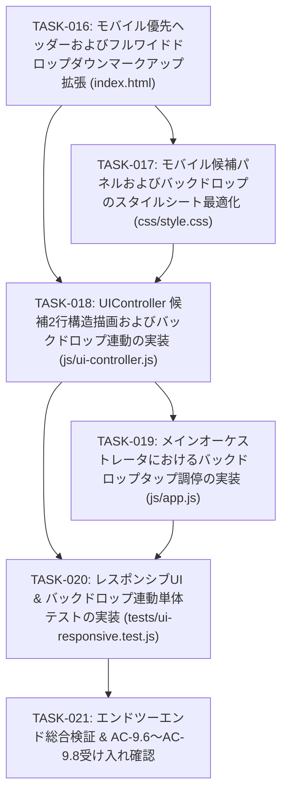

# 実装計画・タスク仕様書: 防災ハザードマップ & 避難場所表示 静的HTMLアプリケーション
## （第3版: モバイル優先ヘッダー情報設計 & ビューポート基準フルワイド候補パネル）

本書は、システムアーキテクチャ設計書（`docs/architecture.md` 第3版）の改訂内容（ADR-07, ADR-08, 受け入れ基準 AC-9.6〜AC-9.8）に基づき、シニアコーダーが迷わず実装に着手できるよう、技術的レビュー所見、詳細インターフェース・マークアップ仕様、テスト戦略、および段階的な実装タスク仕様を定義した技術計画書である。

初版（TASK-001〜TASK-008）の静的SPA基盤、および第2版（TASK-009〜TASK-015）のハイブリッド検索・スマートリランキング基盤を厳格に保護しつつ、**「スマートフォン（モバイル幅 360px〜400px）環境におけるヘッダー狭小化による検索バー圧迫、および検索結果ドロップダウン不可読問題」を抜本的に解決するための実装タスク（TASK-016〜TASK-021）**を定義する。

---

## 1. アーキテクチャレビュー所見

### 1.1 実現可能性評価 (Feasibility Assessment)
- **総合判定**: **【極めて高い（Go）】**
- **理由**:
  1. **モバイルヘッダーの有効検索幅確保（ADR-07）**:
     - ヘッダー左側のタイトルテキスト「防災ハザードマップ」に Tailwind レスポンシブクラス `hidden sm:block` を適用し、パディングを `px-2 sm:px-4`、検索コンテナのマージンを `mx-1.5 sm:mx-3` に調整することで、画面幅 360px〜400px（iPhone SE等）の実機環境において、検索バーコンテナ（`#search-container`）に **210px〜250px 以上の有効幅**を確実に確保できる。
     - ヘッダーを2段化することなく1行（高さ 64px）のコンパクトさを維持するため、地図の表示ファーストビューを一切圧迫しない。
  2. **ビューポート基準フルワイド候補パネルの独立性（ADR-08）**:
     - 親要素 `#search-container` の幅制約（約220px）からドロップダウンを脱出させるため、モバイル画面（`< sm`）では `fixed inset-x-2 top-[60px]`（左右マージン各8px、ヘッダー直下展開）を適用する。
     - これにより、画面幅 360px〜400px 全体（幅 344px〜384px）を活用して候補カードを2行構造でゆったりと描画でき、文字の極端な省略（`truncate`）を根本解決できる。
     - デスクトップ画面（`>= sm`）では `sm:absolute sm:inset-x-0 sm:top-full` により、検索バー直下の整然としたフローティングドロップダウン（幅約400px〜448px）として動作し、PC版の洗練されたレイアウトを100%保護できる。
  3. **単一DOMアーキテクチャによる高パフォーマンス（NFR-7）**:
     - モバイル用とPC用で別個のDOMツリーを作成せず、同一の `#search-results-dropdown` 要素に Tailwind CSS のレスポンシブユーティリティクラスを付与するのみで切り替えるため、メモリオーバーヘッドおよびDOM構築コストが最小化される。

### 1.2 CSS・Tailwind仕様整合性評価
- `index.html` では公式 Tailwind CSS CDN（`https://cdn.tailwindcss.com`）が読み込まれており、`fixed`, `inset-x-2`, `top-[60px]`, `sm:absolute`, `sm:inset-x-0`, `sm:top-full`, `z-50`, `z-40`, `bg-black/40` 等のユーティリティクラスは完全にサポートされている。
- `css/style.css` において、候補アイテムのタッチターゲット高さ（`min-h-[48px]`）、タップフィードバック（`active:bg-blue-100`）、および最大高さ（`max-h-[70vh]`）のスクロール挙動を補強することで、CSSとTailwindのシナジーにより堅牢なUIを実現できる。

### 1.3 留意事項・技術リスク (Technical Risks & Mitigations)
1. **重なり順（z-index）階層の厳密な調停**:
   - **リスク**: 地図（`#map`: `z-10`）、ヘッダー（`<header>`: `z-30`）、バックドロップ（`#search-backdrop`）、ドロップダウン（`#search-results-dropdown`）の z-index が不整合だと、バックドロップがドロップダウンの上に重なってタップ不能になったり、地図コントロールが突き抜けたりする恐れがある。
   - **対策**:
     - 地図: `z-10`
     - ヘッダー: `z-30`
     - バックドロップ（`#search-backdrop`）: `z-40`（地図・サイドバーを覆う）
     - 検索ドロップダウン（`#search-results-dropdown`）: `z-50`（最前面に浮上）
     - この明確な階層設計により、視覚的ノイズの完全な遮断と候補アイテムの確実なタップを保証する。
2. **デスクトップ画面におけるバックドロップ誤表示の防止**:
   - **リスク**: デスクトップ表示（幅 640px 以上）ではフローティングドロップダウンの背後に画面全体の黒オーバーレイは不要であり、表示されると操作性を損なう。
   - **対策**: `#search-backdrop` のHTMLクラスに `fixed inset-0 bg-black/40 z-40 hidden sm:hidden` を付与する。JS側が候補表示時に単に `hidden` クラスを除去（`classList.remove('hidden')`）しても、Tailwindのメディアクエリ `sm:hidden` により 640px 以上の環境では自動的に非表示が維持される。
3. **バックドロップおよびドロップダウンの表示・非表示の完全同期**:
   - **リスク**: 候補タップ時、ESCキー押下時、バックドロップタップ時、検索窓外クリック時、現在地取得時、初期化時にバックドロップだけが画面に残り、画面操作不能（フリーズ状態）になるリスク。
   - **対策**: ドロップダウンの非表示処理をすべて `UIController.hideSearchResults()` に集約し、その内部でドロップダウンとバックドロップの双方を不可分に `hidden` 化する。また、`#search-backdrop` のクリックイベントリスナーに `UIController.hideSearchResults()` をバインドする。
4. **モバイルブラウザのアドレスバー伸縮（ビューポート変動）**:
   - **リスク**: モバイルSafariやChrome等でスクロール時にアドレスバーが出現・格納され、`100vh` が変動してドロップダウン下部が画面外に押し出されるリスク。
   - **対策**: ドロップダウンの最大高さを `max-h-[70vh]`（または `max-h-[calc(100dvh-80px)]`）に抑え、`overflow-y-auto` による縦スクロールを有効化することで、キーボードやアドレスバーの出現時でも画面内に収まるように制御する。

### 1.4 アーキテクトへのエスカレーション有無
- **エスカレーション**: **【なし（完全合意）】**
  - システムアーキテクチャ設計書第3版の設計（ADR-07, ADR-08, AC-9.6〜AC-9.8）と完全に整合しており、シニアコーダーが直ちに安全な実装を行える仕様となっている。

---

## 2. 影響範囲・変更対象ファイル一覧

### 2.1 変更対象ファイル一覧

```text
HazardMap-app/
├── index.html                  # [変更] ヘッダーロゴ文字のレスポンシブ非表示、ドロップダウンクラス再定義、バックドロップ新設
├── css/style.css               # [変更] モバイル候補カードのタッチターゲット(min-h 48px)、アクティブ背景、スクロール調整
├── js/
│   ├── ui-controller.js        # [変更] showSearchResultsの2行構造描画、バックドロップ表示・非表示連動
│   └── app.js                  # [変更] バックドロップクリックイベントリスナー登録、クローズ調停
└── tests/
    └── ui-responsive.test.js   # [新規] モバイル/PCレスポンシブDOM構造、バックドロップ連動、タッチ属性検証テスト
```

### 2.2 依存関係・後方互換性・PC版レイアウト保護への考慮事項
- **PC版（デスクトップ）レイアウトの完全保護**:
  - デスクトップ表示（幅 640px 以上）では、ヘッダーにロゴタイトル「防災ハザードマップ」およびサブタイトルが通常通り表示される。
  - 候補一覧は検索バー直下の幅約400px〜448pxの整然としたフローティングドロップダウンとして展開され、バックドロップは表示されない（`sm:hidden`）。
- **後方互換性の厳格維持**:
  - `UIController.showSearchResults(candidates, onSelect)` および `UIController.hideSearchResults()` のメソッドシグネチャを一切変更しない。
  - `GeocodingService`、`MapService`、`ShelterService` のロジック・データ構造への変更はゼロであり、第1版・第2版の機能に一切の副作用を与えない。
- **既存全50テストの100%保護**:
  - 既存のテストスイート（`tests/config.test.js`, `geocoding.test.js`, `initial-location.test.js`, `qa-edge-cases.test.js`, `qa-verification-phase2.test.js`, `shelter.test.js`）を壊すことなく、全件PASSを継続維持する。

---

## 3. インターフェース・HTML/DOM構造・Tailwind/CSS仕様

### 3.1 ヘッダーレイアウトレスポンシブ仕様 (`index.html`)

画面幅 360px〜400px のモバイル環境で `#search-container` に最低 200px 以上の有効幅を確保するため、ヘッダー各要素のクラスを以下の通り最適化する。

```html
<!-- ヘッダーコンテナ: パディングを px-2 sm:px-4 に最適化 -->
<header class="h-16 bg-white border-b border-gray-200 px-2 sm:px-4 flex items-center justify-between z-30 shadow-sm shrink-0">
  <div class="flex items-center gap-2 sm:gap-3 shrink-0">
    <!-- モバイル用サイドバートグルボタン -->
    <button id="btn-toggle-sidebar" class="lg:hidden p-2 rounded-md hover:bg-gray-100 text-gray-600 focus:outline-none" aria-label="メニュー開閉">
      <i class="fa-solid fa-bars text-lg"></i>
    </button>

    <!-- アプリケーションロゴ & タイトル -->
    <div class="flex items-center gap-2 sm:gap-2.5 cursor-pointer" id="header-logo">
      <div class="w-9 h-9 rounded-lg bg-gradient-to-tr from-blue-600 to-indigo-600 flex items-center justify-center text-white shadow-sm shrink-0">
        <i class="fa-solid fa-shield-halved text-lg"></i>
      </div>
      <div>
        <!-- モバイル時は hidden、タブレット・PC (sm以上) で表示 -->
        <h1 class="font-extrabold text-base md:text-lg text-gray-900 tracking-tight leading-tight hidden sm:block">防災ハザードマップ</h1>
        <p class="text-[10px] text-gray-500 hidden sm:block">国土地理院オープンデータ連携ナビ</p>
      </div>
    </div>
  </div>

  <!-- 住所・施設名 検索バー & 候補ドロップダウンコンテナ: マージンを mx-1.5 sm:mx-3 に最適化 -->
  <div class="flex-1 max-w-md mx-1.5 sm:mx-3 relative" id="search-container">
    <form id="search-form" class="relative flex items-center">
      <input
        type="text"
        id="search-input"
        placeholder="住所・駅名・施設名を入力して検索..."
        class="w-full pl-9 pr-10 py-1.5 text-xs sm:text-sm bg-gray-50 border border-gray-300 rounded-lg focus:outline-none focus:ring-2 focus:ring-blue-500 focus:bg-white transition"
        autocomplete="off"
        aria-autocomplete="list"
        aria-controls="search-results-dropdown"
        aria-expanded="false"
      />
      <i class="fa-solid fa-magnifying-glass absolute left-3 text-gray-400 text-xs" id="search-glass-icon"></i>
      <button
        type="submit"
        id="search-btn"
        class="absolute right-1.5 p-1 px-2.5 text-xs bg-blue-600 hover:bg-blue-700 text-white rounded font-medium transition shadow-sm flex items-center gap-1.5 disabled:opacity-60 disabled:cursor-not-allowed"
        title="検索実行"
      >
        <i class="fa-solid fa-spinner fa-spin hidden" id="search-spinner"></i>
        <span id="search-btn-text">検索</span>
      </button>
    </form>

    <!-- 候補一覧ドロップダウン (3.3にて定義) -->
    <div id="search-results-dropdown" ...></div>
  </div>

  <!-- 現在地取得ボタン -->
  <div class="flex items-center gap-2 shrink-0">
    <button
      id="btn-current-location"
      class="flex items-center gap-1.5 px-2.5 sm:px-3 py-1.5 text-xs sm:text-sm bg-indigo-50 hover:bg-indigo-100 text-indigo-700 border border-indigo-200 rounded-lg font-semibold shadow-sm transition active:scale-95 shrink-0"
      title="ブラウザの位置情報から現在地を取得"
    >
      <i class="fa-solid fa-location-crosshairs text-indigo-600"></i>
      <span class="hidden sm:inline">現在地を取得</span>
    </button>
  </div>
</header>
```

---

### 3.2 半透明バックドロップ仕様 (`#search-backdrop`)

候補一覧の背後に配置し、地図の視覚的ノイズを低減するとともに、画面外タップによる直感的なクローズ領域を提供する。

- **配置位置**: `index.html` 内の `<header>` 直下（またはメインコンテンツ直前）。
- **HTML構造**:
  ```html
  <!-- 検索候補用半透明バックドロップ (モバイル用、初期状態: hidden、デスクトップ時は常に非表示) -->
  <div
    id="search-backdrop"
    class="fixed inset-0 bg-black/40 z-40 hidden sm:hidden"
    aria-hidden="true"
  ></div>
  ```
- **設計ポイント**:
  - `fixed inset-0`: 画面全体を覆う。
  - `bg-black/40`: 透過率40%の黒色オーバーレイ。地図の道路やハザード着色を暗転させ、候補リストの白背景を鮮明に浮き上がらせる。
  - `z-40`: ヘッダー（`z-30`）や地図（`z-10`）の上、ドロップダウン（`z-50`）の背後に位置。
  - `sm:hidden`: デスクトップ環境ではJSが `hidden` を解除しても表示されない。

---

### 3.3 ビューポート基準フルワイド候補ドロップダウン仕様 (`#search-results-dropdown`)

親要素 `#search-container` の幅に関わらず、モバイル環境ではビューポート基準の全幅（左右マージン各8px）で展開する。

- **HTML構造**:
  ```html
  <!-- 候補一覧ドロップダウン: モバイルは fixed inset-x-2 top-[60px]、デスクトップは sm:absolute sm:inset-x-0 sm:top-full -->
  <div
    id="search-results-dropdown"
    class="fixed inset-x-2 top-[60px] sm:absolute sm:inset-x-0 sm:left-0 sm:right-0 sm:top-full sm:mt-1.5 bg-white border border-gray-200 rounded-xl shadow-2xl z-50 overflow-hidden hidden max-h-[70vh] sm:max-h-80 overflow-y-auto divide-y divide-gray-100"
    role="listbox"
    aria-label="検索候補一覧"
  >
    <!-- JSから動的に候補行 (<div role="option" class="search-result-item ...">) が生成される -->
  </div>
  ```
- **レイアウトマトリクス**:
  | 画面解像度 | 位置決め (`position`) | 横幅・マージン | 上部配置 (`top`) | 最大高さ |
  | :--- | :--- | :--- | :--- | :--- |
  | **Mobile (`< sm`)** | `fixed` | `inset-x-2` (左右マージン 8px、幅 約344px〜384px) | `top-[60px]` (ヘッダー直下) | `max-h-[70vh]` |
  | **Desktop (`>= sm`)** | `absolute` (`sm:absolute`) | `inset-x-0` (`sm:inset-x-0`, 検索バー幅に合致、最大448px) | `top-full` (`sm:top-full`, 検索バー直下) | `max-h-80` (`sm:max-h-80`, 320px) |

---

### 3.4 候補アイテムの2行構造HTML・タイポグラフィ仕様

`UIController.showSearchResults` が動的に生成する各候補カードのDOM構造。モバイル全幅（幅344px〜384px）を活用し、情報の視認性とタップターゲットを極大化する。

```html
<div
  class="search-result-item p-3.5 hover:bg-blue-50 active:bg-blue-100 cursor-pointer transition select-none flex flex-col justify-center min-h-[48px]"
  role="option"
  tabindex="0"
>
  <!-- 1行目: 提供元バッジ + 主要名称 + 直線距離 (左右幅いっぱいを活用) -->
  <div class="flex items-center justify-between gap-2 mb-1">
    <div class="flex items-center gap-1.5 min-w-0">
      <!-- 提供元バッジ: 国土地理院 (エメラルド) または OSM (ブルー) -->
      <span class="inline-flex items-center text-[10px] font-bold px-1.5 py-0.5 rounded bg-blue-100 text-blue-700 border border-blue-200 shrink-0">OSM</span>
      <!-- 主要名称: 太字・可読テキスト (最大幅まで省略なし) -->
      <span class="font-bold text-xs sm:text-sm text-gray-900 truncate">新宿駅</span>
    </div>
    <!-- 直線距離: 右寄せ配置 -->
    <span class="text-[11px] text-gray-500 font-medium shrink-0 flex items-center gap-1">
      <i class="fa-solid fa-route text-gray-400 text-[10px]"></i>約3.2km
    </span>
  </div>

  <!-- 2行目: 詳細住所 (ピンアイコン付き・全幅活用で可読文字数を最大化) -->
  <div class="text-[11px] sm:text-xs text-gray-500 truncate" title="東京都新宿区新宿三丁目38-1">
    <i class="fa-solid fa-location-dot mr-1 text-gray-400 text-[10px] shrink-0"></i>東京都新宿区新宿三丁目38-1
  </div>
</div>
```

- **アクセシビリティ & タッチ要件**:
  - **最小高さ**: `min-h-[48px]`（WCAG / Apple HIG 基準に完全準拠）。
  - **パディング**: `p-3.5`（約14pxの上下左右パディング）により、隣接カードとの誤タップを完全防止。
  - **フィードバック**: `active:bg-blue-100` により、指でタップした瞬間に視覚的押し込み感を付与。
  - **可読性**: 1行目にタイトルと距離を分離し、2行目に詳細住所を配置することで、モバイル画面でも住所が25〜35文字程度まで文字欠落なく読める。

---

### 3.5 モジュール別インターフェース仕様

#### (1) `js/ui-controller.js`
```javascript
export class UIController {
  /**
   * 検索候補一覧およびバックドロップを表示する（改訂）
   * @param {Array<Object>} candidates - 表示候補一覧
   * @param {(candidate: Object) => void} onSelect - 選択時コールバック
   */
  static showSearchResults(candidates, onSelect) {
    // 1. 引数検証 (配列かつ1件以上)
    // 2. #search-results-dropdown のDOMクリア
    // 3. 候補アイテム（2行構造、min-h-[48px]、active:bg-blue-100、escapeHtmlサニタイズ）を生成・追加
    // 4. #search-results-dropdown の hidden を解除
    // 5. #search-backdrop の hidden を解除
    // 6. #search-input の aria-expanded を "true" に設定
  }

  /**
   * 候補一覧ドロップダウンおよびバックドロップを非表示にし、DOMをクリアする（改訂）
   */
  static hideSearchResults() {
    // 1. #search-results-dropdown に hidden を付与し、innerHTML = '' でクリア
    // 2. #search-backdrop に hidden を付与
    // 3. #search-input の aria-expanded を "false" に設定
  }

  // ※ その他のメソッド (setSearchLoading, showToast, renderShelterList, escapeHtml 等) はすべて維持
}
```

#### (2) `js/app.js`
```javascript
export class App {
  /**
   * イベントリスナーのセットアップ（改訂）
   */
  static setupEventListeners() {
    // 既存リスナー (検索フォーム送信、ESCキー押下、検索窓外クリック等) に加え:
    
    // バックドロップタップ時に候補一覧を閉じる
    const searchBackdrop = document.getElementById('search-backdrop');
    if (searchBackdrop) {
      searchBackdrop.addEventListener('click', () => {
        UIController.hideSearchResults();
      });
    }
  }
}
```

---

## 4. テスト戦略 (Test Strategy)

### 4.1 単体・統合テスト方針 (Unit & Integration Testing)
- **テストランナー**: Node.js 18+ 組み込みテストランナー（`node --test`）。
- **新規テストファイル**: `tests/ui-responsive.test.js`
- **主要検証項目**:
  1. **HTMLマークアップ静的検証 (`index.html`)**:
     - ロゴタイトル `h1` に `hidden sm:block` クラスが付与されていること。
     - ヘッダーに `px-2 sm:px-4`、検索コンテナに `mx-1.5 sm:mx-3` クラスが付与されていること。
     - `#search-backdrop` 要素が存在し、`fixed inset-0 bg-black/40 z-40 hidden sm:hidden` クラスが定義されていること。
     - `#search-results-dropdown` に `fixed inset-x-2 top-[60px] sm:absolute sm:inset-x-0 sm:top-full` クラスが指定されていること。
  2. **UIController ドロップダウン & バックドロップ連動検証**:
     - `showSearchResults` 実行時、`#search-results-dropdown` と `#search-backdrop` の双方が `hidden` クラスを除去されること。
     - 候補カードが2行構造（タイトル行と詳細住所行）で描画され、`escapeHtml` によるXSSサニタイズが施されていること。
     - 候補カードに `min-h-[48px]`（またはタッチ領域確保クラス）および `active:bg-blue-100` が付与されていること。
     - `hideSearchResults` 実行時、`#search-results-dropdown` と `#search-backdrop` の双方に `hidden` クラスが再付与され、ドロップダウンのDOMがクリアされること。
  3. **イベント調停・クローズ動作検証**:
     - バックドロップ（`#search-backdrop`）のクリックイベント発火時に `hideSearchResults` が呼び出されること。
     - ESCキー押下時、検索コンテナ外側クリック時に `hideSearchResults` が呼び出されること。

### 4.2 レスポンシブ結合テストシナリオ (ブラウザ検証)

| シナリオID | テスト手順 | 期待される結果 | 対応AC |
| :--- | :--- | :--- | :--- |
| **RT-01: モバイルヘッダー幅** | 画面幅 360px〜400px（iPhone SE等）で表示 | ロゴタイトル「防災ハザードマップ」が非表示となり、検索バーが押し潰されず横幅 200px 以上の有効幅を維持していること。プレースホルダーが明瞭に読めること。 | AC-9.6 |
| **RT-02: フルワイド候補一覧** | モバイル画面で「新宿」等で検索 | ドロップダウンが画面全幅（左右マージン約8px）でヘッダー直下に展開され、背後に黒半透明のバックドロップが表示されて地図ノイズが遮断されること。 | AC-9.7 |
| **RT-03: 候補カードの可読性** | モバイル画面で候補一覧を確認 | 1行目に提供元バッジ・候補名・直線距離、2行目に詳細住所がゆったり表示され、文字が不自然に極小省略されず一目で識別・選択できること。 | AC-9.7 |
| **RT-04: タッチ操作性 & クローズ** | モバイル画面でバックドロップをタップ | ドロップダウンおよびバックドロップが瞬時に閉じ、地図操作に復帰できること。 | AC-9.7 |
| **RT-05: デスクトップ表示整合性** | 画面幅 1024px で表示し検索 | ロゴタイトルが通常表示され、候補一覧は検索バー直下の幅約400pxフローティングドロップダウンとして展開され、バックドロップが表示されないこと。 | AC-9.8 |

### 4.3 回帰テスト観点
- 既存の全50テスト（`node --test tests/*.test.js`）が引き続きオールグリーン（PASS）であること。
- 新規追加テスト（`tests/ui-responsive.test.js`）を含め、全テストが 100% 成功すること。
- サンプル地点ジャンプ、避難所計算、ハザードレイヤー表示、現在地取得などの基本機能に一切のデグレがないこと。

---

## 5. 実装タスク一覧 (順序定義)



---

### タスク [TASK-016]: モバイル優先ヘッダーおよびフルワイドドロップダウンマークアップ拡張 (`index.html`)
- **ID**: `TASK-016`
- **目的**: 画面幅 360px〜400px における検索バー有効幅（200px以上）の確保、フルワイド候補ドロップダウンのクラス設計、および半透明バックドロップ要素の新設を行う。
- **入力**:
  - `docs/architecture.md` ADR-07, ADR-08, AC-9.6〜AC-9.8
  - 本書 セクション 3.1, 3.2, 3.3
  - 既存 `index.html`
- **期待される結果**:
  - `index.html` のヘッダーロゴタイトル `h1` に `hidden sm:block` が適用される。
  - ヘッダーのパディングが `px-2 sm:px-4`、検索コンテナのマージンが `mx-1.5 sm:mx-3` に最適化される。
  - `#search-backdrop`（`fixed inset-0 bg-black/40 z-40 hidden sm:hidden`）が配置される。
  - `#search-results-dropdown` に `fixed inset-x-2 top-[60px] sm:absolute sm:inset-x-0 sm:left-0 sm:right-0 sm:top-full sm:mt-1.5 z-50` が設定される。
- **対象ファイル**:
  - `index.html`
- **依存関係**: なし（第2版 TASK-015 完了基盤の上で実施）
- **受け入れ基準**:
  - ロゴタイトルテキスト「防災ハザードマップ」がモバイル幅（`< sm`）で非表示、デスクトップ（`>= sm`）で表示されるクラス構成となっていること。
  - `#search-backdrop` 要素が定義され、初期状態で `hidden` および `sm:hidden` であること。
  - `#search-results-dropdown` がモバイル時に `fixed inset-x-2 top-[60px]`、デスクトップ時に `sm:absolute sm:top-full` として切り替わるクラス構成となっていること。
  - 既存のアクセシビリティ属性（`role="listbox"`, `aria-expanded` 等）が維持されていること。
- **検証方法**:
  - HTMLファイルをブラウザで読み込み、開発者ツールの要素インスペクタで各要素のクラスと初期非表示状態を確認。

---

### タスク [TASK-017]: モバイル候補パネルおよびバックドロップのスタイルシート最適化 (`css/style.css`)
- **ID**: `TASK-017`
- **目的**: 候補アイテムのタッチターゲット（最小高さ 48px）、タップ時の視覚的フィードバック（`active:bg-blue-100`）、および最大高さスクロールとバックドロップのアニメーション調整を行う。
- **入力**:
  - `docs/architecture.md` ADR-08, NFR-5
  - 本書 セクション 3.3, 3.4
  - 既存 `css/style.css`
- **期待される結果**:
  - `css/style.css` に候補アイテムのタッチ最適化スタイル（`min-height: 48px;`、タップハイライト制御、アクティブ背景色）が追加される。
  - モバイル時の候補ドロップダウン最大高さ（`max-height: 70vh;`）およびスクロールバー挙動が保証される。
- **対象ファイル**:
  - `css/style.css`
- **依存関係**: `TASK-016`
- **受け入れ基準**:
  - `.search-result-item` に `min-height: 48px;` が担保され、十分なタッチターゲットが確保されること。
  - `.search-result-item:active` の背景色が適切に定義され、タップ時の視覚的フィードバックが機能すること。
  - `#search-results-dropdown` に `backdrop-filter: blur(8px);` および適切な角丸・シャドウが維持されること。
- **検証方法**:
  - ブラウザのレスポンシブモードで候補アイテムの高さとタップ時の背景色変化を確認。

---

### タスク [TASK-018]: UIController 候補2行構造描画およびバックドロップ連動の実装 (`js/ui-controller.js`)
- **ID**: `TASK-018`
- **目的**: `showSearchResults` におけるモバイル全幅を活用した2行構造（1行目: バッジ+名称+距離、2行目: 詳細住所）カード生成の実装、および `showSearchResults` / `hideSearchResults` によるバックドロップ（`#search-backdrop`）の表示・非表示連動を実装する。
- **入力**:
  - `docs/architecture.md` ADR-08, AC-9.7
  - 本書 セクション 3.4, 3.5 (1)
  - `js/ui-controller.js`
- **期待される結果**:
  - `UIController.showSearchResults(candidates, onSelect)` が改修され、2行構造HTMLが安全（`escapeHtml` 適用）に生成され、ドロップダウンとともに `#search-backdrop` の `hidden` が解除される。
  - `UIController.hideSearchResults()` が改修され、ドロップダウンとともに `#search-backdrop` に `hidden` が再付与される。
- **対象ファイル**:
  - `js/ui-controller.js`
- **依存関係**: `TASK-016`, `TASK-017`
- **受け入れ基準**:
  - 各候補カードの1行目に「提供元バッジ」「主要名称（太字）」「直線距離」が配置され、2行目に「詳細住所（ピンアイコン付き）」が配置されること。
  - 外部API由来の文字列（`title`, `address` 等）は必ず `UIController.escapeHtml()` を経由して挿入され、XSS脆弱性を完全に防止すること。
  - 候補カードのDOMに `min-h-[48px]` および `p-3.5` が指定され、クリック/キーボード（Enter/Space）でコールバックが正常実行されること。
  - `showSearchResults` 実行時に `#search-backdrop` の `hidden` クラスが除去され、`hideSearchResults` 実行時に再付与されること（バックドロップ要素が存在しない場合でも安全にnullガードされること）。
- **検証方法**:
  - モックデータを用いた候補リスト描画テスト、およびブラウザ実機での表示・DOM検証。

---

### タスク [TASK-019]: メインオーケストレータにおけるバックドロップタップ調停の実装 (`js/app.js`)
- **ID**: `TASK-019`
- **目的**: バックドロップ（`#search-backdrop`）がタップ・クリックされた際に、安全に候補一覧およびバックドロップを非表示化するイベントリスナーを登録し、外側クリック・ESCキーとの一貫した調停を実現する。
- **入力**:
  - `docs/architecture.md` ADR-08, AC-9.5, AC-9.7
  - 本書 セクション 3.5 (2)
  - `js/app.js`
- **期待される結果**:
  - `App.setupEventListeners()` に `#search-backdrop` のクリックリスナーが追加され、タップ時に `UIController.hideSearchResults()` が呼び出される。
- **対象ファイル**:
  - `js/app.js`
- **依存関係**: `TASK-018`
- **受け入れ基準**:
  - `#search-backdrop` クリック時に `UIController.hideSearchResults()` が確実に呼び出され、ドロップダウンとバックドロップが閉じること。
  - 地図操作、現在地取得ボタン、サンプルボタン、ESCキー押下時の既存クローズ処理が引き続き正常に動作すること。
  - `#search-backdrop` 要素が存在しないテスト環境等でもエラーとならないよう null チェックが施されていること。
- **検証方法**:
  - ブラウザでドロップダウン表示中にバックドロップをクリックし、正常に閉じることを確認。

---

### タスク [TASK-020]: レスポンシブUI & バックドロップ連動単体テストの実装 (`tests/ui-responsive.test.js`)
- **ID**: `TASK-020`
- **目的**: モバイルヘッダーのレスポンシブクラス構成、バックドロップ要素の仕様、`UIController` の2行構造HTML描画・XSSサニタイズ・バックドロップ連動、および `App` のクローズイベント調停を網羅検証する単体テストを新規作成する。
- **入力**:
  - `index.html`
  - `js/ui-controller.js`
  - `js/app.js`
  - 本書 セクション 4.1
- **期待される結果**:
  - `tests/ui-responsive.test.js` が作成され、`node --test tests/*.test.js` で全テスト（既存50件＋新規テスト）が PASS すること。
- **対象ファイル**:
  - `tests/ui-responsive.test.js`
- **依存関係**: `TASK-018`, `TASK-019`
- **受け入れ基準**:
  - 以下のテストケースを実装し、すべて PASS すること:
    1. **DOM静的構造テスト**: `index.html` を読み込み、ロゴタイトル `h1` の `hidden sm:block`、ヘッダーの `px-2 sm:px-4`、バックドロップ `#search-backdrop` の `fixed inset-0 bg-black/40 z-40 hidden sm:hidden`、ドロップダウンの `fixed inset-x-2 top-[60px] sm:absolute` クラスの存在を確認。
    2. **UIController 連動テスト**: `showSearchResults` でドロップダウンおよびバックドロップの `hidden` が解除されること、`hideSearchResults` で双方が `hidden` 化され DOM がクリアされること。
    3. **候補カード2行構造・XSSテスト**: 1行目にタイトルと距離、2行目に詳細住所が含まれ、悪意あるスクリプト（`<script>` 等）が安全にエスケープされていること。
    4. **タッチターゲット属性テスト**: 各候補カード要素に `min-h-[48px]` または同等の高さスタイル・パディングが含まれていること。
    5. **バックドロップタップ調停テスト**: バックドロップ要素の click イベント発火で `hideSearchResults` が実行されること。
  - 既存の全50テストを一切破壊せず、オールグリーンであること。
- **検証方法**:
  - `node --test tests/*.test.js` を実行し、全テストのパスを確認。

---

### タスク [TASK-021]: エンドツーエンド総合検証 & AC-9.6〜AC-9.8受け入れ確認
- **ID**: `TASK-021`
- **目的**: ローカルWebサーバーを起動し、デスクトップおよびモバイル実機シミュレーション（画面幅 360px〜400px）において、受け入れ基準 AC-9.6〜AC-9.8 を含む全機能の結合・受入検証を実施する。
- **入力**:
  - `TASK-016` 〜 `TASK-020` の全成果物
  - `docs/architecture.md` AC-9.6〜AC-9.8
  - 本書 セクション 4.2
- **期待される結果**:
  - モバイル環境（360px〜400px）およびデスクトップ環境の双方で、検索バーの視認性、候補ドロップダウンのフルワイド展開、2行表示の高い可読性、バックドロップによる地図ノイズ低減、タップクローズが完璧に動作することが確認される。
- **対象ファイル**:
  - 全対象ファイル（動作検証のみ）
- **依存関係**: `TASK-016` 〜 `TASK-020`
- **受け入れ基準**:
  - **AC-9.6**: 画面幅 360px〜400px において、ロゴタイトルが非表示となり、検索バーコンテナに 200px 以上の有効幅が確保され、プレースホルダーや入力文字が押し潰されないこと。
  - **AC-9.7**: 画面幅 360px〜400px において、ドロップダウンがビューポート固定フルワイド（左右マージン約8px）で展開され、背後に黒半透明バックドロップが表示されること。候補カードが2行構造で文字が途切れず、タッチターゲット高さ 48px 以上で快適にタップできること。バックドロップタップで即座に閉じること。
  - **AC-9.8**: デスクトップ画面（幅 640px 以上）ではロゴタイトルが表示され、候補一覧は検索バー直下の幅約400pxドロップダウンとして展開され、バックドロップが表示されないこと。
  - ブラウザのコンソールエラーが一切発生しないこと。
- **検証方法**:
  - ローカルWebサーバーを起動し、ブラウザの開発者ツール（モバイルデバイスエミュレータ: iPhone SE 375px、Pixel 7 412px等）およびデスクトップ画面で操作検証。

---

## 6. シニアコーダーへの申し送り事項・実装上の注意点

1. **完全実装の徹底（コード省略・プレースホルダーの禁止）**:
   - `// TODO: 実装する` や `/* 略 */` などの不完全なコードは記述せず、本番稼働可能な完全なコードを作成してください。
2. **単一DOMアーキテクチャの厳守**:
   - モバイル用とPC用で別々のドロップダウンHTML要素を作成して二重管理することは禁止します。`#search-results-dropdown` に対する Tailwind レスポンシブクラス（`fixed inset-x-2 top-[60px] sm:absolute sm:inset-x-0 sm:top-full`）の切り替えのみで制御してください。
3. **安全なHTMLサニタイズ（XSS防止）**:
   - 候補カードのHTML生成時、外部APIから返却された `candidate.title` や `candidate.address` は必ず `UIController.escapeHtml()` を経由させてください。
4. **バックドロップのPC非表示保証**:
   - `#search-backdrop` には必ず `sm:hidden` クラスを付与してください。これにより、JSが候補表示時に `hidden` クラスを解除しても、デスクトップ幅ではCSSメディアクエリによってバックドロップが確実に非表示のまま保たれます。
5. **既存全50テストの破壊禁止**:
   - 実装の前後で必ず `node --test tests/*.test.js` を実行し、既存テストが1件たりとも失敗（FAIL）しないことを確認してください。
